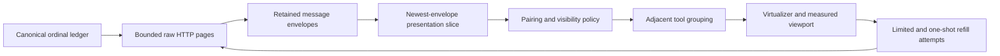
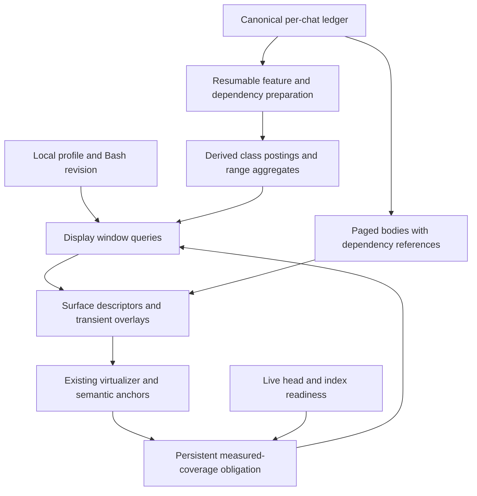

# Combined Feed Architecture Investigation and Options

Status: historical investigation, not the current execution plan. Baseline: `origin/main` at `b56408daef8db5b53f64ad9a15511204302f18d9`. Branch: `investigate/combined-feed-architecture`. Investigation date: 2026-11-04.

Option D and the live/reconnect ingress cutover were subsequently selected and implemented in PR #982. See [the selected architecture](TRANSCRIPT_DISPLAY_READ_MODEL_DESIGN.md) for the technical design and [the current execution plan](COMBINED_FEED_EXECUTION_PLAN.md) for the scope freeze, exclusions, and remaining validation. Statements below about prototypes, open choices, or no production changes describe the November 4 investigation, not the current branch.

The November 7 scope correction preserves complete resend-candidate lists and the existing chips. Resend pagination/status controls and broader auxiliary UX redesign are not requirements of the combined-feed fix. The complete resend list is an explicit exception to the later design's bounded auxiliary reads.

## Conclusions

The problem is primarily **pagination over a filtered, grouped projection**, plus a separate **coverage-demand liveness problem**. Virtualizing the DOM does not solve either problem by itself. Changing publication ownership does not change the unit being paged.

Other applications separate underlying records, projected rows, child retrieval, and viewport geometry. The closest inspected precedents are AG Grid's server-side group/child stores, CodeMirror's folded-range height map, and Cyrus/JMAP's collapsed-conversation query demand. None has precisely Garcon's semantics, and none makes unknown arbitrary filtering free.

Recommended direction:

1. A persistent, surface-local measured-coverage obligation, independent of the data-serving choice. Remove the second envelope-count slice. A work quantum may pause demand, not silently complete it.
2. For inexpensive access past very large collapsed runs, a controller-side display read model with compact summaries and paged details. Prototype **structural visibility classes plus indexed range aggregates**, rather than a persisted projection for every browser preference combination.
3. Preserve canonical row addresses and the existing virtualizer's interaction protections. Do not introduce a general sparse-row repository or bundle the earlier publication-owner refactor.
4. Treat live/reconnect ingress as a separate scope decision. A display-history endpoint alone does not stop full bodies arriving over the existing WebSocket stream.

The feature-index direction now has source and synthetic support. It is not yet a proven production design: storage/query latency, checkpointing, integrated overlays, browser behavior, and transport migration remain substantial work.

## Scope and Evidence

The new branch starts from main, without the prior cap increase or PR #854. The prior four-file 10-to-50 mitigation remains uncommitted in `/garcon/.worktrees/more-queue-cleanup`; it was not changed during this investigation. Nothing here commits or pushes that work.

The actual user request is for a clean, performant solution and comprehensive options before architectural implementation. The earlier stronger formulation, requiring no unbounded scanning/materialization whatsoever, was assistant framing. It must not silently become an approved product requirement. Eventual completion and run-length-independent prepared reads are different choices.

Evidence used:

- Current source and the governing [V5 design][design], especially addressing, raw paging, active/parked windows, and read folds.
- Previously reproduced cold-entry and live-slice failures; prior browser validation belongs to the separate mitigation, not this branch.
- A parent-owned in-memory differential/query prototype, extended during this investigation.
- A fresh Oracle consultation: three completed reviewers; one reviewer failed. Its disagreements are adjudicated below rather than resolved by vote.
- Read-only external implementation research, with selected primary source claims independently checked.

No production code changed. No real transcripts became fixtures. Full application tests, builds, startup, and browser tests were not run on this research-only branch.

## What Fails Today

The current pipeline is effectively:



Five independent issues matter:

| Issue | Consequence | Required correction |
| --- | --- | --- |
| Demand counts server-presentable envelopes, not projected rows | Thousands of fetched messages may become one short summary | Demand in display units, or keep scanning until measured coverage/exhaustion |
| Secondary newest-100 envelope slice | Context already in memory disappears before grouping during live append | One logical presentation window, not two unrelated slices |
| Refill stops on cap, cancellation, or unsettled measurement | Successful raw progress can leave a stable short feed | Persistent obligation with explicit pause/re-arm states |
| Collapse, filter, resize, and some restoration paths lack maintained demand | Layout can shrink after initial filling and remain underfilled | Re-evaluate after relevant settled geometry/projection changes |
| Collapsed groups retain members and per-member maps | Small DOM does not imply small model or memory | Aggregate descriptors, indexed membership, bounded detail windows |

The initial 50 messages plus ten compressed demands of 200 explain the reproduced 2,050-envelope plateau. Raising ten to fifty only moves the threshold. A logical demand is not an HTTP-request bound: [the loader][raw-demand] can repeatedly follow lifecycle-only pages, retaining every response; its shrinking remaining-message limit can produce one-row requests through hidden history.

The [presentation slice][slice] is independently wrong for the reported use case. The earlier live probe retained 101 entries but projected only the newest 100 tool inputs, removing the prompt without losing it from memory. Manual Load can therefore reveal memory rather than retrieve missing history.

The [group representation][groups] is also independently linear in member count. Removing the slice without changing projection work can make repeated combined-mode rebuilding more expensive. Slice deletion is not a memory-management strategy.

## Similar Problems in Computer Science

### Query planning over filtered adjacent runs

For an ordered sequence of canonical events `R`, the desired operation resembles:

```text
displayPage(R) = page(summarizeAdjacentToolRuns(filter(resolveDependencies(R))))
```

It does not generally equal:

```text
summarizeAdjacentToolRuns(filter(resolveDependencies(rawPage(R))))
```

Filtering and grouping change cardinality; dependency resolution can change meaning when its input is truncated. Pushing a display `LIMIT` below these operations is not a valid general query optimization.

```text
Raw:       tool A, hidden thinking, tool B, visible text, tool C
Filtered:  tool A,                  tool B, visible text, tool C
Displayed: [tools A and B],                 visible text, [tool C]
```

This is the database **gaps-and-islands** or ordered-run aggregation problem, related to run-length encoding. It is not ordinary global `GROUP BY tool_type`: that would incorrectly combine tool C with A and B. A straightforward SQL formulation filters, detects boundaries with predecessor/window operations, assigns run IDs, aggregates those runs, then paginates. Writing that query does not automatically make it cheap: it can still scan a large prefix before applying the limit.

For every fixed raw-fetch allowance, a longer hidden/collapsed run is a counterexample. Without prepared information or different semantics, the implementation must inspect farther to discover an earlier visible separator. Cooperative scheduling bounds a turn's work, not total work.

### Materialized views and incremental maintenance

A display index is a derived materialized read model. It moves recurring read work into initial preparation, append maintenance, and filter-policy changes. The ledger stays authoritative; losing a derived index must not lose history or require native Reload.

The valuable new distinction is **structural prefix stability**. Under current full-view policy, processing a complete prefix forward fixes each canonical row's hidden/member/breaker role. Later appends can extend its last group but do not change earlier canonical roles. This follows from the current dependency rules, not merely from ledger immutability:

- Results pair only with earlier pending tool occurrences; later uses do not repair old orphan results.
- Question-wrapper association affecting a result is established when that result is processed.
- Tool-input layout does not depend on a future result.
- Command completion changes formatting, not the output row's breaker role.

This makes append-only class postings with stored ranks and cumulative weights plausible. It does **not** make the whole UI append-local: details and transient overlays still change earlier presentation.

### Order-statistics and range aggregates

An augmented tree or class-posting index can locate source addresses, visible boundaries, and aggregate counts without enumerating members. The prototype uses sorted ordinal lists and prefix weights; a production implementation could use indexed predecessor/successor queries over persisted postings.

Garcon's summary needs four category totals, member count, and first-occurrence category order. Edit changes have weighted counts. These are compact range aggregates. Category order can be preserved with first-eligible-successor queries; it does not require fetching every member or changing the label order.

Rank/select is a related concept, not an automatic property of any bitmap. Membership bits alone do not make predecessor, count, or select cheap. Similarly, per-class ranks do not immediately give the global number of tool groups under an arbitrary profile: adjacency matters. Do not promise an exact whole-history scrollbar or jump-to-the-kth-group from this index.

### Lost wakeups and level-triggered demand

The coverage bug also resembles an event-loop lost-wakeup bug: one notification causes an attempt, the attempt stops, but the condition requiring work remains true. Linux's [edge-triggered `epoll` example][epoll] describes the analogous mistake of consuming only part of available input and then waiting for another edge that may never arrive.

The transferable principle is level-triggered demand, not use of `epoll` itself:

```text
visible surface + insufficient measured coverage + eligible continuation
    => outstanding obligation
```

The obligation remains until coverage, authoritative exhaustion, explicit failure, or loss of the owning surface/navigation. A frame/CPU/request budget yields and schedules continuation. It is not successful completion. Repeated readiness failure must wait for a real wakeup or scheduled retry, not spin in microtasks.

## How Other Applications Handle It

### AG Grid server-side grouping

[Requests][ag-requests] carry a group route, a row interval within that route, sorting, and filters. [Expanding a group][ag-expand] creates a child store lazily. Parent pages therefore need not include every child body.

The [official grouping example][ag-example] applies its page limit to grouped output, not an arbitrary prefix of raw records. However, it is an in-memory fake server, and its total-count path reruns the query without a limit. It proves a useful contract, not bounded backend work. A separate filtering example demonstrates server predicates; the inspected grouped example does not prove every combined filter/group case.

AG Grid also makes [expansion pagination a product choice][ag-pagination]: count only top-level groups, or include expanded children in pagination. Garcon needs the equivalent decision for huge expanded groups.

**Borrow:** summary/member contracts, lazy child stores, explicit expansion semantics. **Do not copy blindly:** value-based grouping, offset paging, or unlimited totals.

### CodeMirror folded editors

[Fold state][cm-fold] represents document intervals as replacement decorations and maps them through edits. Its [height-map tree][cm-height] stores both source-document length and projected height. A collapsed interval can retain its source extent while contributing only a widget's displayed height. [Viewport selection][cm-viewport] uses the height map; measurements refine it.

**Borrow:** distinct source and display coordinates; explicit collapsed ranges; structural metadata independent of measured geometry. **Limit:** the document is already represented. This does not solve downloading or classifying unseen remote transcript bodies.

### Cyrus IMAP and JMAP conversations

The inspected query path filters/sorts email matches and maintains separate collapsed and uncollapsed result arrays. Its [window-filling logic][cyrus-window] requests enough **collapsed conversations**, rather than treating a fixed number of emails as enough output. Some requests, including total counts and anchor lookup, explicitly force full loading.

**Borrow:** projected-unit demand and distinct source/projected caches. **Limit:** this can still process the entire matching set. Conversation-ID collapse is global, unlike Garcon's adjacent runs, and `Thread/get` enumerates members rather than independently paging them.

### Prior chat and tree research

VS Code's asynchronous tree supports collapsed nodes independently of child resolution, but fetched children are eager. Synapse's indexed thread listing separates thread identities from replies, but its count/latest operations do not establish constant work. Matrix's pagination loop documents a cap-and-give-up failure with filtering. These are useful supporting precedents or cautions, not complete solutions to Garcon's policy.

**Common pattern:** storage, projection, detail retrieval, and viewport demand are separate responsibilities. No inspected app establishes an instant exact answer for an unseen arbitrary predicate without paying preparation or scan cost somewhere.

## Exact Semantics That Must Be Settled

| Behavior | Current dependency | Consequence for architecture |
| --- | --- | --- |
| Tool/result pairing | FIFO occurrences within supplied rows, not unique tool IDs | Full-view pairing differs from today's window-local behavior |
| Question wrappers | Pending uses and pending wrapper queues | Nearby body pages cannot always establish result visibility |
| Tool/thinking settings | Remove rows after pairing; hidden separators permit merging | Query-time class selection can preserve exact adjacency |
| Bash patterns | Command matching affects the input and its paired result | Prepare positive eligible postings, not a rejection loop over raw candidates |
| Pending permissions | Placement after visible loaded anchor; otherwise feed-end fallback | Define representation-based anchoring without hiding actionable requests |
| Permission terminals | Latest loaded occurrence terminal affects details | Dependency lookup must not create permission actionability |
| Command output | Later terminal, duplicate stdout/results, and publication-gap evidence | Old row formatting can change without changing canonical grouping |
| Local diagnostic notices | Tail-dependent duplication and placement | Overlay removal/addition can merge/split presentation |

The [pairing/visibility code][policy] and [command projection][commands] establish these distinctions. Error visibility must follow the actual rule, not a blanket "every error breaks a group": Bash's `special` result mode, for example, differs from the empty-required-input error override.

Browser settings normalize hidden tools into seven groups, plus the thinking toggle. For a fixed combined mode there are up to 256 normalized mask/thinking combinations, not an unbounded number of arbitrary per-type profiles. Bash patterns are already server-synced workspace settings. They remain the arbitrary content-dependent dimension.

**Full-view semantics are the recommended target**, because output should not change merely because another page was loaded. This is a visible change at window boundaries, not byte-for-byte equivalence with current window-local projection. Explicit golden tests must bless those differences.

Exact forward preparation needs durable pending FIFO state. Its size is proportional to unmatched uses/wrappers and can be O(N). A user-text boundary is not a pairing reset. Do not serialize an entire growing pending map at every checkpoint or preserve repeated linear wrapper searches while claiming linear preparation.

## Guarantees to Choose Separately

| Guarantee | Meaning | Additional cost |
| --- | --- | --- |
| Eventual coverage | Finite eligible history cannot leave an owned, healthy surface silently underfilled | Persistent demand and progress; potentially a long raw scan |
| Cheap prepared traversal | Crossing a collapsed run does not inspect/transfer every member once preparation is ready | Indexed boundaries, eligibility, aggregates, and member lookup |
| Bounded ordinary browser residency | Collapsed bodies are not retained merely to render summaries | Separate descriptors, bodies, dependency lookup, and interaction leases |
| Reduced live/reconnect ingress | Browser does not receive all collapsed bodies during streaming or catch-up | Browser WS/subscription/recovery changes beyond a history endpoint |

All guarantees are conditional on healthy I/O and eventually usable layout. Completely filtered history, or genuinely too little eligible content to fill a viewport, is legitimate exhaustion. A hidden anchor needs a semantic fallback; unchanged `scrollTop` cannot be promised through arbitrary hiding or reflow.

Strict byte bounds are another choice. A 200-row limit cannot bound bytes when one row can be arbitrarily large. Large-body references, chunking, or explicit exceptional handling would be required. Do not describe bounded body count as bounded bytes.

## Options

### A. Persistent reconciler with cooperative raw scanning

Delete the secondary slice and lifetime compressed-demand stop condition. Maintain demand across layout supersession, hidden-only pages, collapse, filtering, resize, restoration, and detached reading. Replace a giant logical page accumulation with resumable raw batches and fixed raw request quanta. Incremental reduction is part of making this viable, not an independent architectural destination.

**Benefits:** smallest production change; no new server read model or protocol; eventual finite-history coverage is achievable. **Costs:** cold traversal still downloads/classifies every intervening raw row. Current full-body retention is not bounded, and repeated full projection can become quadratic across page loads. Compact reduction can reduce resident bodies but still needs dependency/membership information or refetching.

Exact backward incremental reduction is not simply "reduce a page and prepend": older reused IDs can change pairing and visibility in the already-loaded suffix. Retaining current window-local behavior is cheaper than adopting stable full-view semantics.

**Use when:** eventual filling with proportional cold-load work is acceptable. **Scope:** L for a robust reconciler and regression matrix; more if body retention and exact dependency reduction are included.

An explicit finite scan allowance with a Continue button is a different, weaker variant. It avoids silent failure but retains manual intervention. It does not satisfy the user's rejection of a best-effort permanent fix unless that product decision changes.

### B. Browser Worker and IndexedDB projection

Build/query a compact local index in a Worker; keep only displayed bodies on the main thread. Persist it in IndexedDB for reuse.

**Benefits:** no new server display API; cheap prepared reads on a warm device; an offline-history foundation if independently wanted. **Costs:** first preparation still transfers O(N) bodies to each browser; browser eviction repeats it. Add worker messaging, quota/schema/recovery/privacy cleanup, and cross-tab lifecycle. Moving classification to a Worker does not remove current main-thread WS parsing or make arbitrary regex execution finish promptly.

**Assessment:** not preferred for this server-resident-data problem without a separate offline requirement. It is not universally inferior: offline access and avoiding backend changes could justify it. **Scope:** L-XL.

### C. Server exact per-profile prepared projection

For each requested profile, prepare explicit display rows, summary spans, and member eligibility. Serve pages from that read model. A bounded in-memory version can be the simplest prototype; persistence is a separate decision.

**Benefits:** direct query model; straightforward display-page reads once ready; centralized browser-independent preparation. **Costs:** O(N) preparation per uncached profile and potentially O(JN) derived storage for J retained profiles. Appends update retained profiles; settings churn needs admission, eviction, and progress. Whole-group totals alone cannot cheaply answer transient subrange splits.

**Assessment:** credible simpler-query fallback if the class model proves too difficult or future policy loses its current decomposition. Not the first preference given the small fixed visibility dimensions. **Scope:** XL integrated; lower prototype complexity than the complete durable implementation.

### D. Server structural features with query-time classes and range aggregates

Prepare each canonical row's role, filtering class, summary contribution, and occurrence/dependency links. Store ordered class postings with rank and cumulative summary weight. For a request, choose eligible classes from local settings; locate visible breakers and summarize intervals between them.

**Benefits:** no separate persisted projection for each thinking/tool mask; compact responses and body windows independent of collapsed membership; append-only structural maintenance under current full-view policy. Positive Bash eligibility can be shared across browsers under its workspace revision.

**Costs:** exact policy extraction, dependency checkpoints, real indexed query planning, new display/member/body contracts, preparation lifecycle, and surface integration. Storage remains O(N). A nominally small class count times every display item can still mean many SQLite seeks; actual latency must be measured.

**Assessment:** preferred performance architecture to prototype. It preserves existing filtered adjacency without an arbitrary larger allowance. **Scope:** L for discriminating prototypes; XL for production integration. Live-ingress changes enlarge that scope.

### E. Simpler activity-block semantics

Define static blocks bounded by conversational/safety rows. Tool calls, results, and perhaps thinking become details inside the block; collapsed counts describe activity independently of detail filters.

**Benefits:** static boundaries simplify indexing, identity, and preparation. **Costs:** changes what users see. Results/reasoning currently separating groups may disappear into summaries; counts may include filtered tools; permission visibility and error disclosure need explicit safeguards. Exact filtered detail pages still need classification.

**Assessment:** legitimate product option, not a silent implementation shortcut. It still needs prepared structure for cheap unseen-history traversal. **Scope:** potentially simpler than D after semantics are approved, still a substantial UI/read-contract change.

### F. Publication-owner or shared sparse repository refactor

This is complementary coordination work, not a coverage solution. The single-panel reproductions still fail with a single writer if demand counts envelopes and the projection slices out context. Existing cache publication, snapshot coalescing, and replay ordering already provide useful shared ownership.

**Assessment:** exclude from this fix unless a concrete integration requirement demonstrates necessity. A narrow owner for shared prepared data/jobs is not a reason to redesign every transcript mutation path.

## Recommended Read Model Shape



Separate three facts rigorously:

1. **Raw continuity received:** what the existing message/replay application contract has actually delivered and applied.
2. **Projected completeness:** which eligible display units are represented for a certified interval, view, profile, and watermark.
3. **Resident bodies:** the subset fetched for rendering, details, navigation, and protected interactions.

A summary certifies the second, **not** receipt of all underlying message bodies or advancement of the raw replay cursor. Existing raw append validation accepts empty presented intervals; that is not authorization to manufacture raw progress from a summary.

A narrow read model needs newest/before/after/around display windows, bounded member windows, batched body/dependency lookup, and canonical-target resolution. It does not need a generic arbitrary sparse-row mutation API.

Summary descriptors contain canonical span/endpoints, first and last eligible member, count, four weighted totals, and category-first ordering. They contain no all-member ID array. Responses must distinguish source head, prepared frontier, and response watermark; incompleteness is not EOF.

Ordinary pagination cursors should name display-unit boundaries. An around-target request inside a group must resolve its actual neighboring eligible breakers before claiming a complete summary. A raw cursor in the middle of a run is not evidence of a true group endpoint. Explicit overlay fragments and provisional preparation fragments need distinct completeness semantics.

Keep `(chatId, transcriptViewId, ordinal)` as the durable identity. Use a canonical member plus profile/window context to remap summaries through merges/splits. Tail extension can preserve a group's anchor; filter changes and overlays can change its identity. Body eviction must not change permission placement or make actions disappear solely because an index knows a corresponding durable row exists elsewhere.

Expansion must page members, including direct opening around a deep target. The current [all-member expansion][expansion] and anchor/focus maps cannot remain unchanged while claiming bounded metadata. Hidden targets need an explicit reveal/fallback outcome. Search and ticket resolution retain their canonical targets, but hydration must obtain the relevant dependency evidence, not just the current raw 50-row neighborhood.

Parking should preserve a bounded set of descriptors, resident/protected bodies, semantic target, and dirty/frontier information. Background activity may invalidate parked windows without hydrating every omitted member. Parking does not currently preserve DOM selection, component expansion state, or virtual measurements; do not promise those accidentally.

## Index Details That Determine Whether It Is Actually Cheap

- Use **positive eligible postings** for Bash membership and Bash-dependent result breakers. Seeking raw candidates and rejecting hidden ones can scan the entire hidden run again.
- Store class-local ranks and cumulative weighted counts. Ordinary SQL `COUNT`/`SUM` over an indexed range can still visit every matching row.
- Preserve first-occurrence summary order with eligible successor seeks. Subtracting prefix minima is invalid; changing to fixed category order is optional, not required.
- Page members by canonical ordinal using class cursors. Canonical-target lookup does not require a global member offset or an all-member map.
- Ordinary singletons and all-visible alternating rows should degrade to useful row paging, not expensive whole-view regrouping.
- New Bash patterns require revisiting relevant command strings. Syntax/length limits do not bound JavaScript regex runtime. Worker isolation plus deadlines/failure states protects responsiveness but cannot promise every expression completes.
- Exact policy revision and Bash revision must qualify prepared data. A generation mismatch must not silently produce results under an older filter.
- If future policy changes an earlier row's structural role based on later facts, append-only prefixes no longer suffice. Revisit the data structure then; do not build a generic correction tree now without that requirement.

Extract only the pure structural policy into `common/`: intrinsic visibility, result eligibility, grouping role, and summary contributions. Keep translated labels, renderers, actions, and visual registry behavior in the web layer. Both extraction and rendering should consume the shared structural policy, with parity tests against the full-view reference. Do not import the localized UI registry into the controller or duplicate its decisions in a second table without enforcement.

## Storage and Preparation Lifecycle

**Preferred candidate: separate, rebuildable per-chat derived storage.** It keeps expensive classification outside the synchronous authoritative commit, limits derived corruption's impact, and makes policy rebuilds independent of native Reload. Reuse search's ordered jobs, coalesced watermarks, acknowledgements, and fixed worker capacity as patterns, not its FTS schema or enablement lifecycle.

**Alternative: derived tables in the ledger database.** Small deterministic features can be transactionally consistent with appends and share existing view lifetime. However, derived work joins commit latency/failure, async writers can contend with the synchronous writer, schema changes couple to the authoritative store, and cascade deletion is not automatically bounded. "The index must never fence the ledger" is not guaranteed merely by catching an error in a shared database transaction. This option needs a concrete latency/failure/deletion proof, not an assumption that colocation removes coordination.

Preparation requirements apply to either placement:

- Build a fixed view through a captured watermark; append catch-up must not restart the whole build continuously.
- Commit feature rows, pending-dependency updates, and processed frontier atomically in bounded frames. Restart resumes from a durable checkpoint.
- Fence old-view admission and late publication on replacement; cancel/fence deletion jobs before storage removal so late work cannot recreate the chat.
- Keep worker count, open connections, queues, retained revisions, and caches explicitly bounded. Prioritize visible demand without starving finite builds under continuous live work.
- Distinguish preparing, ready-through-watermark, lagging, failed, and filtered exhaustion. A last-ready prefix can remain useful, but a missing suffix cannot masquerade as current completeness.
- Do not perform regex matching or whole-transcript classification in the authoritative append transaction.

The existing [stored snapshot helper][stored-read] paces reads but accumulates the whole prefix before invoking its worker callback. The existing TaskWorker also accepts a whole array. A bounded preparation pipeline needs true framed stored-row streaming; simply reusing those entry points does not establish bounded memory.

Cold/new-filter UX remains a product decision. An explicit preparing/catching-up state is honest. Automatic raw fallback can preserve progress but reintroduces the transfer/residency costs the index was meant to avoid; it must be an intentional policy, not an invisible second engine.

## Live Publication and Protocol Scope

Current [ledger fanout][fanout] broadcasts full presented message bodies; browsers subscribe to the global chat topic and parse events before downstream filtering. Reconnect iterates the entire missing raw interval through a fixed head. The amount is not bounded independently of history or turn length.

Two coherent scope choices exist:

1. **History/residency scope:** leave full-body WS/replay intact, incrementally consume it, and bound retained bodies. This fixes historical read cost but explicitly accepts live/reconnect transfer and parsing.
2. **End-to-end ingress scope:** add lightweight/coalesced head and readiness notifications and refresh bounded display windows on reconnect. Preserve separate delivery of preview/activity/read-receipt data, plan state, pending permissions, optimistic acknowledgements, and ordered terminal events.

The second needs explicit browser event contracts and migration of current `chat-messages` consumers. It cannot be achieved by dropping bodies after they have already been parsed. Permission/actionability and execution completion must not wait indefinitely for a lagging index; a visible catching-up state may be necessary.

A controller-only browser display API does **not** automatically change the executor or CLI contract. Keep raw `/api/v1/chats/messages` unchanged for CLI/history consumers. Bump executor protocol only when actual forwarded/RPC payloads change. Browser DTO changes still require typed sender/receiver paths and contract tests.

## Probe Results and Limits

Parent probe: `/home/ubuntu/tmp/combined-feed-architecture-probe.LVpuUZ/`, run with:

```sh
bun /home/ubuntu/tmp/combined-feed-architecture-probe.LVpuUZ/build-run.ts
```

It imports production full-view projection/visibility functions, builds in-memory class postings, then compares query output with production grouping. It uses generated localization modules from the existing earlier worktree; it does not compile a browser or Svelte rune-based application.

- 64 profile/pattern combinations matched the reference projected sequence and summary inputs.
- 1,088 cursor-prefix comparisons passed, including cuts inside groups.
- Weighted edits, reused IDs, thinking, visible results, permission rows, and plan rows are represented in the synthetic mix.
- A visible pending-permission split matched two independently queried subrange summaries.
- All-filtered exhaustion, window/full-view pairing divergence, later command-format changes, and hidden permission-anchor fallback were asserted separately.

| Synthetic tool/result pairs | Preparation rows | Prepared two-item query lookups | Binary-search comparisons | Descriptor JSON bytes | Selected detail ordinals | Two split-summary lookups |
| --- | --- | --- | --- | --- | --- | --- |
| 600 | 1,201 | 7 | 41 | 164 | 20 | 4 |
| 1,500 | 3,001 | 7 | 45 | 166 | 20 | 4 |
| 40,000 | 80,001 | 7 | 65 | 169 | 20 | 4 |

The lookup count is constant for this homogeneous shape, but search work grows logarithmically. Descriptor field count is constant; encoded numeric lengths grow. The measured preparation times in the extended run were 2/3/116 ms, excluding database reads, transport, persistence, and browser rendering. These are single synthetic observations, not production latency predictions.

The prototype retains all input bodies during preparation. It proves query behavior, **not bounded browser memory**. It uses the full production fold rather than a chunkable extractor; no crash/restart, integrated overlay service, actual detail hydration, HTTP request bound, or live-publication claim follows from it.

The cursor-prefix comparisons validate clipping a known projection. They do not yet validate complete group identity for an around-target query whose raw target is inside a run. That remains part of the vertical-slice gate.

Oracle's additional synthetic reports support canonical prefix stability and exact resumable pairing, and demonstrate growing unmatched state. One reported 4,569,600 role checks and 980 resume points; its reused-ID-heavy corpus also found window/full-view differences. Those synthetic frequencies are not estimates of production prevalence. Its SQLite experiment showed an indexed 10,000-row count/sum still executed about 50,000 VM instructions while fetching a stored prefix endpoint used 18, excluding B-tree internals. That is evidence against disguised range scans, not a Bun production benchmark.

## Adjudicating the Reviews

The fresh reviewers converge on a persistent reconciler and a feature-index prototype when cheap traversal is required. Several stronger statements should not be adopted:

- **"The index is required for correctness"** is too broad. Uncapped resumable scanning can eventually fill finite history. The index is required for the stronger prepared-read cost target, not eventual completion alone.
- **"Append-only ledger means every projection is append-local"** is false. Current canonical structural roles are prefix-stable; details and overlays are not.
- **"Keep member sets, exact hydration, and virtual item contracts unchanged"** conflicts with aggregate-only groups and dependency-aware lazy navigation. Reuse the virtualizer and interaction policies, not all existing data shapes.
- **"A summary advances raw continuity"** is incorrect. It certifies projected completeness only.
- **"Fixed summary clause order is necessary"** is unsupported. Positive eligibility and successor queries preserve the current order.
- **"Same-database cascade makes deletion and failures free"** is unsupported. Authoritative write failure, contention, and bounded cleanup still require proof.
- **"A raw fallback or truncated pairing state is exact and bounded"** is unsupported without dependency certificates. Fallback must disclose its semantics and cost.
- **"No WS change is needed"** is true only for history/residency scope. It cannot accompany a claim of reduced browser ingress.

The choice between in-ledger and separate derived storage remains substantive. The separate-store candidate is preferred for failure and latency isolation, but a focused prototype should establish whether that extra lifecycle is justified in practice.

## Decision Gates and Verification Plan

These are investigation gates, not an approved implementation schedule.

1. **Choose the performance target.** Is eventual filling with O(intervening history) cold transfer acceptable, or must long collapsed runs be cheap after server preparation? Decide separately whether live/reconnect bytes are in scope.
2. **Approve presentation semantics.** Full-view occurrence pairing; exact current filtered adjacency versus activity blocks; paged huge expansion; hidden-target fallback; permission placement and preparation/lag behavior.
3. **Prove the reconciler.** Held request plus append, superseded measurement, collapse, all-hidden filtering, resize, detached reading, rapid switch/reactivation, and true exhaustion. A yielded/invalidated attempt must not erase owned demand. Preserve semantic anchors and native-scroll intent.
4. **Prove actual storage queries and resumability.** Class/posting seeks, positive Bash eligibility, weighted sums, category-first order, deep canonical targets, chunk-boundary pairing, crash points, replacement/deletion, and bounded pending-state updates. Measure query counts, rows visited, bytes, and event-loop time, not merely response size or `EXPLAIN` labels.
5. **Prove a thin vertical slice.** Ordinary context before 600/1,500/40,000 pairs; one paged expansion; middle-member navigation plus dependencies; overlay split/merge; filter change; no member enumeration hidden in identity or retention.
6. **Prove the browser and lifecycle.** Desktop/mobile coverage, mounted DOM, body/descriptor counts, bytes, selection/focus, warm/evicted parking, append catch-up, and simultaneous surfaces. Add live/reconnect wire-byte checks if that guarantee is selected.

Relevant existing test owners include `conversation-scroll-controller.test.ts`, `transcript-row-navigation.test.ts`, `ConversationToolGroupState.test.ts`, `ConversationFeedVirtualControllerHiddenRemap.test.ts`, `ConversationFeedRetentionState.test.ts`, `conversation-panel-registry.test.ts`, ledger `view-reader.test.js`/`bulk-operations.test.js`, Chromium `transcript-virtualization.test.ts`, and server `long-chat-responsiveness.test.ts`.

Production validation should include focused tests, `bun run test`, `bun run check`, `bun run build`, the affected Chromium/WebKit workflows, and an isolated timeout-bounded `bun run start --port 0 --bind-address 0.0.0.0` smoke. No existing user server should be stopped. Root tests/startup were not appropriate validation for this documentation-and-scratch-probe turn.

Svelte orchestration should follow the [Svelte 5 effect contract][svelte-effects]: use pure derived presentation, explicit controller transitions, and lifecycle-cleaned DOM/resize observation. Async reads after `await` are not implicit effect dependencies. Do not rebuild the demand mechanism as mutually triggering effects or assume `tick()` establishes permanently settled geometry.

## Expected Complexity Changes

The governing design needs an explicit amendment before production changes: revision 39's client-only grouping, section 4.4's lifetime capped refill and full-body parking, and L7's active-interval retention wording. Section 4.3 can retain its raw-query-only contract for the existing history endpoint while a separate display read fold is specified under section 9. Body eviction must not silently become logical-history removal. No provider/native-history authority change is needed.

Once consumers migrate, remove the secondary visibility slice/reveal bookkeeping, lifetime compressed allowance, initial-only refill gate, eager collapsed-member arrays/maps, and body-count-based assumptions about represented coverage.

Retain raw paging for its independent consumers, canonical addresses, stale-view checks, source publication ordering, independent surface positions, semantic restoration, and the virtualizer's native-touch/focus/selection protections.

New complexity is real: shared structural policy, preparation/checkpoint state, explicit readiness, indexed display/member/dependency APIs, compact expansion identity, bounded body residency, and possibly a browser live contract. It is justified only by replacing repeated whole-run work and invalid coverage assumptions, not by being architecturally fashionable.

The next useful commitment is a **bounded prototype scope**, not the entire rewrite: coverage obligation plus real SQLite feature queries and one lazy detail path. Use the results and the product choices above to decide whether the simpler scanner is sufficient or the indexed path is warranted. The latter is the stronger fit for the user's emphasis on long-chat performance, with explicit preparation costs rather than another hidden give-up threshold.

[design]: https://github.com/cfal/garcon/blob/b56408daef8db5b53f64ad9a15511204302f18d9/docs/transcript-ledger-v5-design.md#L1136-L1248
[raw-demand]: https://github.com/cfal/garcon/blob/b56408daef8db5b53f64ad9a15511204302f18d9/web/src/lib/chat/transcript/transcript-page-demand.ts#L57-L136
[slice]: https://github.com/cfal/garcon/blob/b56408daef8db5b53f64ad9a15511204302f18d9/web/src/lib/chat/transcript/active-transcript-presentation-state.svelte.ts#L21-L82
[groups]: https://github.com/cfal/garcon/blob/b56408daef8db5b53f64ad9a15511204302f18d9/web/src/lib/components/chat/transcript/conversation-feed-virtual-items.ts#L104-L147
[policy]: https://github.com/cfal/garcon/blob/b56408daef8db5b53f64ad9a15511204302f18d9/web/src/lib/chat/transcript/conversation-feed-items.ts#L59-L279
[commands]: https://github.com/cfal/garcon/blob/b56408daef8db5b53f64ad9a15511204302f18d9/common/command-output-projection.ts#L4-L37
[expansion]: https://github.com/cfal/garcon/blob/b56408daef8db5b53f64ad9a15511204302f18d9/web/src/lib/components/chat/transcript/ConversationToolGroupRow.svelte#L13-L29
[stored-read]: https://github.com/cfal/garcon/blob/b56408daef8db5b53f64ad9a15511204302f18d9/server/controller/ledger/store.ts#L508-L574
[fanout]: https://github.com/cfal/garcon/blob/b56408daef8db5b53f64ad9a15511204302f18d9/server/controller/ledger/event-fanout.ts#L49-L63
[epoll]: https://man7.org/linux/man-pages/man7/epoll.7.html
[ag-requests]: https://github.com/ag-grid/ag-grid/blob/2058a4be8c9dd100906170bf7dcb6a839a570466/packages/ag-grid-enterprise/src/serverSideRowModel/stores/lazy/lazyBlockLoadingService.ts#L130-L189
[ag-expand]: https://github.com/ag-grid/ag-grid/blob/2058a4be8c9dd100906170bf7dcb6a839a570466/packages/ag-grid-enterprise/src/serverSideRowModel/services/serverSideExpansionService.ts#L209-L221
[ag-example]: https://github.com/ag-grid/ag-grid/blob/2058a4be8c9dd100906170bf7dcb6a839a570466/documentation/ag-grid-docs/src/content/docs/server-side-model-pagination/_examples/pagination-with-groups/fakeServer.ts#L1-L118
[ag-pagination]: https://github.com/ag-grid/ag-grid/blob/2058a4be8c9dd100906170bf7dcb6a839a570466/documentation/ag-grid-docs/src/content/docs/server-side-model-pagination/index.mdoc#L64-L95
[cm-fold]: https://github.com/codemirror/language/blob/8e9700018446d46f23267f6e31da56628d5117c0/src/fold.ts#L93-L121
[cm-height]: https://github.com/codemirror/view/blob/fbff59ba004d80d8c914f64c42586387b08706ac/src/heightmap.ts#L473-L499
[cm-viewport]: https://github.com/codemirror/view/blob/fbff59ba004d80d8c914f64c42586387b08706ac/src/viewstate.ts#L334-L358
[cyrus-window]: https://github.com/cyrusimap/cyrus-imapd/blob/48dba6f9971a02570050f8f2e0fbaaa2a7226c9c/imap/jmap_mail.c#L5719-L5764
[svelte-effects]: https://svelte.dev/docs/svelte/$effect
