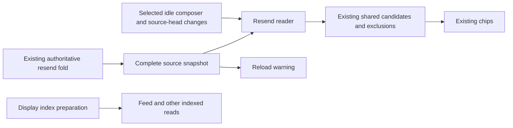

# Combined Feed PR Scope and Execution Plan

Status: implemented and locally validated, 2026-11-07; fresh CI and native iOS evidence remain pending. PR [#982](https://github.com/cfal/garcon/pull/982), branch `investigate/combined-feed-architecture`, reviewed HEAD `769fb1e280707892ec6d87fe3782807046962664`, base `c96dfeaa36090dcfc2509435d866d0a8643c64c5`. The scope correction below is user-directed. This document does not authorize commits, pushes, or committing design documents.

## Document Roles

- `COMBINED_FEED_ARCHITECTURE_OPTIONS.md` is the November 4 investigation. Its options, probes, and baseline descriptions are historical, not the current implementation checklist.
- `TRANSCRIPT_DISPLAY_READ_MODEL_DESIGN.md` specifies the selected architecture and its six original implementation phases. Most of those phases are already implemented. Its earlier passing logs are historical evidence, not validation of subsequent revisions.
- `docs/transcript-ledger-v5-design.md` remains the governing transcript contract. The resend exception below amends the pagination requirement added by this PR, not the source submission semantics.
- This file defines the remaining work and exclusions. Do not restart the six phases or use the architecture document as an open-ended feature backlog.

## Objective

Correctly load and render filtered, combined transcript rows without scanning, transferring, or retaining every collapsed tool body in the browser. Maintain viewport coverage and reading intent through paging, live updates, replacement, and reconnect.

The index is not a second transcript authority. The ledger and source submission rules remain authoritative. A long collapsed run must not strand an underfilled feed or cause a retained prompt to disappear behind a newest-envelope slice.

## Scope Freeze

### Included

- Exact complete-prefix structural classification, occurrence pairing, filtered adjacency, weighted summaries, and indexed boundaries under declared profile/cut/watermark identities.
- Separate disposable display SQLite files and the fixed builder/reader Worker pair; preparation, replacement, recovery, and executable packaging required to run that path.
- Certified top-level windows, bounded member/detail reads, canonical target resolution, and the same display path in combined and non-combined modes.
- Persistent measured-coverage demand, cancellation/backoff correctness, native-scroll publication gating, semantic anchors, protected interactions, body leases, and bounded parking/restoration.
- The already-selected live/reconnect cutover: compact ordered facts, exact input acknowledgements, surface-local optimistic replacement, and no raw browser gap replay.
- Necessary adapters for existing consumers of the removed body stream: recall, navigator, plans, subagents, previews/read receipts/announcements, permissions, fork targets, Reload, and resend chips. Preserve their purpose and existing actions; migrating their data source does not authorize a redesign.
- Fixes for demonstrated regressions on those paths, including the retained-error Retry action and the failure-injection ordering in its browser test.
- In-place updates to a growing final collapsed group while following. Preserve the resident tail size on compatible live refreshes instead of readmitting a full 50-descriptor page and changing scrollbar geometry; explicit navigation and profile replacement retain normal admission sizes.

### Excluded

- Resend pagination, a resend status toolbar/popover, changes to resend eligibility/submission, or a new resend preparation index.
- Composer toolbar redesign, new narrow-screen control layouts, or virtualization/caps for the complete resend-chip list.
- Further recall, navigator, plan, or subagent product enhancements. Existing implemented adapters remain frozen; their exact page sizes and additional UI policies are not prerequisites of the core index and are not a new work queue.
- Offline slash-command admission changes, including the `/rename` issue originating in PR #929 (`a4715bd9a3`).
- Provider/native-history behavior, execution or queue semantics, executor transport, CLI forwarding, search, share, export, or authoritative ledger schema changes.
- A generic sparse repository, publication-owner/event-bus rewrite, browser offline cache, server per-surface subscriptions, pushed display deltas, exact whole-history scrollbar geometry, or global group-rank navigation.
- Speculative fixes for unrelated CI failures. Investigate enough to establish cause; fix a demonstrated PR regression here, otherwise record evidence and separate follow-up. Never weaken an assertion merely to make the run green.

### Accepted Exceptions

- Resend candidates are one complete source-qualified list. Candidate count and aggregate text bytes are not bounded by the display-window budget. Reuse the existing source fold; no eager loop over paged display responses.
- The existing source resend scan is proportional to the unanswered tail and may do substantial synchronous work. This change does not claim to solve that pre-existing cost. Further optimization requires measured evidence and a separate scope decision.
- Cold index preparation still performs work proportional to history. Large individual bodies and protected interactions retain the documented explicit resource exceptions.
- Native iOS momentum remains unverified. Keep that release-risk disclosure; Chromium or scripted coasting is not substitute evidence. No claim of complete native validation is permitted.

## Resend Correction



Use the existing browser-only `/api/v1/chats/transcript-display/resend` URL, but separate it from the indexed auxiliary route loop. No new raw-feed or WebSocket body consumer is introduced.

The request contains `serverInstanceId`, `chatId`, and `transcriptViewId`. The response contains that identity, `sourceHead`, `processingPhase`, and the existing `ResendCandidate[]` (`ordinal`, full `content`, `attachmentNames`). Reuse `parseResendCandidates`; validate all ordinals against the captured head. There is no cursor, limit, historical watermark, preparing state, or count cap.

After request parsing, validate process/view identity and synchronously capture head, processing, and `AgentRegistry.resendCandidates(chatId)`. During processing, skip the scan and identify suppression explicitly. This route must not admit a display preparation job. Existing authentication, typed errors, and no-store behavior remain.

PR description migration note: `/resend` changes from a paged indexed summary to the complete snapshot contract above. Browser and server ship together; no compatibility adapter or CLI/executor protocol change is needed. Removing the unused resend tables increments disposable display storage format from 2 to 3, causing old derived files to rebuild on demand. The authoritative ledger is unchanged.

The selected-composer reader owns one request and one coalesced notification-driven follow-up. It is disabled while hidden, disconnected, or processing and is fenced by process/chat/view and request epoch. Processing-to-idle refreshes even without a changed head. No readiness subscription or autonomous retry polling is added. Stale/error/suppressed data is not presented as a current empty list; use the existing error notification surface, outside composer controls.

Candidate and exclusion ownership stays in the existing overlay store. Successful complete snapshots can prune exclusions for candidates no longer offered. Cancellation, processing suppression, and failure must not prune them. Reload uses the unfiltered complete snapshot, not the chip list after exclusions; unavailable data remains explicitly incomplete.

## Ordered Execution

1. **Freeze scope and reconcile documents.** Add this checklist and cross-link the investigation/design. Amend resend-only claims in the governing design. Preserve historical measurements with their original dates. No design documents are staged or committed.
2. **Replace the resend contract and server read.** Update `common/transcript-display-auxiliary.ts`, its contract tests, `server/controller/routes/transcript-display.ts`, and route composition. Remove resend from the indexed query/service/worker dispatch and delete its unused extractor writes/tables. Increment disposable storage format when its schema changes; no source migration. Prove complete data beyond 100 candidates, long text/attachment labels, source parity, literal/suppressed policy, stale identities, and independence from a preparing/failed index.
3. **Restore complete-list client behavior.** Replace only resend's generic paged controller use with a concrete notification-driven reader in `web/src/lib/chat/transcript/`. Restore `ResendCandidate` through overlay/registry/ports, chips, and Reload. Remove all resend pager/popover plumbing and its toolbar-only CSS/strings. Preserve the separate uncommitted Retry fixes and the unrelated pre-existing offline-test edit.
4. **Prove behavior through the original paths.** Expand `integration-tests/tests/chromium/transcript-display-consumers.test.ts` beyond 50 candidates; exclude an early candidate and verify the real provider receives every remaining candidate in order. Retain useful desktop/mobile geometry checks without preserving the deleted UI. Test held reads across chat/view/process changes, idle transition, errors, and actual empty success. Existing feed/consumer/reconnect wire assertions must still exclude raw history and unrequested tool bodies.
5. **Validate and review the exact final tree.** Focused common/server/web tests, `bun run test`, `bun run check`, `bun run build`, relevant Chromium/WebKit workflows, and isolated timeout-bounded startup. Run the material-diff review after focused tests. Address only accepted in-scope defects, rerun affected checks, and record failures without calling old green runs final evidence.
6. **Close out explicitly.** Report files/behavior changed, exact checks, pending CI/native evidence, and any unrelated blockers. Commit/push and fresh CI require the appropriate user authorization; this plan does not authorize them implicitly.

## Verification Commands and Assertions

Use Bun, foreground commands, `$HOME/tmp` for retained logs, and `--maxWorkers=2` for focused Vitest runs. Keep the user's servers running. Synthetic fixtures must contain only deterministic generic identities/content.

```sh
bun test common/__tests__/transcript-resend.test.js server/controller/routes/__tests__/transcript-display.test.ts
bun test server/controller/transcript-display/__tests__
bun run --cwd web test --maxWorkers=2 src/lib/chat/transcript/__tests__/resend-candidates-controller.test.ts src/lib/chat/transcript/__tests__/conversation-transcript-overlay-store.test.ts src/lib/components/chat/composer/__tests__/PromptComposer.test.ts src/lib/components/chat/composer/__tests__/ResendCandidateChips.test.ts
bun run test
bun run check
bun run build
bun test --max-concurrency=1 --timeout=120000 integration-tests/tests/chromium/transcript-display-consumers.test.ts integration-tests/tests/chromium/composer-resend-layout.test.ts
timeout 30s bun run start --port 0 --bind-address 0.0.0.0 --config-dir <isolated-config> --workspace-dir <isolated-workspace> --project-base-dir <isolated-project>
```

Additional affected tests: session-controller/display-controller Retry, Reload dialog, route identity/replacement, Chromium failed-display controls, and the existing WebKit display workflow. A startup timeout is expected only after successful compilation/listening; record that separately from a crash. No tests or builds are silently backgrounded.

The completed-list assertions must distinguish an unavailable snapshot from an actual empty result. Browser geometry checks must preserve textarea identity, draft, focus/selection, and toolbar bounds at desktop and narrow widths. Naturally adding/removing real resend chips retains existing behavior; a status-only refresh must not add height or a reserved control slot.

`integration-tests/tests/{chromium,webkit}/transcript-display-combined-append.test.ts` share a scenario in `integration-tests/support/transcript-display-combined-append.ts`, running real scripted Claude writes at 1440px and 390px. Hold the third write until the feed displays "Edit 2 files", then sample every animation frame through "Edit 3 files". Require the same resident DOM nodes, unchanged non-group text, row positions/heights and scroll geometry within 1px, continuous bottom-follow, and no later-history boundary. Require both labels in the frame trace. Release a subsequent assistant response and require continued following. No collapsed tool/result bodies or member reads may cross the browser wire. This tests a count-only collapsed-summary update, not intentional reflow from an expanded group or a taller summary.

## Current Local Verification

These results cover the uncommitted correction above HEAD `769fb1e280707892ec6d87fe3782807046962664`. No commit, push, PR metadata update, or fresh CI run was performed. Logs are retained under `/home/ubuntu/tmp/resend-scope.U2nLbz/`.

- `TMPDIR=/home/ubuntu/tmp VITEST_MAX_WORKERS=2 bun run test`: passed. The Bun stages report 9,642 passing tests; the web stage reports 9,203 passing tests across 700 files. Log: `final-root-test.log`.
- `bun run check`: passed lint, provider/server/CLI/integration typechecks, and Svelte diagnostics with zero errors and warnings. Log: `final-check.log`.
- `bun run build`: passed, including the eager-asset guard; existing large-chunk warnings remain. Log: `closing-build.log`.
- Final Chromium/WebKit batch: 19/19 passed across seven files. Includes combined-append, live-follow/rapid switching, complete resend exclusion/submission, native-composer geometry, certified display/Retry/reconnect, and Clear/Reload. Log: `closing-browser.log`.
- Isolated `timeout 30s bun run start --port 0 --bind-address 0.0.0.0 ...`: reused the current build, listened on port 43737, and returned HTTP 200 before timeout shutdown. Log: `startup.log`. No existing server was stopped.
- `git diff --check`: clean. Desktop/mobile combined-row screenshots and the 320/390/1440px composer screenshots were inspected.

The exact combined-append regression was first red: the final row and visible neighbors stayed mounted, but refreshing 50 descriptors readmitted trimmed history and changed scrollbar geometry. The controller now preserves the retained tail size only for compatible, pinned, already-trimmed live windows. Initial/short-history, profile-change, and explicit-navigation reads retain their normal size. The final browser tests assert stable DOM, row geometry, scroll geometry, and bottom-follow on every sampled frame, followed by successful following of a new assistant row.

The first resend restart run also exposed a scheduled source read surviving a disconnected socket. Disconnected composers now deactivate that reader and fence its request; both Chromium and WebKit 40,000-pair restart tests pass without permitting an extra 409 console error.

## Baseline Evidence and Remaining Gate

At the start of this correction, root validation reached 9,188 passing web tests and two failing tests in the uncommitted toolbar experiment. Prior scoped Retry tests and browser workflow passed. These are baseline facts, not completion evidence for the correction.

The prior CI failure inventory includes an established pre-existing offline-command guard and other failures whose PR causality is not established. They remain explicitly tracked, not reclassified as flakes. Fresh CI, the complete browser/Lightpanda matrix, and native iOS momentum were not verified by this local closeout. Do not claim the PR merge-ready until its required checks and unresolved-regression review are complete.

Screenshot review also shows a truncated native-Claude model label at 320px in the unchanged composer toolbar. Removing the resend slot avoids additional pressure but does not redesign that toolbar. The geometry regression checks cover unchanged bounds, non-overlapping controls, and draft/focus preservation, not full label readability at every width. Track that remaining layout limitation separately from combined indexing.

## Combined-Append Coverage Audit

The subsequent audit covers growing combined rows, bottom-follow intent, and false "Load later messages" controls. It changes tests and this plan only; the production implementation above is unchanged.

Existing coverage remains useful: full-prefix/profile parity and bounded queries; source lag versus genuine historical continuation; held window/body/application-gate ownership races; detached detail refresh; expansion split/merge/filter and protection; Chromium moving-head and rapid-switch frame traces. These tests exercise different ownership layers and should not be collapsed into one large browser test.

Gaps addressed:

- The short-history test previously asserted only `limit: 50` without appending content. It now appends an ordinary row through a limit-respecting API double and checks that prior context remains present.
- The trimmed-tail test combined live append, navigation, and profile replacement. A shared fixture now supports independent live-append and navigation/profile/cut cases. Assertions include exact hydration seeds, no catch-up loop after settlement, and normal-sized admission when resuming from a historical window.
- Expanded-group append previously shared a test with parking/filtering and checked only bounded length. It now advances the watermark and verifies the exact member ordinals, anchor, expansion identity, continuation count, resident-body reuse, and absence of append-stream hydration or polling. Parking/filtering remains separately covered.
- Retained-island tests previously changed geometry along with eligibility. New row/group cases change eligibility alone, verify no geometry transaction, and preserve the reading offset through hide/show.
- Real-worker tests now append both a single Write and a weighted Edit to a final open group. They prove one-row suffix preparation, unchanged preceding descriptors, updated totals, and immutable historical summaries even after an assistant row closes the group.
- The exact collapsed-group geometry scenario now runs in both Chromium and WebKit at desktop/mobile viewport widths, using one shared scenario rather than duplicated setup/assertions. Frame traces must observe both labels, retain all resident nodes and geometry, stay pinned, and never flash a later-history boundary.

Remaining coverage limits: native iOS momentum is not covered by desktop WebKit at a mobile viewport. The exact per-frame count-only scenario uses local scripted Claude; expanded-group height changes, wrapping/mixed-category summaries, and remote-executor variants do not yet have equivalent per-frame browser cases. Their constituent policy/controller paths have unit coverage, which is not a claim of identical end-to-end geometry coverage. Fresh CI and the full browser/Lightpanda matrix remain separate gates.

Audit validation logs: `/home/ubuntu/tmp/combined-coverage.DYHm9a/`. The earlier local verification section remains historical evidence for the preceding implementation turn.

- Full `TMPDIR=/home/ubuntu/tmp VITEST_MAX_WORKERS=2 bun run test`: passed, 9,644 Bun-stage tests and 9,209 web tests across 700 web files (`root-test.log`). This includes the final strengthened historical-window admission and open-group fixtures.
- `bun run check`: passed, including integration typechecks and zero Svelte errors/warnings (`check.log`).
- `bun run build`: passed, including the eager-asset gate; existing large-chunk warnings remain (`build.log`).
- Chromium/WebKit: 7/7 passed across both combined-append wrappers and Chromium live-follow/rapid-switch tests (`browser.log`). Desktop/mobile WebKit screenshots were inspected. An initial browser attempt stopped before fixture setup because test-source changes invalidated the build marker; rebuilding resolved that prerequisite failure without changing assertions (`combined-append-browser.log`).
- Isolated timeout-bounded startup on `0.0.0.0:44537`: current build accepted, HTTP 200 (`startup.log`, `startup-http.log`). No existing server was stopped.
- `git diff --check`: clean. No production edits, commits, pushes, or CI runs were made during this audit.
