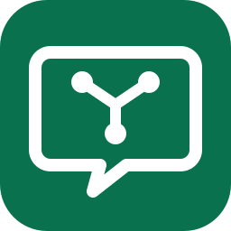
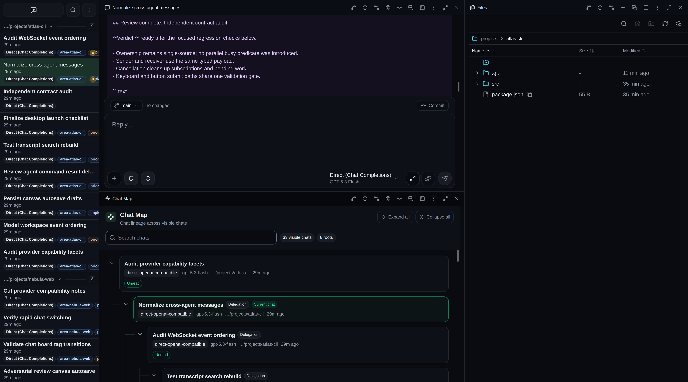
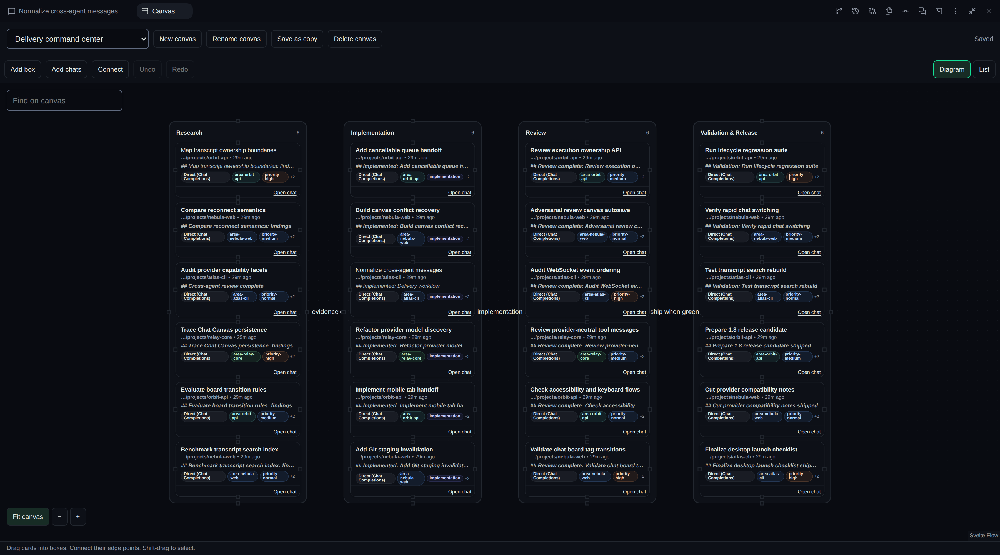
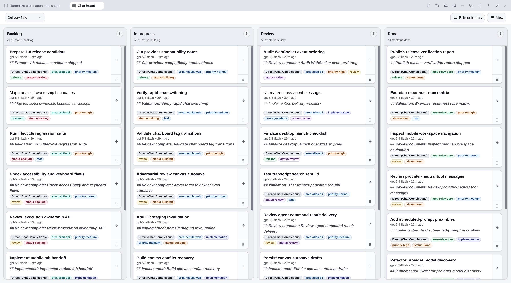
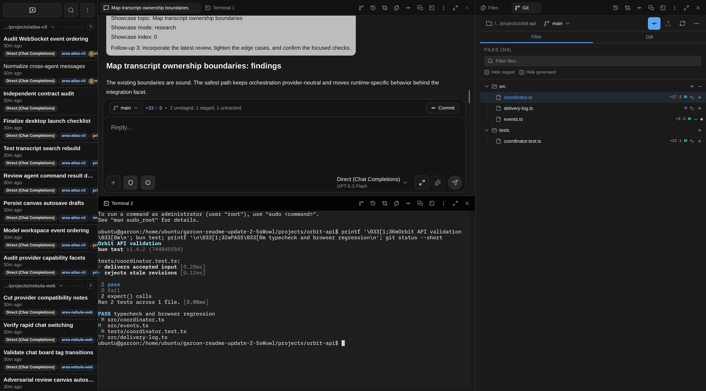
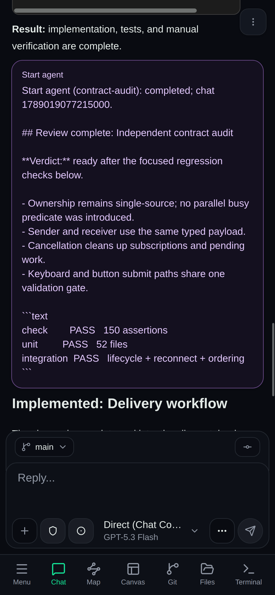
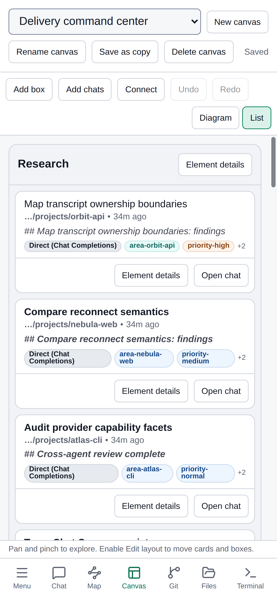

<p align="center">
  
</p>
<h1 align="center">Garcon</h1>

<p align="center"><strong>Run the agents. See the work. Ship the change.</strong></p>

<p align="center">
  Garcon is a self-hosted visual workspace for coding agents. Run Claude Code, Codex, Cursor Agent, OpenCode, Amp, Factory Droid, and Pi side by side, coordinate their work, and move from prompt to reviewed commit without leaving the browser.
</p>

<p align="center">
  <a href="#install">Install</a> &middot;
  <a href="#keep-it-running">Keep It Running</a> &middot;
  <a href="#for-ai-agents">For AI Agents</a> &middot;
  <a href="#why-garcon">Why Garcon</a>
</p>

<p align="center">
  <a href="screenshots/readme-agent-coordination-dark.png">
    
  </a>
</p>

<p align="center"><em>Keep delegated results, chat lineage, files, terminals, and Git visible in one resizable workspace.</em></p>

Garcon runs agents, terminals, files, Git, and pull request commands on the host under your account, using the agent logins and model endpoints you configure.

## Install

Requirements: [Bun](https://bun.sh/), `git`, a modern browser, and at least one coding agent CLI (signed in) or API provider. Pull request features also need an authenticated GitHub CLI (`gh`).

Choose one path:

| You want to                                 | Do this                                       |
| ------------------------------------------- | --------------------------------------------- |
| Try it in a terminal                        | [Run once](#run-once)                         |
| Keep it running, start at login, auto-restart | [Keep it running](#keep-it-running)         |
| Run everything inside a container           | [Docker](#docker)                             |
| Download a prebuilt server                  | [Release downloads](#release-downloads)       |

### Run once

```bash
git clone https://github.com/cfal/garcon.git
cd garcon
bun run setup
bun run start --project-base-dir ~/repos
```

Replace `~/repos` with the folder that holds your projects. Open `http://127.0.0.1:8080`. The server stops when the terminal closes or you press Ctrl+C.

### Docker

```bash
docker pull ghcr.io/cfal/garcon:main
```

The image bundles Claude Code, Codex, Cursor Agent, OpenCode, Amp, Factory Droid, Pi, Git, SSH, and the GitHub CLI. Agents, terminals, and Git run inside the container, so your host's agent logins and language toolchains are not visible there. See the [Docker guide](docs/docker.md) for compose setup, volumes, agent login, and toolchains.

### Release downloads

Starting with v0.4.0, [GitHub releases](https://github.com/cfal/garcon/releases) include server/CLI archives, source, checksums, provenance, and explicitly labeled native previews. Native previews are not signed production distributions; Android connections remain disabled and iOS is simulator-only. Human publication starts Docker promotion to the exact version tag and, for the current stable release, `latest`. See [release verification and operations](docs/releases.md).

## First Run

1. Open `http://127.0.0.1:8080`. On first launch, `/setup` asks you to create an account. Authentication is on by default.
2. Open **Settings**. Coding agents use their existing CLI login; sign in from the agent's settings page if it shows **Not connected**. Add API endpoints under **Providers**.
3. Start a chat and pick a project folder under your `--project-base-dir`.

## Where Things Live

| What                | Default                          | Override                                            |
| ------------------- | -------------------------------- | --------------------------------------------------- |
| Config and state    | `~/.garcon`                      | `--config-dir` or `GARCON_CONFIG_DIR`               |
| Workspace data      | `<config>/workspace-default/`    | `--workspace <name>` or `--workspace-dir <path>`    |
| Running instance    | `<config>/runtime.json`          | Written by the server while it runs                 |
| Projects root       | your home folder                 | `--project-base-dir` or `GARCON_PROJECT_BASE_DIR`   |
| Address             | `127.0.0.1:8080`                 | `--port`, `--bind-address`                          |

The workspace holds chats, transcripts, settings, accounts, and tickets. On Linux and macOS, `~` resolves from `HOME`, so launches with a different `HOME` (another user, `sudo`, or an agent sandbox) use a different config folder and appear to lose state. Windows always uses `%USERPROFILE%\.garcon`. Set `GARCON_CONFIG_DIR` explicitly for anything long-running.

The projects root is also a file-access boundary: Garcon's file browser and project pickers stay inside it.

Only one server can use a workspace at a time. A second copy fails with `Workspace is already in use or could not be locked`.

Run `bun run help` for every option, and see the [server configuration reference](docs/cli.md#server-configuration) for agent CLI overrides such as `CLAUDE_BINARY` and `GARCON_CODEX_CLI`.

## Keep It Running

Each recipe starts Garcon at login, restarts it after a crash, writes a log, pins the config folder, and runs as your normal user. While the service runs, do not also start Garcon by hand on the same config folder.

Use absolute paths. Services do not load your shell profile, so set `PATH` to include the folders that hold `bun` and your agent CLIs. Copy the value from `echo $PATH` in a working terminal.

### Linux (systemd user service)

`~/.config/systemd/user/garcon.service`:

```ini
[Unit]
Description=Garcon
After=network-online.target

[Service]
WorkingDirectory=%h/garcon
Environment=GARCON_CONFIG_DIR=%h/.garcon
Environment=PATH=%h/.bun/bin:%h/.local/bin:/usr/local/bin:/usr/bin:/bin
ExecStart=%h/.bun/bin/bun run start --project-base-dir %h/repos
Restart=always
RestartSec=10

[Install]
WantedBy=default.target
```

```bash
systemctl --user daemon-reload
systemctl --user enable --now garcon
loginctl enable-linger "$USER"     # optional: start at boot without logging in
systemctl --user status garcon     # status
journalctl --user -u garcon -f     # log
systemctl --user restart garcon    # restart
systemctl --user disable --now garcon && rm ~/.config/systemd/user/garcon.service  # remove
```

### macOS (LaunchAgent)

`~/Library/LaunchAgents/app.garcon.plist`, with `you` replaced by your user name:

```xml
<?xml version="1.0" encoding="UTF-8"?>
<!DOCTYPE plist PUBLIC "-//Apple//DTD PLIST 1.0//EN" "http://www.apple.com/DTDs/PropertyList-1.0.dtd">
<plist version="1.0">
<dict>
  <key>Label</key><string>app.garcon</string>
  <key>WorkingDirectory</key><string>/Users/you/garcon</string>
  <key>ProgramArguments</key>
  <array>
    <string>/Users/you/.bun/bin/bun</string>
    <string>run</string>
    <string>start</string>
    <string>--project-base-dir</string>
    <string>/Users/you/repos</string>
  </array>
  <key>EnvironmentVariables</key>
  <dict>
    <key>GARCON_CONFIG_DIR</key><string>/Users/you/.garcon</string>
    <key>PATH</key><string>/Users/you/.bun/bin:/Users/you/.local/bin:/opt/homebrew/bin:/usr/local/bin:/usr/bin:/bin</string>
  </dict>
  <key>RunAtLoad</key><true/>
  <key>KeepAlive</key><true/>
  <key>ThrottleInterval</key><integer>10</integer>
  <key>StandardOutPath</key><string>/Users/you/Library/Logs/garcon.log</string>
  <key>StandardErrorPath</key><string>/Users/you/Library/Logs/garcon.log</string>
</dict>
</plist>
```

```bash
launchctl bootstrap gui/$(id -u) ~/Library/LaunchAgents/app.garcon.plist  # install and start
launchctl print gui/$(id -u)/app.garcon       # status
tail -f ~/Library/Logs/garcon.log             # log
launchctl kickstart -k gui/$(id -u)/app.garcon  # restart
launchctl bootout gui/$(id -u)/app.garcon && rm ~/Library/LaunchAgents/app.garcon.plist  # remove
```

### Windows (Task Scheduler)

Run in a normal, non-administrator PowerShell window. Set the first two paths:

```powershell
$repo = 'D:\repos\garcon'
$projects = 'D:\repos'
$config = "$env:USERPROFILE\.garcon"
$bun = (Get-Command bun).Source
$hostDir = "$env:LOCALAPPDATA\garcon-host"
New-Item -ItemType Directory -Force $hostDir | Out-Null

@"
`$env:GARCON_CONFIG_DIR = '$config'
Set-Location '$repo'
while (`$true) {
  & '$bun' run start --project-base-dir '$projects' *>> '$hostDir\garcon.log'
  Start-Sleep -Seconds 10
}
"@ | Set-Content "$hostDir\run.ps1"

$action = New-ScheduledTaskAction -Execute 'powershell.exe' `
  -Argument "-NoProfile -WindowStyle Hidden -ExecutionPolicy Bypass -File `"$hostDir\run.ps1`""
$trigger = New-ScheduledTaskTrigger -AtLogOn -User $env:USERNAME
$settings = New-ScheduledTaskSettingsSet -ExecutionTimeLimit ([TimeSpan]::Zero) `
  -AllowStartIfOnBatteries -DontStopIfGoingOnBatteries -MultipleInstances IgnoreNew
Register-ScheduledTask -TaskName Garcon -Action $action -Trigger $trigger -Settings $settings
Start-ScheduledTask -TaskName Garcon
```

```powershell
Get-ScheduledTask -TaskName Garcon | Get-ScheduledTaskInfo                 # status
Get-Content "$env:LOCALAPPDATA\garcon-host\garcon.log" -Tail 50 -Wait     # log
Stop-ScheduledTask -TaskName Garcon                                        # stop the restart loop
Stop-Process -Id (Get-Content "$env:USERPROFILE\.garcon\runtime.json" | ConvertFrom-Json).pid  # stop the server
Start-ScheduledTask -TaskName Garcon                                       # start
Unregister-ScheduledTask -TaskName Garcon -Confirm:$false                  # remove
```

Stopping only the server process makes the loop restart it within about 10 seconds. Stop the task first to stop Garcon.

## Windows Notes

- The default config folder is `%USERPROFILE%\.garcon`. Garcon ignores `HOME` on Windows, so Git Bash, PowerShell, and scheduled tasks share one folder. Set `GARCON_CONFIG_DIR` only to use a different location.
- Codex runs from the native `codex.exe` bundled with Garcon. Set `GARCON_CODEX_CLI` only to use a different Codex build.
- Always run Garcon as the same non-administrator user. A copy started as administrator can leave files in the config folder that a normal-user copy cannot open.

## Troubleshooting

| Symptom                                           | Cause and fix                                                                                     |
| ------------------------------------------------- | ------------------------------------------------------------------------------------------------- |
| `Workspace is already in use or could not be locked` | Another copy is running on the same config folder. Check `<config>/runtime.json` for its `pid` and `baseUrl`, or stop the service. |
| Port 8080 is in use                               | Another Garcon or app owns it. Stop it or pass `--port`.                                          |
| Chats or settings disappeared                     | Garcon started with a different config folder. Find every `.garcon` folder and pin the right one with `GARCON_CONFIG_DIR`. |
| Projects open in the wrong folder                 | Pass `--project-base-dir`; the default is your home folder.                                       |
| An agent shows Not connected or is missing        | Its CLI is not on the service's `PATH` or not signed in. Add its folder to `PATH` or set its binary override. |
| Permission or access denied on the config folder  | It was created by another user or an administrator copy. Return ownership to your user.           |

## For AI Agents

### Setting up Garcon for a user

Follow these rules when asked to install or host Garcon:

- Use the [Keep it running](#keep-it-running) recipe for the user's OS. Do not write a custom service manager or edit files in the Garcon repository.
- Confirm these with the user before writing anything: the repository path, the projects folder (`--project-base-dir`), and the config folder (`GARCON_CONFIG_DIR`). Resolve `bun` and every path to an absolute path and check that each exists.
- Before starting, check for a running copy: read `<config>/runtime.json` (`pid`, `baseUrl`, `workspaceDir`) and check whether port 8080 is in use. Never start a second copy on the same config folder. Never print `localCapability` from that file; it is a credential.
- If more than one `.garcon` folder exists, show the user what each contains and ask which to keep. Do not merge or delete workspaces without explicit approval.
- Run as the user's normal account, never as root or administrator.
- Verify the result: `curl -fsS http://127.0.0.1:8080/api/v1/auth/status` returns JSON, the log shows no startup error, and after killing the server process the service brings it back with the same chats.
- Give the user the status, log, stop, start, and remove commands from the recipe.

### Using Garcon from an agent

The [garcon-skills](https://github.com/cfal/garcon-skills) package and the [CLI](#automate-and-delegate) let agents start, monitor, message, and delegate to other Garcon chats, schedule prompts, and manage tickets.

### Developing Garcon

Read [AGENTS.md](AGENTS.md) for the repository's engineering rules, then [docs/file-structure.md](docs/file-structure.md). Validate changes with `bun run check`, `bun run test`, and `bun run start --port 0`; never stop a server you did not start.

## Why Garcon

One agent chat is easy. The hard part begins when several agents are running, one needs approval, another has finished, and their changes still need to be understood and shipped.

Garcon keeps that development loop coherent:

- **Orchestrate visually.** Tile up to four resizable windows, move local tabs between them, organize live chats on durable canvases, track work on tag-driven boards, and inspect fork, handoff, and delegation lineage in Chat Map.
- **Stay in control of every turn.** Queue and reorder instructions, steer active work, approve tools, answer agent questions, pause the queue, interrupt, or stop without losing the transcript.
- **Coordinate agents visibly.** Exchange provenance-labeled messages between chats, launch delegated children, receive their final results, and keep parentage auditable instead of hiding it in a side channel.
- **Track durable work.** Create workspace tickets in a list or status board, assign and claim work, discuss progress, and retain attributed change history across chat deletion and server restarts.
- **Review the real change.** Browse and edit files, run terminals, inspect reasoning and tool calls, review diffs, then stage individual lines, hunks, files, or folders before committing and pushing.
- **Find and reuse context.** Search chat metadata and indexed transcripts, save filters, tag, pin, archive, export Markdown or XML, build bounded handoffs, share snapshots, and [schedule prompts](docs/scheduled-prompts.md) with per-prompt pause and resume.
- **Know what agents cost.** See [token usage and estimated API cost](docs/usage.md) per day, agent, and model from the Claude and Codex transcripts on each executor, with cache hit rates and cost by token type.
- **Work from any screen.** Use the responsive workspace on desktop or phone and choose Classic, Phosphor, or colorblind-aware themes in light or dark mode.

## See It In Action

<p align="center">
  <a href="screenshots/readme-chat-canvas-dark.png">
    
  </a>
</p>

<p align="center"><strong>Shape parallel work on a canvas.</strong> Group live chats into named boxes, connect related work, save multiple canvases, and switch to a structured list when that view fits better.</p>

<p align="center">
  <a href="screenshots/readme-chat-board-light.png">
    
  </a>
</p>

<p align="center"><strong>Turn live metadata into a delivery board.</strong> Define columns from chat filters and move work by applying the configured tag transitions.</p>

<p align="center">
  <a href="screenshots/readme-development-loop-dark.png">
    
  </a>
</p>

<p align="center"><strong>Keep the development loop together.</strong> Follow the agent, run focused checks, inspect changed files, stage precisely, and commit from the same workspace.</p>

<table>
  <tr>
    <td width="50%" align="center">
      <a href="screenshots/readme-mobile-coordination-dark.png">
        
      </a>
    </td>
    <td width="50%" align="center">
      <a href="screenshots/readme-mobile-canvas-light.png">
        
      </a>
    </td>
  </tr>
  <tr>
    <td align="center"><strong>Steer and unblock from anywhere.</strong></td>
    <td align="center"><strong>Carry the same visual plan to mobile.</strong></td>
  </tr>
</table>

## Works With

**Coding agents:** Claude Code, Codex, Cursor Agent, OpenCode, Amp, Factory Droid, and Pi.

**Direct model access:** Anthropic Messages, OpenAI Responses, and OpenAI Chat Completions compatible endpoints.

**Provider presets and discovery:** Ollama, OpenRouter, Gemini, Fireworks, Together, Alibaba Cloud, Z.AI, and custom OpenAI or Anthropic compatible services.

Use an existing agent login or subscription where its CLI supports one, or configure API providers in Settings. Each chat keeps its own agent, model, effort, permission, provider, endpoint, and preamble settings where supported.

Claude Code 2.1.238 or newer is required. Model names ending in `[Nk]` set a per-chat auto-compaction window; see [Claude context windows](docs/claude-context-windows.md).

## Automate And Delegate

The CLI drives ordinary visible Garcon chats through an already-running server. It covers live catalog discovery, synchronous or detached starts and resumes, steering, exact-turn waiting, status and fenced permission decisions, chat metadata, transcript search and bounded reads, export, handoff, and stop controls.

```bash
# Start detached work with explicit lineage.
bun cli/main.ts --runtime controller start-async --cwd /path/to/project \
  --parent 1785337200123456 --agent codex --model gpt-5.4 \
  --permissions acceptEdits "Implement the validation and run focused tests."

# Find prior work, then read exact context around a durable transcript row.
bun cli/main.ts --runtime controller search '"version bump"' --json
bun cli/main.ts --runtime controller read 1785337200123456 84 -B 5 -A 5

# Inspect or steer work without creating a hidden session.
bun cli/main.ts --runtime controller status 1785337200123456 --messages 20
bun cli/main.ts --runtime controller resume-async 1785337200123456 \
  --allow-steer "Address the review finding and rerun the tests."
```

See the [CLI and server guide](docs/cli.md) for the full command and connection reference. `bun run build-exe` produces standalone Linux x64 and macOS arm64 executables.

The companion [cfal/garcon-skills](https://github.com/cfal/garcon-skills) package exposes the same control plane to Claude, Codex, Pi, and other skill-aware agents:

- `garcon-captain` searches, reads, organizes, monitors, and coordinates chats; `garcon-agent` starts or resumes a selected agent through the CLI.
- `garcon-task` starts, resumes, stops, or removes delegated child chats and returns their final output; `garcon-message` exchanges in-band messages with up to 16 existing chats.
- `garcon-schedule` creates future or recurring prompts for the current chat; `garcon-amp` equips a parent with fresh Oracle, Finder, Librarian, and Reporter specialists.
- `garcon-ticket` manages durable workspace tickets from a chat.

Garcon also installs six editable preambles: a Captain control room for CLI-based chat discovery and coordination, plus the in-chat protocols for chat identity, inter-chat messages, delegated agents, scheduled prompts, and tickets. They are excluded from automatic defaults but can be selected per chat. Fresh workspaces receive all six; existing workspaces receive only missing entries on startup, without overwriting edits or restoring deleted entries. The companion skills provide deeper workflows and Garcon-Amp orchestration.

```bash
git clone https://github.com/cfal/garcon-skills.git
cd garcon-skills
./link.sh
```

The installer links the skills for Claude, Codex, Pi, and other compatible agents. Messages, delegated work, results, and lineage remain visible in Garcon.

## Tickets

Track workspace work without starting a chat: list and board views, comments, relationships, attributed history, and **New chat from ticket**. See the [tickets guide](docs/tickets.md) and [ticket CLI](docs/cli.md#tickets).

## Path-Prefix Deployments

The webapp, API, and WebSockets can share a runtime URL prefix without rebuilding
the frontend: set `--base-path /garcon` or `GARCON_BASE_PATH=/garcon`. Reverse
proxies must preserve that prefix. See [path-prefix deployments](docs/cli.md#path-prefix-deployments).

## Remote Executors

Garcon can run agents, files, Git, and terminals on Local and on trusted remote
workers. Either side may initiate the connection; both directions use an
authenticated Noise-encrypted WebSocket. Worker listeners support native TLS
or explicit `--no-tls` behind a protected TLS proxy.

Add a target in the Executors dialog. Dialing workers receive their full
connection credential through `GARCON_CONTROLLER_URL`, never `--connect`.
Configure the controller's external address with `--public-url` or
`GARCON_PUBLIC_URL`; its path must match `--base-path`. Proxy deployments should not rely on Host fallback.
Workspace-wide CLI access is a separate default-off grant.

See [executor deployment and onboarding](docs/cli.md#executor-connections) and
[executor trust, credentials, and revocation](docs/security.md#executor-trust-boundary)
before enabling remote access.

## Trusted Local Use

To disable authentication for a trusted single-user environment:

```bash
bun run start --disable-auth
# or
GARCON_DISABLE_AUTH=true bun run start
```

Do not expose an unauthenticated instance to an untrusted network. Garcon does not sandbox agents or their commands. Review the [security notes](docs/security.md) before exposing it beyond a trusted network.

## Build And Develop

```bash
bun run build      # Build the SvelteKit frontend
bun run build-exe  # Build and smoke-test standalone executables
bun run check      # Lint and type-check
bun run test       # Run server, CLI, and web tests
```

- `web/`: SvelteKit and Svelte 5 frontend.
- `server/`: Bun server, chat lifecycle, providers, Git, auth, and notifications.
- `server-agents/`: agent-specific runtimes and translation behind the integration boundary.
- `common/`: shared chat, transport, agent, provider, and API contracts.
- `integration-tests/`: black-box server, provider, and browser workflows.

Contributions are welcome. See [CONTRIBUTING.md](CONTRIBUTING.md) for the development workflow. Garcon is licensed under [GPL-3.0](LICENSE).
