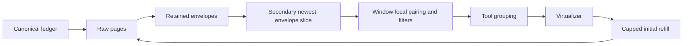
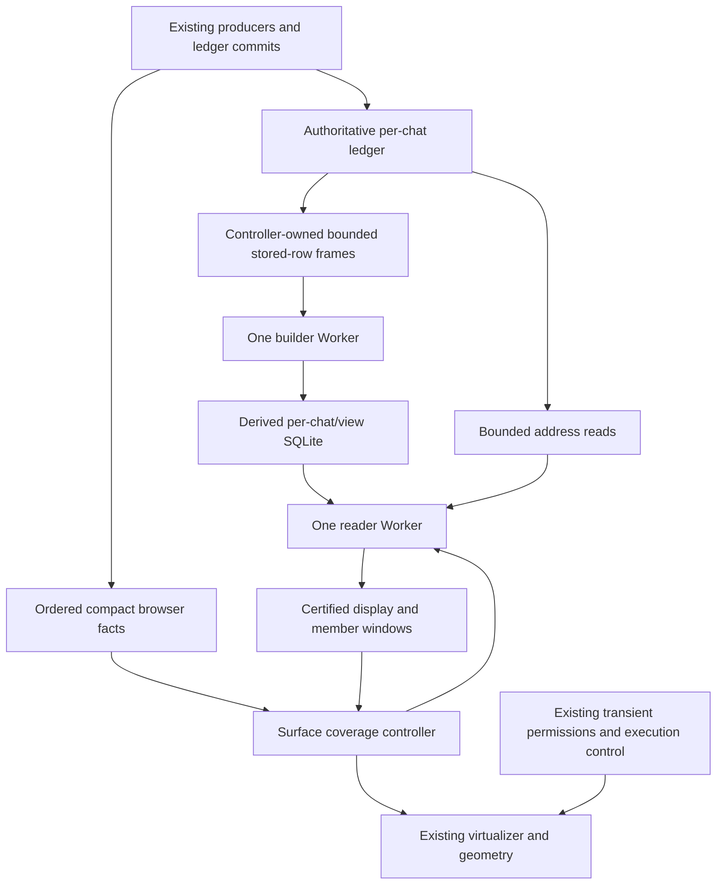
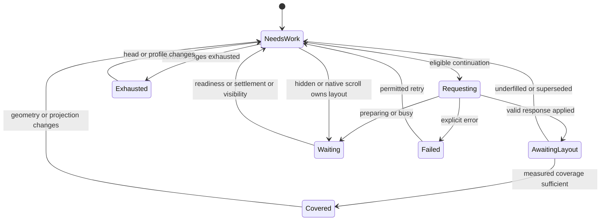

# Transcript Display Read Model

Status: selected architecture, implemented in PR #982. The November 5 automated results below are historical evidence, not validation of later changes. Native iOS momentum remains unverified. Current scope and closeout gates: [COMBINED_FEED_EXECUTION_PLAN.md](COMBINED_FEED_EXECUTION_PLAN.md).

November 7 scope correction: resend uses a complete source-qualified snapshot and the existing chips, independent of display preparation. Resend pagination/status UI and its derived index are removed. This supersedes the original resend-paging proposal; the feed index, bounded member reads, and compact live/reconnect cutover remain unchanged.

Baseline: `b56408daef8db5b53f64ad9a15511204302f18d9` on `investigate/combined-feed-architecture`. This document records the architectural choices delegated by the user. Revision 42 of `docs/transcript-ledger-v5-design.md` integrates the governing amendment. No commit is authorized or implied.

## 1. Decision

Replace browser raw-history projection with a controller-owned, rebuildable **display read model**. Serve certified display windows, aggregate tool-run summaries, and bounded member/detail windows from it. Use that same path for initial loading, ordinary paging, non-combined mode, live updates, navigation, and reconnect.

The ledger remains the sole authority. The new model is a disposable index of its current view, not another transcript, execution journal, provider integration, or publication owner.

The implementation has five parts:

1. Shared, pure structural display policy and an exact forward occurrence resolver.
2. A separate per-chat/view SQLite index with class postings, prefix aggregates, and dependency evidence.
3. A fixed builder/reader Worker pair and bounded, acknowledged source frames.
4. Surface-owned display/member windows, semantic anchors, body residency, and a persistent measured-coverage obligation.
5. Compact ordered browser notifications and explicit replacements for consumers of the old body stream.

This is an XL refactor. The query index alone is not the difficult majority: removing raw-history assumptions from browser interactions and secondary consumers is equally important. The phases below are implementation and verification boundaries, not a plan to keep two production display engines indefinitely.

### Decisions made

| Question | Decision |
| --- | --- |
| Required performance | Cheap prepared traversal past collapsed history, bounded ordinary browser residency, and reconnect without raw-gap replay |
| Projection domain | The complete canonical prefix through a declared watermark, not the browser's loaded body window |
| Filter/group semantics | Preserve filtered adjacency, weighted counts, first-category order, result visibility, and current seven tool-hide groups |
| Storage | Separate rebuildable SQLite, outside the ledger directory and authoritative transactions |
| Worker topology | One builder and one reader for the controller; no per-chat workers |
| Cold preparation | Explicit preparing state; no provisional window-local projector or automatic raw fallback |
| Regex failure | Fail the exact requested revision visibly; never silently disable a pattern |
| Expansion | An anchored, bounded member window, flattened into the existing feed virtualizer |
| Hidden targets | Explicit filtered/non-rendered outcomes; honest surrounding context, no automatic filter override |
| Active retention | Evict outside the measured working region only after interaction/layout settlement, with protection exceptions |
| Live delivery | Notify then fetch through the same display API; no raw-body reducer in the browser |
| Compatibility | Server/browser switch together; raw CLI/export contracts remain unchanged |

### Non-goals

- A general sparse-row repository, event bus rewrite, or PR #854/publication-settlement refactor.
- Provider, executor-RPC, CLI-forwarding, source-ledger schema, or native-history changes.
- Browser IndexedDB/offline history, exact whole-history scrollbar geometry, or jump-to-the-kth-group.
- Static activity blocks that hide currently visible results/reasoning.
- Strict maximum bytes for arbitrary individual bodies or indefinitely protected selections.
- Server-side per-surface subscriptions or pushed display deltas.
- Perfect reconstruction after unsupported external ledger edits/restores.

## 2. Problem and current behavior

Current loading pages raw rows, retains presented envelopes, slices those envelopes again, resolves dependencies over the slice, filters, groups, and finally measures the viewport. These are different coordinate systems.



Confirmed failures:

- Fifty initial envelopes plus ten compressed demands of 200 produce the reproduced 2,050-envelope plateau. Thousands of envelopes can still be one short summary.
- The independent newest-100 slice can hide a retained prompt on append. Increasing a refill constant does not fix it.
- Superseded/unsettled measurement can end a fill attempt without preserving demand. Collapse, filter, resize, visibility, and detached-reading transitions do not consistently re-arm it.
- A logical visible-row demand can follow arbitrarily many hidden raw pages, retain all responses, and shrink requests toward one row.
- Collapsed groups still contain member arrays, expansion ID sets, and per-member navigation maps. DOM virtualization does not bound those structures.
- Combined-mode append can rebuild the whole loaded projection. Removing the slice alone exposes that cost.
- Global `chat-messages` broadcasts and reconnect replay transfer full bodies even when the feed needs only one aggregate.

Relevant source owners at the baseline:

| Concern | Existing source |
| --- | --- |
| Slice/reveal bookkeeping | `web/src/lib/chat/transcript/active-transcript-presentation-state.svelte.ts`, `transcript-row-projection.ts` |
| Raw demand and refill | `transcript-page-demand.ts`, `conversation-viewport-auto-fill.ts`, `conversation-compressed-autofill-budget.ts`, `conversation-scroll-controller.svelte.ts` |
| Pairing, visibility, details | `conversation-feed-items.ts`, `common/command-output-projection.ts` |
| Group/member expansion | `web/src/lib/components/chat/transcript/conversation-feed-virtual-items.ts`, `ConversationToolGroupState.svelte.ts` |
| Geometry/interaction | `ConversationFeedProjectionState.svelte.ts`, `ConversationFeedVirtualController.svelte.ts`, `ConversationFeedRetentionState.svelte.ts` |
| Source reads/lifecycle | `server/controller/ledger/{store,service,view-reader,adoption,codec,presentation}.ts` |
| Body delivery | `server/controller/ledger/event-fanout.ts`, `server-event-wiring.ts`, `ws/chat.ts` |
| Browser ingress | `web/src/lib/events/router.svelte.ts`, `web/src/lib/ws/reconnect-coordinator.svelte.ts` |
| Surfaces/parking | `conversation-panel-registry.svelte.ts`, `inactive-transcript-window-store.ts` |

Paths without a full prefix in the first three rows belong to `web/src/lib/chat/transcript/`. The [investigation report](COMBINED_FEED_ARCHITECTURE_OPTIONS.md) contains the earlier alternatives, public implementation analogues, and probe limitations.

## 3. Guarantees and semantics

### Three independent facts

1. **Source continuity:** canonical rows committed in the ledger. Any independent raw consumer tracks only rows actually received under its raw contract.
2. **Projected completeness:** every eligible display unit in a certified interval is represented under one policy/profile/watermark.
3. **Body residency:** only selected rows and their explicitly requested dependencies are resident.

A summary certifies only the second fact. It is never evidence of raw delivery, provider dispatch, or member-body receipt. The new browser path has no raw replay cursor to advance.

### Exact full-prefix policy

For source prefix `R[1..W]`, compute:

```text
resolve occurrences and detail evidence
  -> intrinsic layout
  -> tool-group, Bash, and thinking visibility
  -> eligible adjacency
  -> overlay cuts
  -> display descriptors
```

The implementation may extract these facts in one forward pass, but must preserve the reference semantics:

- Results consume the oldest pending use of the same tool ID, not the nearest use. An orphan result stays orphaned; future uses do not repair it.
- An AskUserQuestion wrapper claims the earliest pending, unwrapped question use for its tool ID; otherwise it queues for a subsequent question use. It does not claim a non-question use.
- Use/result pairing crosses user rows, breakers, run boundaries, and source pages. None is a reset certificate.
- Results inherit filtering from their paired use. Empty-required-input error handling is part of intrinsic result eligibility.
- Permission terminals and clean command results remain intrinsically hidden as today. Permission requests and visible result rows remain breakers.
- Tool-group member count counts uses. Category totals retain edit-change weighting. Clause order follows first eligible occurrence, not a fixed category order.
- Groups of one member remain groups in combined mode.
- Non-combined mode exposes the same eligible rows individually; it does not revive raw paging.

Full-prefix behavior intentionally differs from today's loaded-window artifacts. For example, `Glob(x), Bash(x), Result(x), Bash(y)` pairs the result with Glob even when the browser shows only the latter three rows. Differential tests must record this as an intentional change, not normalize it away.

### Structural stability, not universal append locality

Under the current rules, a complete forward prefix fixes each row's hidden/member/breaker role. Later appends can extend its final group but cannot reclassify an earlier canonical row. This property follows from the policy above, not merely from L2 ledger immutability.

Details are different: later results, terminals, command evidence, and overlays can change earlier presentation. They are separately watermark-qualified. A future policy making earlier structural roles depend on future facts requires a policy revision and a new index design; append-only prefixes must not silently be reused.

### Explicit product changes

- Stable full-view occurrence pairing replaces loaded-window pairing.
- Opening a large group opens a member window, not every member.
- On a split, expansion follows its anchor-containing fragment; it is not inherited by every fragment.
- Active windows may release distant unprotected descriptors/bodies after settlement. Canonical history remains pageable.
- Cold preparation and filter application are visible states, not false empty results.
- Processing may be complete while transcript presentation is catching up.
- Prompt recall and the user navigator read explicit user-row indexes rather than whichever raw rows happen to be loaded.
- Plan presentation occurrences use canonical addresses, removing reused-tool-ID collisions. They remain ordinary UI suggestions, not permission capabilities.

## 4. Architecture and ownership



New controller owner: `server/controller/transcript-display/`. It owns derived lifecycle, preparation, queries, browser read APIs, and narrowly scoped auxiliary read folds. It does not own execution, publication acceptance, provider capabilities, or chat existence.

`common/` owns DTOs, parsers, structural rules, category contributions, and normalized presentation reducers. The web registry keeps renderers, action labels, localization, and visual behavior. Core does not import the web registry or parse native provider history.

`web/src/lib/chat/transcript/` owns surface display windows, coverage, expansion, and residency. The existing conversation registry continues owning surface lifetimes and shared optimistic/notices state. A shared body cache deduplicates immutable bodies but never owns scroll positions or applies a response to arbitrary surfaces.

### Why persistent separate storage

Persistence avoids repeating full-prefix extraction on every controller restart or browser opening and lets exact unmatched dependency queues grow on disk rather than in controller heap. In-memory-only indexing is a credible smaller implementation, but it does not satisfy this chosen end state as well: eviction causes complete rebuilds, and exact dependency state can grow with history.

Same-transaction indexing is rejected because a derived insert failure becomes an authoritative commit failure. An asynchronous writer in `ledger.sqlite` can contend with the controller's synchronous writer. A separate database removes that transaction/failure coupling and permits independent policy rebuilds.

This is not absolute resource isolation. Both stores share CPU, memory, and possibly a filesystem. Derived quotas, free-space admission, fixed workers, and backpressure reduce those risks; they cannot guarantee ledger availability after machine-wide resource exhaustion.

### Why a fixed Worker pair

The builder owns decoding, extraction, matching, and derived writes. The reader owns indexed queries and bounded body/detail presentation. Only the builder writes a derived database; the reader never runs user regexes.

A warm synthetic SQL query below 1 ms does not bound cold I/O, decoding, frame updates, or arbitrary patterns on the controller event loop. Conversely, a general worker pool or dedicated regex pool is unnecessary initially. Separate builder job kinds and a supervised matcher deadline isolate failures while keeping ready reads available.

Workers never open the authoritative ledger. The controller reads it through its existing owner in short statements. No worker-held source transaction can block the protocol-significant handoff checkpoint.

## 5. Shared policy and structural classes

Add:

- `common/transcript-display-policy.ts`
- `common/transcript-display-contract.ts`
- `common/transcript-display-matcher.ts`
- `common/__tests__/transcript-display-policy.test.js`

Move only structural decisions out of `tool-display-registry.ts`/`tool-display-policy.ts`/`tool-use-summary.ts`: input visibility, result flags, empty-required-input predicate, grouping role, hide-group membership, summary category and weight. Keep one exhaustive table over known normalized tool message types, with an explicit default for `unknown-tool-use`.

```ts
export const DISPLAY_POLICY_REVISION = 1;

export type HiddenToolGroup =
  | 'bash' | 'exec' | 'file-reads' | 'file-changes'
  | 'web' | 'tasks' | 'provider';

export type SummaryCategory = 'commands' | 'fileReads' | 'fileEdits' | 'other';

export interface StructuralToolPolicy {
  readonly input: 'hidden' | 'member' | 'breaker' | 'permission';
  readonly result: 'hidden' | 'visible' | 'error-only' | 'question';
  readonly hideGroup: HiddenToolGroup | null;
  readonly category: SummaryCategory;
  readonly bashPatternSensitive: boolean;
}

export interface DisplayProfile {
  readonly combine: boolean;
  readonly showThinking: boolean;
  readonly hiddenToolGroups: readonly HiddenToolGroup[];
  readonly bashRevision: string;
}
```

The local settings store currently normalizes any selected type to its entire hide group. Preserve that behavior and move the seven-group definition to `common/`; do not keep an arbitrary-type filter API merely because the old intermediate representation used strings.

A posting class is the disjoint tuple:

```text
(role, hideGroup, thinkingOnly, summaryCategory, bashPatternSensitive)
```

`role` is member or breaker; intrinsically hidden rows have no visibility posting. Breakers have no summary category. The Bash-sensitive partition is separate from other tools in the `bash` hide group: `write-stdin` and `claude-monitor` must not be pattern-filtered. Result classes use the paired use's group and Bash sensitivity.

The class inventory is a finite consequence of the shared table, not one class per tool occurrence or per browser profile. Store generated class IDs under `DISPLAY_POLICY_REVISION`; expose readable group IDs in browser DTOs. Adding or changing group membership increments the policy revision.

The web registry consumes the common structural table. Parity tests check every tool variant, including hidden inputs, error-only results, empty required input, plan tools, and default behavior. No independent copy of a visibility flag survives the migration.

## 6. Storage and source validation

### Location and ownership

Use the configured controller data root, not the repository or executor filesystem:

```text
<controller-data-root>/transcript-display/<chatId>/<view-policy-hash>.sqlite
```

The filename is a fixed hexadecimal digest of the source view ID and policy revision. Do not use an unvalidated view ID directly as a path. The manifest records the original identity and is verified on every admission. Directories are mode 0700 and files 0600 where supported; reject symlinks/path escapes using the ledger directory guard pattern.

The controller alone creates directories, after checking chat existence and lifecycle generation. Workers receive an admitted path; they never create parent directories. A missing file is preparing, not an empty chat.

One current structural generation is admitted per chat. Old files are fenced immediately on replacement and removed after handles retire. At most two Bash revisions exist within it: the previously published revision and the requested revision being prepared. No browser-specific profile cache is persisted.

### Essential schema

The following is the initial derived schema, not a ledger migration. Use `STRICT` tables and bound integers to safe JavaScript values on the wire. Additional indexes must be justified by a named query.

```sql
PRAGMA journal_mode = WAL;
PRAGMA synchronous = NORMAL;
PRAGMA foreign_keys = ON;
PRAGMA busy_timeout = 50;

CREATE TABLE manifest (
  singleton INTEGER PRIMARY KEY CHECK (singleton = 1),
  format_version INTEGER NOT NULL,
  chat_id TEXT NOT NULL,
  view_id TEXT NOT NULL,
  policy_revision INTEGER NOT NULL,
  written_by_server_instance TEXT NOT NULL,
  prepared_through INTEGER NOT NULL,
  frontier_fingerprint TEXT NOT NULL,
  last_gap_ordinal INTEGER NOT NULL,
  captured_goal INTEGER NOT NULL
) STRICT;

CREATE TABLE feature (
  ordinal INTEGER PRIMARY KEY,
  role TEXT NOT NULL CHECK (role IN ('hidden', 'member', 'breaker')),
  class_id INTEGER,
  message_type TEXT,
  summary_weight INTEGER NOT NULL,
  permission_occurrence TEXT,
  command_id TEXT,
  estimated_body_bytes INTEGER NOT NULL
) STRICT;

CREATE TABLE posting (
  class_id INTEGER NOT NULL,
  ordinal INTEGER NOT NULL,
  rank INTEGER NOT NULL,
  cumulative_weight INTEGER NOT NULL,
  PRIMARY KEY (class_id, ordinal)
) WITHOUT ROWID, STRICT;

CREATE TABLE pending_use (
  tool_id TEXT NOT NULL,
  use_ordinal INTEGER NOT NULL,
  tool_type TEXT NOT NULL,
  empty_required_input INTEGER NOT NULL,
  is_question INTEGER NOT NULL,
  wrapper_ordinal INTEGER,
  PRIMARY KEY (tool_id, use_ordinal)
) WITHOUT ROWID, STRICT;
CREATE INDEX pending_unwrapped_question
  ON pending_use(tool_id, use_ordinal)
  WHERE is_question = 1 AND wrapper_ordinal IS NULL;

CREATE TABLE pending_wrapper (
  tool_id TEXT NOT NULL,
  wrapper_ordinal INTEGER NOT NULL,
  PRIMARY KEY (tool_id, wrapper_ordinal)
) WITHOUT ROWID, STRICT;

CREATE TABLE tool_pair (
  use_ordinal INTEGER PRIMARY KEY,
  result_ordinal INTEGER NOT NULL UNIQUE,
  wrapper_ordinal INTEGER,
  evidence_ordinal INTEGER NOT NULL
) STRICT;

CREATE TABLE permission_terminal (
  occurrence_id TEXT NOT NULL,
  ordinal INTEGER NOT NULL,
  PRIMARY KEY (occurrence_id, ordinal)
) WITHOUT ROWID, STRICT;

CREATE TABLE command_evidence (
  command_id TEXT NOT NULL,
  evidence_ordinal INTEGER NOT NULL,
  first_output_ordinal INTEGER,
  stdout_count INTEGER NOT NULL,
  result_count INTEGER NOT NULL,
  last_result_ordinal INTEGER,
  last_result_complete INTEGER NOT NULL,
  last_gap_at_result INTEGER NOT NULL,
  PRIMARY KEY (command_id, evidence_ordinal)
) WITHOUT ROWID, STRICT;

CREATE TABLE bash_input (
  use_ordinal INTEGER PRIMARY KEY,
  command TEXT NOT NULL
) STRICT;
CREATE TABLE bash_event (
  ordinal INTEGER PRIMARY KEY,
  use_ordinal INTEGER NOT NULL,
  class_id INTEGER NOT NULL,
  weight INTEGER NOT NULL
) STRICT;
CREATE TABLE bash_revision (
  revision TEXT PRIMARY KEY,
  prepared_through INTEGER NOT NULL,
  status TEXT NOT NULL,
  failure_code TEXT
) STRICT;
CREATE TABLE bash_decision (
  revision TEXT NOT NULL,
  use_ordinal INTEGER NOT NULL,
  eligible INTEGER NOT NULL,
  PRIMARY KEY (revision, use_ordinal)
) WITHOUT ROWID, STRICT;
CREATE TABLE bash_posting (
  revision TEXT NOT NULL,
  class_id INTEGER NOT NULL,
  ordinal INTEGER NOT NULL,
  rank INTEGER NOT NULL,
  cumulative_weight INTEGER NOT NULL,
  PRIMARY KEY (revision, class_id, ordinal)
) WITHOUT ROWID, STRICT;
```

Additional narrow tables are defined in sections 8 and 14: public-tail evidence, user navigation, and auxiliary subagent preparation. They are not alternative authorities. Resend has no derived tables. Do not persist full transcript bodies; Bash command strings are the deliberate exception needed for repeated classification.

For empty/no-effective patterns, query base Bash postings directly. Otherwise replace them with positive `bash_posting` classes for the requested revision. Do not union both sets.

### Power loss and ordinal reuse

The source uses WAL/NORMAL. After power loss it can recover to an earlier committed prefix, then reuse lost ordinals. A separately surviving derived file must not describe those new rows.

On the first source open in a controller process, capture its recovered `(view, head)` **before accepting any new append**. Keep this small recovery boundary per registered chat for that process, across source connection-LRU closes. Expose it read-only from `TranscriptLedgerService`; it is not a new durable identity or an index dependency on the source write path.

Before reusing a derived file written by another server instance:

1. Require its view/policy to match and its frontier to be at or below that captured recovered head, not merely today's potentially regrown head.
2. Read the source row at its frontier and compare a SHA-256 fingerprint of a canonical JSON tuple of its exact stored fields (`view_id`, `ordinal`, `kind`, `at`, `client_message_id`, `payload_json`). Empty frontier uses a fixed empty-prefix marker. JSON string framing preserves otherwise ambiguous separators and unpaired Unicode code units.
3. Validate every derived sub-frontier is at or below the structural frontier. Rebuild any independently invalid Bash generation.
4. On mismatch, fence derived admission, discard, and rebuild from ordinal one.

The recovered-head check closes the lazy-open rollback/regrowth case that a current-head comparison alone misses. The row fingerprint additionally catches ordinary mismatched/restored files. This relies on SQLite's recovered transaction-prefix behavior and the supported append-only source contract; it is not proof against adversarial external rewriting of an earlier prefix with an identical endpoint.

Files built in the current process are qualified by that process and lifecycle generation. On server-instance change the browser clears immutable body caches too; a reused address must not retrieve a pre-restart cached body.

## 7. Preparation, fairness, and checkpoints

### Source streaming

`rowPagesThrough()` already provides bounded decoded streaming. Do not claim that streaming is absent. However, the selected Worker architecture needs the analogous **stored-row** stream so JSON decode happens off the controller thread. `withStoredRowsThrough()` and the current `TaskWorker` whole-array protocol are not that stream.

Extend the ledger narrowly:

```ts
interface StoredFramePort {
  withStoredRowFrames<T>(
    chatId: string,
    watermark: TranscriptWatermark,
    fromOrdinal: number,
    consume: (frames: AsyncIterable<readonly StoredLedgerRow[]>) => Promise<T>,
    signal: AbortSignal,
  ): Promise<T>;

  storedRowsByOrdinals(
    chatId: string,
    watermark: TranscriptWatermark,
    ordinals: readonly number[],
  ): readonly StoredLedgerRow[];
}
```

Implement the first using `#streamPages(..., readBoundedStoredPage, ..., fromOrdinal)` without collecting pages. Parameterize the stored-page helper's limits for this consumer so it reads the section 16 frame budget directly; retain existing limits for other callers. Preserve view validation before each statement and after completion. Wrap the consumer so the existing `UNDECODABLE_LEDGER_ROW` error is translated through the source owner's current-view fence; other worker/derived errors never fence the ledger.

Address reads use the canonical primary key, at most the admitted address count, and no source transaction across an `await`. Select each hydration batch using stored per-row byte estimates before reading bodies; do not materialize the entire requested address set and only then enforce the byte budget. An oversized row is its own batch. Source rows cross to the Worker in bounded frames; body responses are serialized there, not by decoding a whole history in the controller.

```ts
const nextFrontier = await source.withStoredRowFrames(chatId, goal, frontier + 1, async frames => {
  for await (const rows of frames) {
    signal.throwIfAborted();
    await builder.applyFrame({ generation, goal, rows }, signal);
    return rows.at(-1)?.ordinal ?? frontier;
  }
  return frontier;
}, signal);
```

This code expresses one acknowledged scheduling quantum, not the whole scheduler. Release the frame and iterator before returning the global slot; resume from `nextFrontier` on the job's next fair turn. Do not leave a suspended iterator holding a frame for every chat. At most one source frame is awaiting builder acknowledgement globally. Queues contain chat identities and desired watermarks, not raw batches or whole transcripts. Early iterator exit still requires the service's final current-view/publication check.

### Forward extractor

The extractor accepts one canonical row at a time and a narrow dependency-store port. It cannot inspect future rows. For a tool use, persist compact classification facts in `pending_use`. For a question wrapper, seek the earliest pending unwrapped question via the partial index; otherwise insert `pending_wrapper`. For a result, seek/pop the earliest pending use, classify the result, and insert `tool_pair` with `evidence_ordinal = result_ordinal`.

```sql
SELECT use_ordinal, tool_type, empty_required_input, is_question, wrapper_ordinal
FROM pending_use
WHERE tool_id = ?
ORDER BY use_ordinal
LIMIT 1;

SELECT use_ordinal
FROM pending_use INDEXED BY pending_unwrapped_question
WHERE tool_id = ? AND is_question = 1 AND wrapper_ordinal IS NULL
ORDER BY use_ordinal
LIMIT 1;
```

Unmatched state is O(unmatched occurrences) on disk. Never truncate it, reset it at a conversational boundary, materialize it all on restart, or serialize an entire queue map every frame. Indexed row updates replace growing `shift()` arrays and repeated linear `.find()` calls.

A frame transaction atomically writes features/postings, queue deltas, pair links, command/permission evidence, auxiliary facts, frontier fingerprint, and `prepared_through`. Acknowledgement follows commit. Crash before commit replays the whole frame; crash after commit resumes after its frontier. Replaying a committed frame is rejected or acknowledged idempotently by exact generation/frontier, never duplicated.

### Catch-up and scheduling

- On first demand capture source goal `H0`; finish that finite prefix even if new rows arrive.
- Commits only coalesce a larger desired head. The builder always reads its missing suffix from the ledger; no separate live-extraction engine or raw-batch queue is necessary.
- After `H0`, take another finite goal. A valid completed prefix is published even if it is already behind the newest source head.
- Give visible demand priority, with weighted round-robin service that grants at least one non-visible maintenance frame after eight visible frames when maintenance is eligible. A continuously live chat cannot monopolize the builder.
- Only explicitly opened or previously prepared current views are eligible for background work. A background display job never invokes genesis adoption. First browser open uses the existing adoption owner.
- Warm at most the most recent eight existing prepared chats on startup, lazily and paced. Do not pre-index every registry entry as a startup requirement.
- Reader requests have a bounded queue and return typed busy/retry outcomes. Build jobs coalesce per chat; no unbounded promise chain per commit.

### Worker supervision

Builder job kinds are `structure-frame`, `bash-frame`, and `auxiliary-frame`. Regex matching occurs before its write transaction. A failed matcher cannot leave half a posting prefix committed. A timeout marks that exact chat/pattern revision failed, retires the builder, and resumes unrelated jobs from committed checkpoints after confirmed Worker closure.

Termination is not instantaneous. Do not spawn replacement builders while the old writer may still be alive. If retirement does not complete, mark the builder unavailable; ready reads and source execution continue. Use worker identity/task/generation checks on every reply.

Reader queries are also bounded and supervised. They use short derived read transactions; no transaction spans a body fetch or browser wait. As-of evidence makes separate bounded reads through the same W coherent despite appends.

Register `transcript-display-builder` and `transcript-display-reader` in `server-agents/common/src/build/standalone-entrypoint.ts`, `scripts/build-exe.js`, and their build tests. Reuse worker-entrypoint/supervision patterns, not the existing whole-array TaskWorker host.

## 8. Detail evidence at a watermark

Immutable bodies are keyed by `(chat, view, ordinal)`. Details are keyed by that address plus response watermark and policy revision. A body becoming resident does not make its historical neighbors display rows.

### Tool and permission dependencies

- Pair links are visible only when `evidence_ordinal <= W`. A use at W cannot acquire a future result just because the link exists in today's database.
- A result's paired use and question wrapper are referenced explicitly. Hydrate those bodies only when their renderer needs them.
- Permission terminal lookup is `WHERE occurrence_id = ? AND ordinal <= W ORDER BY ordinal DESC LIMIT 1`; decode the selected terminal body. This preserves the current latest-terminal rule without a history scan.
- Historical AskUserQuestion rendering consumes the paired use/result and wrapper/terminal certificate. It no longer reconstructs correlation from neighboring resident rows.
- No detail response contains a permission capability. Actionability always comes from current server-instance/run-qualified transient control state.

### Command evidence

Append a compact `command_evidence` version at each command output/result. Track the first output ordinal including stderr, stdout count, result count, last result/capture, and the latest publication gap at that result. The manifest checkpoints the current global gap ordinal.

For an originally Markdown stdout body at ordinal `o`, retain Markdown only if the latest evidence version at or before W proves:

```text
offset == 0
stdout_count == 1
result_count == 1
last_result_complete
last_result_ordinal > o
last_gap_at_result < first_output_ordinal
```

Otherwise render plain. Do not promote an originally plain body. A later duplicate stdout/result can reverse a previous Markdown decision. Gap evidence after the qualifying result does not incorrectly invalidate it. This requires one command-key seek, not hydrating every command output.

### Diagnostic tail evidence

Local diagnostic deduplication uses the last server-presentable message and sometimes its predecessor, not merely the last visible row. Maintain append-only `public_tail(ordinal PRIMARY KEY, message_type, content_digest, failed_result_plus_notice_digest)` evidence while extracting. Digests hash the same JSON-framed exact string on both sides, without whitespace normalization. Only relevant result/notice strings produce digest fields; private/session rows never become the tail. The extractor must retain/refetch the immediately preceding public result's content when constructing a combined digest; two unrelated digests cannot be concatenated to obtain it. This is one row-sized dependency, not a transcript-sized buffer.

Window responses include the last qualifying tail evidence through W. A local diagnostic may temporarily remain visible while W lags its terminal barrier; remove it only after current evidence proves duplication. Failure/readiness must never hide the only error notice.

### Invalidation simplification

Do not build a dependency-change log or server-side resident subscriptions initially. A coalesced per-chat advancement marks resident **details**, not immutable bodies, dirty. A bounded batch revalidates the surface's resident detail seeds at the new W; bodies already cached by address are not retransferred. This bounds work by the working set and avoids an additional durable log. Add selective invalidations only if measured bounded revalidation is too costly.

## 9. Bash filter revisions

The pattern set is already a workspace remote setting; thinking/tool masks are browser-local. Hash the canonical normalized pattern list together with the matcher-policy version. Retain current JavaScript regex and glob semantics, including empty-pattern handling and Unicode glob behavior.

For every Bash use, store its command once in `bash_input`; `bash_event` contains chronological input and intrinsically eligible paired-result candidates. The revision job walks candidates in ordinal order. It evaluates each input once, persists its positive/negative decision, and uses that decision for later result candidates. Only positive candidates enter `bash_posting`.

The revision frontier certifies that **all** Bash candidates through that ordinal were classified. Hidden candidates advance it too. When no candidates occur between its last event and the structural frontier, advance across that gap explicitly. Empty eligible output is not stalled progress.

Ranks and cumulative weights are appended in candidate ordinal order. Never process all uses first, publish a frontier, then insert result postings below it. Queries never scan base Bash postings while rejecting hidden candidates.

New patterns require O(relevant command bytes + regex work); no arbitrary-regex completion bound exists. Limits of 200 patterns and 1,000 characters do not solve catastrophic backtracking.

On timeout or matcher failure:

- Persist a sanitized failure for that chat/revision outside the failed transaction.
- Keep the previously certified window explicitly labelled as using the previous filter, or show preparing/error on a cold surface.
- Offer retry and existing settings editing. Never remove the offending pattern, change the effective revision, or silently use unfiltered data.
- Do not automatically retry the same deterministic timeout in a loop. A changed revision or explicit retry re-admits it.
- Other chats/revisions and already-published reader queries continue after worker retirement.

For a profile hiding the entire Bash tool group, pattern eligibility cannot affect that profile. It may use the structural frontier without waiting for Bash classification, while still echoing the requested revision. This optimization has a dedicated equivalence test.

## 10. Indexed query algorithm

Let C be active structural classes, D returned top-level descriptors, M returned member rows, Q overlay cuts, and N canonical rows.

### Primitive seeks and totals

For each active class, use indexed predecessor/successor seeks. Do not rely on `MIN(ordinal) WHERE class_id IN (...)` or a planner-selected range aggregate.

```sql
SELECT ordinal, rank, cumulative_weight
FROM posting
WHERE class_id = ? AND ordinal <= ?
ORDER BY ordinal DESC
LIMIT 1;

SELECT ordinal, rank, cumulative_weight
FROM posting
WHERE class_id = ? AND ordinal > ? AND ordinal <= ?
ORDER BY ordinal
LIMIT 1;
```

For `(a, b]`, class count and weight equal endpoint-prefix differences. Missing predecessor means rank/weight zero. Category order comes from the minimum first eligible successor per category within the interval. Prefix minima cannot be subtracted.

The Bash equivalents add `revision = ?` and use `bash_posting`. Do not perform SQL range `COUNT`/`SUM`, offset pagination, bitmap rejection scans, or per-member membership tests to summarize a run.

### Complete runs and target resolution

To resolve a groupable eligible target `t` at W:

1. Find the nearest eligible breaker strictly before t across breaker classes; use sentinel 0 when absent.
2. Find the nearest eligible breaker strictly after t through W; use sentinel W+1 when absent.
3. Seek/count eligible members between those boundaries.
4. Apply valid overlay cuts inside the base interval and return the target-containing fragment plus the requested neighboring units.

A raw cursor inside a run must never become a fabricated group boundary. The first and last eligible member, neighboring breakers, and tail-open marker establish the complete base group **through W**. W+1 means the tail may extend, not a permanently closed run.

Forward/backward display paging advances by an entire descriptor's boundary. A continuation carries the certificate and canonical exclusive boundary; it is not a raw-row prefix limit. Each class seek returns a candidate; choose the next/previous eligible row across C. Emit an ordinary breaker or summarize the containing member interval, then move past it. Empty intervals emit no phantom group.

An all-hidden prefix completes with a bounded set of unsuccessful class seeks. It does not issue N candidate checks. In non-combined mode, merge eligible member and breaker cursors directly.

### Members

Member queries take a certified base extent, profile, fragment cuts, and an ordinal before/after/around anchor. Validate the extent against its certificate. Merge at most M eligible postings across classes, using bounded per-class batches. Counts remaining on each side use endpoint ranks.

Do not support arbitrary kth-member offsets in this release; canonical target navigation already opens the desired location directly. No all-member descriptor/ID array is created anywhere in the browser contract.

### Costs to verify

| Operation | Algorithmic target |
| --- | --- |
| Initial extraction | O(source bytes + N log N), plus matching work |
| Exact pending queues | O(unmatched occurrences) disk, bounded hot cache |
| Prepared display window | O(C(D + Q) log N) |
| Member page | O(C log N + M log C) with batched class cursors, or measured bounded seek equivalent |
| Detail/body request | O(requested addresses/dependencies * log N + selected body bytes) |
| Append | Suffix extraction and dependency deltas, never whole-source re-projection |
| Bash change | Relevant command traversal and matching; potentially failed deadline |

These are targets, not established production latency. Verify actual statements, rows materialized, query plans, bytes, and event-loop time. A `SEARCH` query plan alone does not prove constant work.

## 11. Browser API

Use authenticated browser-only POST routes under `/api/v1/chats/transcript-display/`. POST permits bounded structured profiles/cuts without opaque URL blobs. Reads remain side-effect-free except lazy preparation/adoption on explicit open; `plan-dismiss` is explicitly a presentation mutation with the usual mutation authorization/CSRF checks.

Operations:

| Route suffix | Purpose |
| --- | --- |
| `open` | Canonical view/head, processing/control/transient/plan snapshots, index status, outstanding submission resolution |
| `window` | Newest, before, after, or around display descriptors |
| `members` | Bounded member window within a certified group/fragment |
| `bodies` | Bounded selected bodies and W-qualified dependency/detail certificates |
| `resolve` | Canonical target outcome and optional surrounding display window |
| `user-rows` | Paged navigation/recall previews |
| `resend` | Complete current source candidate snapshot, independent of display preparation |
| `subagents` | Paged auxiliary presentation snapshot |
| `plan` / `plan-dismiss` | Current ephemeral plan presentation and idempotent presentation dismissal |

No new route is added to `CLI_OPERATIONS`. Keep raw `/api/v1/chats/messages`, existing CLI snapshots, export, search, share, and fork execution contracts intact. No executor protocol bump follows from these browser-only DTOs. If implementation changes an actually forwarded payload, review both gateway paths and bump at that point rather than asserting this exemption broadly.

### Core types

```ts
export interface CanonicalAddress {
  readonly chatId: string;
  readonly transcriptViewId: string;
  readonly ordinal: number;
}

export interface DisplayCertificate {
  readonly serverInstanceId: string;
  readonly chatId: string;
  readonly transcriptViewId: string;
  readonly policyRevision: number;
  readonly profileKey: string;
  readonly bashRevision: string;
  readonly watermark: number;
  readonly cutsKey: string;
}

export interface DisplayCut {
  readonly id: string;
  readonly afterOrdinal: number;
  readonly anchorRule: 'eligible-row' | 'raw-position';
}

export interface GroupExtent {
  readonly afterBreaker: number;
  readonly beforeBreaker: number;
  readonly firstMember: number;
  readonly lastMember: number;
  readonly openAtWatermark: boolean;
}

export type DisplayDescriptor =
  | {
      readonly kind: 'row';
      readonly ordinal: number;
      readonly messageType: string;
      readonly layout: 'standard' | 'permission';
      readonly estimatedBodyBytes: number;
      readonly permissionOccurrenceId: string | null;
    }
  | {
      readonly kind: 'tool-group';
      readonly base: GroupExtent;
      readonly fragment: { readonly after: number; readonly through: number };
      readonly firstMember: number;
      readonly lastMember: number;
      readonly count: number;
      readonly totals: Readonly<Record<SummaryCategory, number>>;
      readonly categoryOrder: readonly SummaryCategory[];
    };

export interface DisplayCursor {
  readonly certificate: DisplayCertificate;
  readonly boundaryOrdinal: number;
}

export type WindowAnchor =
  | { readonly kind: 'newest' }
  | { readonly kind: 'before' | 'after'; readonly cursor: DisplayCursor }
  | { readonly kind: 'around'; readonly ordinal: number };

export interface DisplayWindowRequest {
  readonly chatId: string;
  readonly transcriptViewId: string;
  readonly policyRevision: number;
  readonly profile: DisplayProfile;
  readonly anchor: WindowAnchor;
  readonly cuts: readonly DisplayCut[];
  readonly limit: number;
  readonly atWatermark?: number;
  readonly requiredThrough?: number;
}

export type DisplayEdge =
  | { readonly kind: 'more'; readonly cursor: DisplayCursor }
  | { readonly kind: 'exhausted-through-watermark' }
  | { readonly kind: 'preparing'; readonly requiredThrough: number };

export interface AvailableDisplayWindow {
  readonly kind: 'available';
  readonly certificate: DisplayCertificate;
  readonly sourceHead: number;
  readonly structuralPreparedThrough: number;
  readonly bashPreparedThrough: number;
  readonly interval: { readonly after: number; readonly through: number };
  readonly items: readonly DisplayDescriptor[];
  readonly earlier: DisplayEdge;
  readonly later: DisplayEdge;
  readonly cutPlacements: readonly {
    readonly id: string;
    readonly placement: 'inline' | 'detached';
  }[];
}

export type DisplayWindowResponse = AvailableDisplayWindow | {
  readonly kind: 'preparing' | 'lagging' | 'failed' | 'busy';
  readonly serverInstanceId: string;
  readonly chatId: string;
  readonly transcriptViewId: string;
  readonly policyRevision: number;
  readonly profileKey: string;
  readonly bashRevision: string;
  readonly sourceHead: number;
  readonly preparedThrough: number;
  readonly errorCode: string | null;
  readonly retryAfterMs: number | null;
};
```

The implementation extends the available response with typed public-tail evidence and target resolution as appropriate. The core shape above deliberately has no `messages` field, member ID list, or raw continuity claim. `messageType` must validate against the shared rendered-message union, not arbitrary user strings.

Parsers reject unsafe integers (including overflowing aggregate totals), unknown/duplicate groups, invalid spans, out-of-window items, inconsistent counts/category order, foreign certificates, and malformed continuations. Hashes are cache qualifiers, not authorization. Recompute profile/cut keys server-side and revalidate cursor boundaries; callers cannot invent a group to bypass filtering or body-read policy.

### Watermark rules

- Capture source head H and current view at admission. Let F be the minimum relevant prepared frontier. Choose `W <= min(H, F)`, or use the explicitly requested W if available.
- For a first `newest` open, capture required goal H0. Do not return an early prefix as though it were the newest view. Return preparing until H0 is prepared, then return the H0-qualified window and disclose newer head/lag.
- For ordinary paging, retain the existing certificate's W. For refresh, capture a new finite goal and replace/reconcile the bounded working window at that W.
- An append during a request does not invalidate an otherwise valid response. Apply it and schedule subsequent catch-up; rejecting all behind-head responses causes starvation.
- Never mix pages or details with incompatible view/profile/policy/cuts/W in one claimed certificate. Protected old components may remain during an atomic replacement, visibly outside its new completeness claim until rebound.
- Later exhaustion means only exhaustion through W. The surface is current at the live edge only when W covers the captured source head and no newer notification is known.
- A fully filtered view is available with zero items and certified exhaustion. A missing index or suffix is preparing, not filtered-empty.

Fetch new descriptor/detail certificates while the old snapshot remains current, then swap atomically. A new row may temporarily render a loading/error placeholder, but that placeholder's height cannot satisfy the measured coverage obligation as though its real content had settled. Detail hydration/measurement must wake coverage again. Immutable bodies from an older request may enter the cache only after server/view checks; stale details never enter a newer certificate.

### Member contract

```ts
export interface MemberWindowRequest {
  readonly certificate: DisplayCertificate;
  readonly profile: DisplayProfile;
  readonly cuts: readonly DisplayCut[];
  readonly base: GroupExtent;
  readonly fragment: { readonly after: number; readonly through: number };
  readonly anchor:
    | { readonly kind: 'first' }
    | { readonly kind: 'before' | 'after' | 'around'; readonly ordinal: number };
  readonly limit: number;
}

export interface MemberWindowResponse {
  readonly certificate: DisplayCertificate;
  readonly base: GroupExtent;
  readonly fragment: { readonly after: number; readonly through: number };
  readonly ordinals: readonly number[];
  readonly earlier: { readonly beforeOrdinal: number; readonly remaining: number } | null;
  readonly later: { readonly afterOrdinal: number; readonly remaining: number } | null;
}
```

The response lists only the requested page's members. `around` uses bounded predecessor/successor member merges, not an offset into all members. Hydration uses `bodies` at the same certificate. The top-level window still certifies the whole summary; a child window certifies only its explicitly declared member interval.

### Body and dependency contract

```ts
export interface BodyDependencyRequest {
  readonly certificate: DisplayCertificate;
  readonly profile: DisplayProfile;
  readonly cuts: readonly DisplayCut[];
  readonly seedOrdinals: readonly number[];
  readonly residentOrdinals: readonly number[];
  readonly limitBodies: number;
  readonly estimatedByteBudget: number;
}

export interface RowDetails {
  readonly ordinal: number;
  readonly pairedUse: number | null;
  readonly pairedResult: number | null;
  readonly questionWrapper: number | null;
  readonly permissionTerminal: number | null;
  readonly commandFormat: 'plain' | 'markdown' | null;
}

export interface BodyDependencyResponse {
  readonly certificate: DisplayCertificate;
  readonly details: readonly RowDetails[];
  readonly bodies: readonly {
    readonly ordinal: number;
    readonly message: ChatMessage;
    readonly submissionClientMessageId: string | null;
  }[];
  readonly deferredOrdinals: readonly number[];
  readonly oversizedOrdinal: number | null;
}
```

Member and body requests carry the same bounded profile/cuts inputs as their certificate; the server recomputes both keys without a persisted profile registry. Seeds and cached-address hints are bounded. Return a bounded direct dependency closure, not recursively every neighbor: use/result, wrapper, selected terminal, and compact command evidence suffice for current renderers. The body endpoint can explicitly hydrate a selected filtered user/tool row for a non-feed action, but that never inserts it into the feed or overrides visibility.

Apply `ledgerRowToMessage` to every outgoing body. Sessions, private chat-ID notices, provider metadata, native paths/refs, and storage-only details cannot leak. A requested non-presentable ordinal gets a typed non-rendered outcome, not a raw payload. `submissionClientMessageId` comes only from a canonical user-input submission field, never provider-authored message metadata; it supports the existing fork/remap semantics without a cached-window uniqueness scan.

An oversized selected row travels alone and is reported explicitly. Routine byte limits are scheduling/admission budgets, not truncation. There is no body preview/chunk subsystem in this design.

### Target outcomes

`resolve` returns one of `visible-row`, `group-member`, `attached-detail`, `filtered`, `non-rendered`, `preparing`, `stale-view`, or `missing`.

- A group member opens a member page around its canonical ordinal.
- An intrinsically attached result resolves to its paired input/detail and opens that detail, even if its standalone result row is hidden by intrinsic layout.
- Profile-filtered targets remain filtered. Land on preceding visible context, or following context if no predecessor exists; announce the reason and do not report target success.
- Intrinsically non-rendered lifecycle/private rows are not false-success navigation to a neighbor.
- A target beyond F but within source H is preparing. A target outside the source view/head is missing/stale as appropriate.
- Tool-ID DOM aliases are not canonical. Existing internal links must resolve to occurrence addresses before navigating.

## 12. Overlays, expansion, and anchors

### Overlay cuts

The browser cannot split an aggregate by subtracting unknown members. It sends bounded cut anchors; the server computes subrange descriptors with the same indexed aggregates.

- Optimistic input uses `raw-position`: insert after its canonical `afterOrdinal`, even when that source row is hidden.
- Pending permission uses `eligible-row`: inline only when its eligible anchor is represented in this surface's certified interval; otherwise retain the detached fallback.
- Local notices remain trailing. Their deduplication uses W-qualified public-tail evidence.
- Body cache residency never decides placement.
- The certificate includes `cutsKey`; a changed cut invalidates affected presentation, not source identity.

A fragment retains its base group extent and explicit cut bounds. Do not present it as an independently complete canonical run. Sort same-anchor local overlays by the existing stable display order. If a surface exceeds the cut admission budget, show a resource-limited state and keep controls reachable; do not silently discard a permission or optimistic row.

Suppress a floating actionable permission only when that occurrence has an actual renderable representation in the current surface. A represented durable request may use the transient payload before its ordinary body is fetched. Merely knowing the request exists somewhere in the index is insufficient.

### Anchored member windows

```ts
export interface ExpansionIntent {
  readonly anchorOrdinal: number;
  readonly previousExtent: GroupExtent;
  readonly memberCursor: number;
  readonly openedAt: number;
}

export interface SemanticAnchor {
  readonly address: CanonicalAddress;
  readonly location: 'row' | 'group-header' | 'member' | 'detail';
  readonly offsetWithinItem: number;
}
```

Expansion is local presentation state, not an array/set of all members. Opening defaults to the first 50 eligible members. Deep navigation centers a page on the target. Earlier/later member boundaries report exact remaining counts and load/move a bounded child window. They share the feed's one virtualizer and scroll surface.

Top-level display requests count ordinary rows and group descriptors, not all expanded children. Member-window requests are separate narrow operations. The browser only flattens already-certified descriptors, child rows, and boundaries; it does not regroup raw bodies. No expanded interval list is required by the top-level server query under this chosen pagination policy.

Rules:

- Append: preserve anchor/member window; update summary totals and later continuation. An open group does not automatically hydrate its entire append stream.
- Split: retain expansion on the anchor-containing fragment. Other fragments collapse except temporarily protected loaded children.
- Merge: keep the intent owning focused/targeted content, then the reading anchor, then the most recent explicit expansion. Release redundant unprotected member windows.
- Filter change: remap to the nearest surviving member within the previous extent; suspend expansion if none survives.
- Collapse: close child transients and move focus to the summary before releasing unprotected children.

Group DOM keys combine surface identity, profile/cuts identity, and first eligible member. Keys may change on merge/split/filter; semantic anchors do not rely on key persistence. Remapping uses interval lookup or `resolve`, never member enumeration.

## 13. Surface state, coverage, and residency

### One surface owner

`DisplayWindowController` owns one working top-level interval, member windows, current certificate, request epochs, and coverage. `DisplayWindowState.svelte.ts` exposes immutable snapshots through `$state.raw`; pure descriptor adaptation uses `$derived`. `DisplayBodyStore` owns shared immutable body caching and explicit leases. Existing scroll/virtualizer controllers continue owning geometry, native-scroll deferral, focus, selection, and intent cancellation.

A response must match captured surface, chat, view, profile, cut revision, navigation epoch, and requested cursor. Geometry revisions may supersede measurement but must not cause a valid data response to be discarded solely because new source rows arrived.

Explicit target navigation keeps its target and request ownership through preparation, resolution, and any follow-up member/detail load. Preparing, lagging, and busy responses wait for readiness with a slow bounded retry; they are not missing-target results. Cancellation, replacement, and the caller's deadline retire that wait. Automatic catch-up and coverage cannot occupy the navigation's request slot while its resolver is pending.

### Persistent measured obligation



The obligation records identity, semantic anchor, candidate edge/member cursor, last applied certificate, and pending reason. It is complete only on measured coverage, certified exhaustion, explicit failure/resource limitation, or disposal/superseding navigation. A request/CPU quantum ending is a yield, never successful completion.

Wakeups: activation, accepted data, index readiness, source head, collapsed/expanded structure, profile changes, overlay cuts, viewport/row/font/image resize, visibility restoration, native-scroll settlement, target settlement, and explicit retry. Zero visible rows must not disable demand.

Detached readers participate. Filling preserves their semantic anchor; it does not repin them to the live edge. At an expanded-member boundary, fill that member window in the reading direction before skipping to an unrelated parent edge. At a latest underfilled view with no later content, fetch earlier descriptors. At a bounded historical window, honor the active direction and preserve its anchor while filling available space.

Only one demand request per surface and one deferred run callback are scheduled. After a held request completes, re-read the level condition. If a wakeup occurred in flight, process it even when the old layout wait was superseded. Use requestAnimationFrame/event-loop yielding, not an unbounded microtask loop. Preparing/lagging waits on readiness plus a slow bounded fallback status refresh, not tight polling.

Implementation skeleton:

```ts
async function reconcileCoverage(port: CoveragePort): Promise<void> {
  const owner = port.captureOwner();
  const measurement = await port.measure(owner);
  if (!port.isCurrent(owner)) return;
  if (measurement.kind !== 'settled') {
    port.waitForMeasurement(owner);
    return;
  }
  if (measurement.covered) {
    port.markCovered(owner);
    return;
  }
  const next = port.nextDemand(owner, measurement);
  if (next.kind !== 'request') {
    port.applyDemandOutcome(owner, next);
    return;
  }
  const result = await port.load(next.request, owner.signal);
  if (!port.isCurrent(owner)) return;
  port.applyLoadOutcome(owner, result);
  port.scheduleRecheck(owner);
}
```

`CoveragePort` is a narrow tested interface, not a second scrolling abstraction. `applyLoadOutcome` retains a pending reason for preparing/busy/unsettled; `scheduleRecheck` respects that reason rather than immediately retrying. The controller owns cancellation and cleanup.

### Retention

No secondary newest-message slice survives. Retention is expressed in display descriptors and resident bodies, not raw member count.

Maintain a viewport plus overscan working region. After a mutation settles and native scrolling releases ownership, evict far unprotected top-level pages/member pages and release their body leases. Replace each removed edge with its certified continuation and preserve the semantic anchor before geometry adjustment. Do not evict a summary because its raw span is enormous.

Protect focused rows, DOM selection, active menus/dialogs/drag interactions, navigation targets, pending optimistic content, and dependencies their renderers require. Protection may temporarily retain islands outside a member page; represent intervening unloaded spans with explicit member boundaries, not an assertion of continuity.

If protection or one oversized body exceeds a routine budget, keep it, record the exception, and reclaim after release. Do not repeatedly fetch/evict the same mandatory row. Multiple simultaneously visible surfaces may require an explicit root-budget exception to retain their minimum working regions.

Parking retains bounded descriptors, member anchors/cursors, bodies, certificate, semantic position, and latest observed dirty head. It retains neither DOM nor measurements. Background notifications mark dirty; they never hydrate parked bodies. Preserve the existing four-window and 24 MiB estimated-payload ceiling, count actual resident bodies rather than collapsed membership, and keep the existing 8,000-body ceiling as an additional limit. Evict a whole parked window when necessary, retaining only its small semantic target. No persistent raw browser cache is migrated; remove it.

Restoration establishes detached pinning before mounting and reapplies the saved ordinal after snapshot installation, before fetching its certified window. The semantic anchor remains authoritative through pixel positioning, including request/profile cancellation, so incomplete mount geometry cannot replace it. Admitted display revisions resume pending restoration even when the viewport port remains unchanged during preparation. User scrolling or explicit navigation supersedes restoration; a settled unavailable target releases its hold without repinning. A group-summary restore does not expand its members. Presentation gates are cleared on parking, and long-lived transcript callbacks cannot capture retired panel scopes.

### Svelte integration

Observers and controller lifetimes are created/cleaned in `onMount` or a synchronously tracked `$effect`. Capture identity/profile dependencies before asynchronous work. `$derived` performs no fetch or mutation; effects call explicit idempotent transitions rather than each other. `tick()` does not certify permanently settled geometry. The [Svelte 5 effect contract][svelte] governs dependency tracking and teardown.

## 14. Live delivery and secondary consumers

### Compact notification contract

Replace `ChatMessagesMessage` browser publication with separate typed events:

```ts
export interface ChatTranscriptHeadUpdated {
  readonly type: 'chat-transcript-head-updated';
  readonly serverInstanceId: string;
  readonly chatId: string;
  readonly transcriptViewId: string;
  readonly sourceHead: number;
  readonly presentedActivityAt: string | null;
  readonly preview: {
    readonly ordinal: number;
    readonly text: string;
    readonly timestamp: string;
  } | null;
  readonly responseClassOrdinals: Readonly<Record<ResponseClass, number>>;
  readonly planRevision: number;
  readonly auxiliaryRevision: number;
}

export interface ChatInputCommitted {
  readonly type: 'chat-input-committed';
  readonly serverInstanceId: string;
  readonly chatId: string;
  readonly transcriptViewId: string;
  readonly clientMessageId: string;
  readonly ordinal: number;
}

export interface ChatDisplayStateUpdated {
  readonly type: 'chat-display-state-updated';
  readonly serverInstanceId: string;
  readonly chatId: string;
  readonly transcriptViewId: string;
  readonly policyRevision: number;
  readonly bashRevision: string;
  readonly preparedThrough: number;
  readonly phase: 'preparing' | 'available' | 'failed';
  readonly errorCode: string | null;
}
```

`ResponseClass` is a fixed shared enum preserving the announcer's distinctions: assistant, command-output, command-result, thinking, error, permission, and tool. Preview is at most 200 characters and follows the current last Assistant/User/command-output rule. Activity is the maximum presented-message timestamp, not the last raw session/run-ended timestamp. Extract those rules into a shared pure helper and parity-test them.

No event contains resend text, member bodies, an ever-growing ID list, or a full plan. Input acknowledgements are separate exact events; they are not accumulated indefinitely inside a coalesced head. They indicate commit only, not provider delivery.

Head/readiness notifications coalesce per chat, normally no more than four per second each. A compact notification for an inactive chat does not open its derived index. Browser requests coalesce per active surface, with one refresh in flight. Wire volume scales with refresh cadence, visible changes, and explicit interactions, not the bytes of omitted collapsed members. It is not constant over an arbitrarily long live session.

### Ordering and barriers

Use the existing per-chat `scheduleChatTask` ordering. Before emitting a terminal-driven processing/session/run event, flush pending head/plan/ack notifications through that terminal's committed ordinal. View replacement and control publication have the same explicit flush ordering. Do not delay those lifecycle events until the index catches up.

The browser applies processing/control changes immediately and may show idle plus catching-up. Transcript-dependent effects are **surface-local**:

- Remove an optimistic row only when that surface represents its canonical replacement, atomically with the new display snapshot.
- Keep an error notice until its durable equivalent is represented/proven duplicate through the terminal watermark.
- Do not mark raw history validated on terminal completion; that state no longer exists.
- Do not wait for every surface to catch up before updating another. Detached/suspended surfaces must not create a cross-surface barrier.

Optimistic lifecycle: `pending -> committed-awaiting-projection -> represented`. The same local body remains available during index lag. A reconnect resolves only the bounded list of locally outstanding submission IDs using the source submission index. It never replays the whole missing suffix to discover echoes.

### Activation and reconnect

`open` captures the canonical view/head through the existing first-open adoption owner and returns index status plus the existing processing, execution-control, transient-feed, and new plan-presentation snapshots. Reuse their existing types, not their raw-message payloads. The existing CLI snapshot with `messageLimit=0` remains unchanged; it does not by itself provide a canonical transcript head.

```ts
export interface DisplayOpenRequest {
  readonly chatId: string;
  readonly expectedTranscriptViewId?: string;
  readonly outstandingClientMessageIds: readonly string[];
  readonly reason: 'activate' | 'reconnect';
}

export interface DisplayOpenResponse {
  readonly serverInstanceId: string;
  readonly chat: ChatSnapshotChat;
  readonly transcriptViewId: string;
  readonly sourceHead: number;
  readonly display: {
    readonly policyRevision: number;
    readonly bashRevision: string;
    readonly preparedThrough: number;
    readonly phase: 'preparing' | 'available' | 'failed';
  };
  readonly processingPhase: ChatProcessingPhase | null;
  readonly control: ChatExecutionControlState;
  readonly transientFeed: ChatTransientFeedSnapshot;
  readonly plan: PlanPresentationSnapshot;
  readonly submissions: readonly {
    readonly clientMessageId: string;
    readonly ordinal: number | null;
  }[];
}
```

Limit outstanding IDs to 32 per request and resolve only against the explicitly admitted view. A not-found result is not evidence that an uncertain execution command never dispatched; the existing accepted-input recovery contract still owns that decision. HTTP view/adoption failures use the repository's typed error envelope rather than a fabricated available snapshot.

Initial activation schedules the existing native-drift check once after successful source activation, preserving its current eligibility/fencing rules. Ordinary paging, readiness refresh, member reads, background preparation, and reconnect catch-up do not become additional drift-probe occasions.

On reconnect:

1. Fence stale socket replies and recover existing processing/control snapshots.
2. For each active surface, validate view/profile, resolve outstanding inputs, and refresh a bounded window around its semantic anchor or newest if pinned.
3. Mark parked windows dirty without fetching them.
4. On server-instance change, clear old body/detail certificates and process-ephemeral plan/permission state. Refresh; do not recreate actionability from history.
5. On view replacement, discard old descriptors/continuations; semantic ordinal alone cannot identify a row in the replacement.

### Consumer migration inventory

| Existing consumer | Replacement and tests |
| --- | --- |
| Feed/raw cache/parked replay | Display windows and dirty frontiers; no raw body append |
| Sidebar preview/activity/read receipts | Compact head facts; preserve selected-chat plus document-visible receipt policy, not every mounted surface |
| Plan entry/exit handler | Process-ephemeral plan presentation snapshot/revision and canonical plan references; details below |
| Permission batch handler | Existing transient upsert/remove/clear-run/snapshot; derive waiting status from current actionable set, not historical rows |
| Optimistic echoes | Commit acknowledgement plus per-surface represented replacement; bounded reconnect lookup |
| Resend chips and Reload warning | Complete source-qualified snapshot on selected idle-composer demand; no body-bearing events, pagination, or index polling |
| Prompt recall | Latest 100 nonblank user-row references/previews; selected body on demand, bounded adjacent prefetch |
| User-message navigator | Independent user-row keyset pages; selection uses canonical `resolve`, never grows the feed with raw `loadOlder` |
| Subagent toolbar | Separate paged auxiliary presentation fold, independent of loaded/collapsed bodies |
| Question history | Direct paired-use/result/wrapper/terminal dependencies at W |
| Response announcer/detached indicator | Fixed response-class watermarks plus accepted display mutations; do not announce historical hydration as a new response |
| Fork-at-message | Capture canonical target and eligible clientMessageId from a selected row, not a scan of `entries` |
| Session restoration | Descriptor readiness and semantic anchor, not `displayMessageCount` or newest-100 reveal |
| Browser Reload result | Replacement identity/progress only, then newest display open |
| Integration test client | Compact events for synchronization; explicit raw HTTP reads when a test actually asserts source contents |

#### User rows and resend

During structural preparation append `user_navigation(ordinal PRIMARY KEY, preview, timestamp, attachment_count, nonblank, presentation_json)` for server-presentable UserMessage rows. Bound preview text to 300 characters. The navigator returns 50 at a time; recall requests at most 100 nonblank references. Prompt text is fetched only for selection/recall. Async recall completion must still match composer chat, draft revision, and navigation epoch; it cannot overwrite text typed while fetching.

For resend presentation, reuse `AgentRegistry.resendCandidates(chatId)` and its existing literal/missing-integration guards. `/resend` accepts only process/chat/view identity and returns that identity, `sourceHead`, `processingPhase`, and the complete ascending `ResendCandidate[]` with full text and attachment names. Capture head, processing phase, and candidates synchronously after parsing; processing suppresses the scan explicitly. The read never admits display preparation and has no cursor, limit, historical watermark, or candidate-count cap. It does not fetch a raw transcript page.

Only the selected, presented, connected, idle composer requests the snapshot. Activation/reconnect, processing-to-idle (even at the same head), and newer source heads trigger reads. One request and a coalesced notification-driven follow-up suffice; no readiness subscription or autonomous retry loop is needed. Fence responses and exclusion actions by process/chat/view and activation. Do not publish obsolete, suppressed, or failed reads as current empty data. Preserve exclusions through failures and cancellation; successful complete snapshots prune exclusions only when candidates disappear. Reload uses the unfiltered complete list, not the excluded chip projection, and discloses unavailable reads. Existing chips remain; no resend pager, popover, reserved toolbar slot, or new composer status control is part of this architecture.

Candidate count, aggregate text bytes, and the existing synchronous scan proportional to the unanswered tail are accepted exceptions. This preserves source submission semantics and avoids coupling visibility/opt-out to a lagging or failed display index. Optimize only after measured source-read latency justifies a separate scope decision.

If the source snapshot is unavailable or obsolete, suppress unvalidated chips and report failures through the existing notification surface. Reload discloses unavailable candidates rather than a successful zero count. Processing hides the chips without clearing exclusions. The submit contract is unchanged.

#### Plan presentation

Add a small process-ephemeral `ChatPlanPresentationStore` beside the existing transient feed store. It consumes already committed Enter/ExitPlan rows and publishes a revision immediately, independently of index readiness. Store canonical exit occurrences and references, not entire plan bodies in every notification. Page outstanding exit references through `plan`; hydrate a selected plan body by canonical address through a browser presentation read that does not require structural preparation.

Use a browser-only, idempotent `plan-dismiss` command qualified by server instance, chat, view, and plan ordinal. It removes only presentation state. Approval still uses the existing ordinary accepted-input path and permission-mode choice. Denial still requires a real transient capability. Dismissal/approval does not manufacture one or become an executor operation. A dismissed suggestion stays dismissed across same-instance reconnect; restart clears this presentation state. Preserve current retention across ordinary run endings; clear on view replacement/deletion. Client previous-mode restoration remains explicit and is applied once per enter revision, not again on every snapshot refresh.

```ts
export interface PlanPresentationSnapshot {
  readonly serverInstanceId: string;
  readonly chatId: string;
  readonly transcriptViewId: string;
  readonly revision: number;
  readonly latestEnterOrdinal: number | null;
  readonly pendingExitCount: number;
  readonly exits: readonly { readonly ordinal: number; readonly timestamp: string }[];
  readonly nextAfterOrdinal: number | null;
}

export interface DismissPlanPresentationRequest {
  readonly serverInstanceId: string;
  readonly chatId: string;
  readonly transcriptViewId: string;
  readonly ordinal: number;
}
```

Snapshot pages contain at most 50 exit references. A selected `plan` detail read uses the controller's bounded canonical address/presentation port and needs no index certificate because it performs no adjacency/pairing projection. This exception is for an explicit current plan suggestion, not a provisional raw feed. A failed dismissal keeps/reinstates the suggestion with an explicit retry; it cannot be mistaken for a failed provider permission response.

This removes reused `plan-exit-${toolId}` identity and synchronizes presentation dismissal without introducing durable execution state. Tests cover two same-ID exit occurrences, reconnect, dismissal-before-submission failure, actual permission denial, and restart-inert history.

#### Subagent presentation

The existing reducer uses latest results by tool ID, a whole-prefix alias set, user-source fingerprints, and order-sensitive merges. It is not the display skeleton and must not be declared append-local by analogy.

Extract its pure normalized-message presentation logic to `common/subagent-management.ts`; keep labels/rendering in web code. Preserve its reference behavior over a captured full prefix, including its separately documented latest-result rule, rather than silently substituting the display FIFO rule. Canonical anchor ordinals replace tool-ID DOM anchors. No provider runtime/native-history parsing moves into core.

The builder records compact relevant facts, required result fields consumed by the reducer, user fingerprints, and canonical source addresses. Preserve complete identity/alias fields on disk; only outgoing previews are truncated. A coalesced auxiliary job at a captured W performs the reducer's prepasses and ordered reduction using disk-backed working tables, yielding between frames. Store paged output entries with bounded text previews; full message/plan details remain body references. Publish an auxiliary generation atomically after completion. If new relevant facts arrive, finish W and schedule the next generation. Ready display queries never wait for it.

An auxiliary rebuild can be O(subagent-relevant history), and alias dependencies can require revisiting earlier facts. Do not hide that cost under the display-query complexity claim. The toolbar shows its available generation/updating state; its status is presentation only and never determines root execution ownership. Tests compare output with `buildSubagentManagementModel` for reused IDs, aliases, legacy fingerprints, protected statuses, resets, and root idle presentation.

#### Fork targets

Capture `{view, ordinal, clientMessageId}` from the selected body/reference and rely on canonical/source submission uniqueness, not uniqueness within cached entries. Keep the existing fork endpoint/capability checks. If the view changes, only an explicit same-ID lookup in the new view may offer a remapped user target; never content-match or reuse the same ordinal automatically. Provider/native fork work stays behind its current owner.

## 15. Lifecycle and failure behavior

| Event | Required behavior |
| --- | --- |
| Missing derived file | Queue preparation; source/controls remain usable; no false empty result |
| Process crash | Resume from atomic frontier after source recovery validation |
| Source rollback/regrowth | Reject old frontier beyond recovered head or mismatched fingerprint; rebuild |
| Derived corruption/schema or policy mismatch | Fence derived generation, close/unlink, controlled rebuild; no native Reload |
| Source decode/read failure | Preserve existing typed per-chat ledger failure semantics |
| New append while preparing | Coalesce goal; finish captured prefix, then suffix |
| Pattern change | Prepare exact new revision; no old-revision response labelled new |
| Regex timeout | Failed revision, explicit retry/edit; retire builder before replacement |
| Reader busy/timeout | Typed retryable result; obligation remains pending |
| Reload, Clear, or Clear-before-message | Synchronously fence old admission/publication; retire jobs/handles; prepare current view; retained source rows in a replacement still have new view-qualified addresses |
| Delete | Registry/source deletion stays authoritative; synchronously revoke derived generation, then close/remove derived files asynchronously |
| Late frame/query completion | Drop by lifecycle/task generation; never recreate a directory |
| Index eviction | Close handles, discard only inactive derived cache; next use prepares |
| Disk quota/free-space pressure | Stop new derived writes, evict inactive derived files, report preparation blocked; never delete source data |
| Shutdown | Abort admission/readers, settle/retire Workers, close handles; no reconstructed run endings |

Use a controller-local lifecycle epoch per chat and worker/task identity per dispatch. The registry defines chat existence; the canonical ledger defines current view. A generation identifier cannot authorize an old view merely because its file still exists.

Derived deletion is independently ordered and can lag source deletion because it lives under a separate root. Startup cleanup enumerates only the derived root, compares with current registry/view admission, and removes orphaned/obsolete files in paced steps. Unregistered fork/staging chats are never display-preparation candidates. Do not require every synchronous ledger `deleteChat()` caller to await a new worker pipeline.

Source handoff that preserves view does not discard history/index. New normalized rows append normally. Manual replacement does. Keep the source ownership journal and read availability rules unchanged.

## 16. Budgets, observability, and security

Initial internal defaults below are tunable engineering budgets, not semantic history caps. Exceeding them yields, defers, or exposes a resource state; it never invents exhaustion.

| Resource | Initial default |
| --- | --- |
| Top-level page | 50 descriptors, maximum 200 |
| Member page | 50 members, maximum 200 |
| Overlay cuts | 32 per request; explicit overflow state |
| Body seeds / returned bodies | 50 / 200 maximum |
| Body estimated payload | 2 MiB per response; one oversized row alone |
| Source/builder frame | 256 rows or 2 MiB; one oversized row alone |
| Outstanding builder frames | One globally, acknowledged before next |
| Reader queue | 32 bounded requests; busy on overflow |
| Open derived connections | 8 per Worker, with bounded SQLite page caches |
| Matcher batch | At most 64 commands / 256 KiB; one oversized command alone |
| Matcher deadline | 2 seconds per admitted batch; explicit failure, not skipped patterns |
| Normal visible working region | Viewport plus two viewport heights of overscan |
| Active surface soft residency | 512 descriptors, 500 bodies, 12 MiB estimated bytes |
| Shared active body soft budget | 2,000 bodies / 48 MiB, with visible/protected exceptions |
| Parked windows | Four; existing 8,000-body / 24 MiB aggregate limits |
| Derived disk target | 1 GiB total; evict inactive least-recently-used files first |
| Minimum free-space admission | 256 MiB reserve, plus current write-frame estimate |

Large source rows can still incur a large SQLite read/structured clone. This design removes transcript-length-proportional buffering from ordinary feed reads, not the cost of one arbitrarily large row. Complete source resend snapshots are the explicit exception described in section 14. Count, byte-estimate, protected-row, auxiliary-working-set, and disk exceptions must be separately observable.

Metrics, without transcript content:

- Source/prepared/served frontiers and lag age.
- Frame rows/bytes/time, FIFO queue counts, derived bytes, connection/queue utilization.
- Query statements, selected postings, descriptor/member/body counts, response bytes and duration.
- Match batch timeouts/failures by revision identifier, never command text.
- Surface underfill duration and reason, wakeups, superseded measurements, retries, starvation assertions.
- Active/parked body counts/bytes, protected/oversized exceptions, evictions and refetch churn.
- Live/reconnect wire bytes, refreshed surfaces, discarded stale responses.
- Auxiliary preparation frontier/age and source-recovery rebuild reasons.

Security requirements:

- Apply normal authenticated chat access to every route and validate source view at admission and response publication.
- Bound request arrays, strings, class/profile combinations, queue admission, and selected body closure.
- Do not log bodies, patterns, command strings, private metadata, or derived fingerprints as telemetry.
- Derived Bash strings and auxiliary fields are sensitive data: permissions, deletion, backups, and support exports must treat the sidecar accordingly.
- Exclude derived files from authoritative backup requirements; they can be omitted/rebuilt. Do not copy a live SQLite main file without its WAL as a valid derived snapshot.
- Never let a caller choose a filesystem path or use a forged certificate as a capability.
- UI permission state cannot grant authority; provider/executor controls retain their existing run/session/instance checks.

## 17. Governing design amendment

Amend the integrated V5 design in the first implementation phase. Its baseline is revision 41 plus the Clear amendment; do not label this change revision 40. Choose the next available revision at implementation time and update the linked invariant inventory.

Required changes:

1. Revision 39: replace client-only grouping and full-body parked replay with the display read fold and bounded parked working sets.
2. L1/section 9: permit a rebuildable ledger-derived display index while preserving the ledger as sole authority.
3. L2: retain canonical append-only addressing; document source-recovery validation of disposable indexes.
4. L3: replace browser `chat-messages` ordering with commit-before-head/ack/plan notification and head-before-terminal ordering. Do not promise index readiness before terminal processing.
5. L7 and resolved decision 23: replace no-active-edge-trimming wording with protected measured-working-region retention and semantic restoration; memory eviction still cannot truncate source history.
6. Section 4.3 and resolved decision 22: retain the raw history endpoint's one-query/raw-budget contract. Scope its no-sidecar statement to that raw API, not the new independent read fold.
7. Section 4.4: delete the lifetime ten-demand allowance and initial-only fill semantics. Specify persistent coverage, preparation, residency, and Worker ownership outside source commits.
8. Section 9: add full-prefix pairing/detail semantics, profiles/certificates, member paging, browser ingress, and auxiliary read folds.
9. L9: preserve the active-first-open drift-check occasion with the new open path, not each display refresh.
10. Tests, accepted losses, and resolved decisions: record intentional window/full-prefix differences, anchored expansion, lag, regex failure, and protected/oversized exceptions.
11. Update the storage/ownership paragraphs in `AGENTS.md`, `CLAUDE.md`, and `docs/file-structure.md` with the new controller owner and disposable root.

The working-tree revision 42 amendment updates the governing invariants, read fold, retention, publication ordering and ownership documents together with implementation.

## 18. Implementation sequence

These are the original implementation phases, now largely completed, not an open-ended work queue. The current remaining steps and explicit exclusions are in [COMBINED_FEED_EXECUTION_PLAN.md](COMBINED_FEED_EXECUTION_PLAN.md). During the original cutover, a temporary development switch selected one engine for an entire surface; it never mixed projected windows with raw append reduction.

### Phase 1: Policy and reference semantics

- Add the shared policy/profile/category/matcher modules from section 5. Change the local settings store and web registry to consume them.
- Preserve a test-only full-body reference fold before replacing production `conversation-feed-items.ts`/grouping.
- Add deterministic fixtures and full-prefix/window-difference goldens. Update governing design and ownership docs.
- Gate: all tool variants and all 128 hide masks x two thinking modes x both combination modes match the intended reference. Pattern revisions add separate cases.
- Validation: common policy tests, existing web tool-policy/summary tests, `bun run check`.
- Rollback before cutover: revert only shared-policy extraction, not source data; no storage migration exists yet.

### Phase 2: Persistent vertical slice

- Add `server/controller/transcript-display/{contracts,store,extractor,query,service,scheduler,worker-protocol,builder-main,reader-main}.ts`.
- Add source stored-frame/bounded-address ports and process recovery boundary in ledger service/store/view-reader. Register Worker entrypoints.
- Implement schema, queues, source validation, command evidence, positive Bash revisions, one newest/around query, one member page, and body/dependency reads. Use sections 6-11 as the initial contracts.
- Add controller root composition in `server/controller/server.ts`; commit events mark desired heads only. No browser body protocol changes yet.
- Gate: true middle-of-run boundaries, cross-frame occurrence exactness, W-qualified detail, SQLite cost counters, source rollback/regrowth, and crash resume all pass.
- Validation: focused `common` and `server/controller/transcript-display` tests, ledger bulk/view-reader tests, standalone-entrypoint tests.
- Rollback: disable the dark service and remove its disposable root; authoritative ledger unchanged.

### Phase 3: Complete browser read API and auxiliary folds

- Add `server/controller/routes/transcript-display.ts` and browser request/response parsers under `common/` and `web/src/lib/api/`.
- Implement `open/window/members/bodies/resolve`, user/resend/subagent folds, and ephemeral plan presentation/dismissal. Complete explicit snapshot freshness/errors and authorization tests.
- Use the same `ledgerRowToMessage` sanitizer for bodies; code examples in sections 7, 8, 11, and 14 are the required signatures/algorithms.
- Gate: 600/1,500/40,000-pair HTTP vertical slices return bounded descriptors/details, plus ordinary context before the run. No parent request hydrates every member.
- Validation: route/DTO tests, synthetic server integration, privacy fixtures, Local and remote-backed chats reading the same controller ledger.
- Rollback: leave routes unused or disable dark admission; no source recovery operation required.

### Phase 4: Surface, member, and coverage cutover

- Add `DisplayWindowController.ts`, `DisplayWindowState.svelte.ts`, `DisplayBodyStore.svelte.ts`, `display-coverage.ts`, `display-member-window.ts`, and nearest-owner tests in `web/src/lib/chat/transcript/`.
- Replace raw entries/slice/projection inputs in `active-transcript-state.svelte.ts`, `active-transcript-presentation-state.svelte.ts`, and `ConversationFeedProjectionState.svelte.ts` with descriptor adapters. Remove the presentation-state class entirely if only obsolete slice/reveal responsibilities remain.
- Rework `conversation-feed-virtual-items.ts`, `ConversationToolGroupState.svelte.ts`, `ConversationToolGroupRow.svelte`, anchor remapping and target lookup. Preserve geometry/retention/native-scroll behavior while removing member enumeration.
- Integrate existing conversation registry/session restoration, independent surface positions, shared optimistic state, body leases, and bounded parking.
- Migrate navigator/recall/subagent/fork/announcer consumers to their explicit ports. Do not leave a hidden `entries` cache for them.
- Gate: the full coverage/interaction matrix passes under one selected engine. Valid responses behind the newest head make progress.
- Validation: web unit tests, Chromium/WebKit synthetic feeds, rapid chat switching and simultaneous surfaces.
- Rollback during development: select the old whole engine before exposure; never feed its raw batches into the new controller.

### Phase 5: Ordered live/reconnect cutover

- Add compact events and parsers to `common/ws-events.ts`; change fanout/event wiring and browser router together.
- Move permission loading/status effects to the transient feed; plan facts to the new presentation store; preview/read-receipt logic to compact head facts. Implement explicit head/ack/plan flush before terminal events.
- Replace reconnect raw-gap replay with bounded active-surface `open`/refresh and parked dirtying. Rework browser Reload response to replacement identity, leaving source reload operation intact.
- Migrate `integration-tests/support/garcon-client.ts` and affected server tests from body events/replay to compact synchronization plus explicit raw HTTP assertions.
- Gate: no collapsed member bodies arrive during a long live run or a 40,000-row reconnect gap unless explicitly requested as visible details. Controls, plan UI, notices, acknowledgements and read receipts remain correct during index failure/lag.
- Validation: WS/API contract suites, event-router integration, reconnect server/Chromium/WebKit tests, event ordering tests.
- Ship phases 4 and 5 together. A development intermediate may ignore incoming bodies, but it is not the final ingress solution.

### Phase 6: Cleanup and release gate

- Remove the development switch, old browser raw cache persistence, replay state/adapters, slice/reveal machinery, capped refill and all-member maps.
- Delete obsolete WS replay DTOs/handlers only after the final reference audit. Raw HTTP, source replay primitives with actual independent consumers, CLI, exports, shares, search and integration assertions remain available under their own contracts.
- Complete quota/cleanup/replacement/Worker failure tests, bundled executable smoke, performance report, and governing docs.
- Gate: one production display authority in both modes, no unexplained raw-history browser reads, no hidden all-member arrays, all end-to-end acceptance tests green.
- Rollback after release: roll server and browser back together. Disposable sidecars may be deleted; there is no authoritative downgrade migration. Do not re-enable both paths simultaneously as an error fallback.

## 19. Deletion checklist

Delete or reduce these owners when their last migrated caller disappears:

- `conversation-compressed-autofill-budget.ts` and its lifetime-demand state.
- `conversation-viewport-auto-fill.ts` raw-demand loop, replaced by persistent coverage.
- `transcript-page-demand.ts`, `transcript-window-loader.ts`, `transcript-page-progress.ts` browser-raw responsibilities; retain only independently used types after renaming to display intent.
- `visibleMessageCount`, newest-100 slicing, reveal-more/reveal-all bookkeeping.
- Production window-local pairing/grouping/filtering from `conversation-feed-items.ts` and combined full rebuild machinery; retain only pure renderer/detail helpers with active callers.
- `ToolGroupVirtualFeedItem.members`, expanded-member ID sets, collapsed-member maps, and tool-ID alias scans.
- `ChatTranscriptCache` raw bodies/continuity and persisted transcript storage.
- `transcript-reconnect-replay.ts`, replay accumulators/tokens, parked raw append/replay.
- `ChatMessagesMessage`, `ChatSubscribedMessage`, `ChatSubscribeRequest`, server browser replay adaptation, and router accumulators.
- Raw-batch plan/permission handlers, terminal-driven raw-history validation, and raw messages in browser Reload responses.
- Any temporary raw-body-to-head adapter or old/new-engine development switch.

Do not carry the separate worktree's cap-50 mitigation into this branch. It is neither the baseline nor part of this design.

## 20. Test plan and acceptance gates

All fixtures must be synthetic, with deterministic generic content/identities. Never copy real transcripts or excerpts into durable fixtures.

### Unit and property suites

| Proposed test file | Required cases/assertions |
| --- | --- |
| `common/__tests__/transcript-display-policy.test.js` | Every tool variant, seven group normalization, category weights/order, empty-input error override, hidden/question/plan rules |
| `server/controller/transcript-display/__tests__/reference-parity.test.ts` | 512 local profiles plus several Bash revisions; complete sequence/count/order parity against full-prefix reference |
| `.../__tests__/extractor.test.ts` | Every frame boundary through reused IDs, orphan results, wrapper-before/after-use, queues crossing user/run rows, 5,000+ unmatched uses without truncation |
| `.../__tests__/query.test.ts` | All-hidden, alternating classes, one-member groups, 40,000-member middle targets, both breaker bounds, overlay fragments, category-order changes, no empty groups |
| `.../__tests__/details.test.ts` | Pair/result evidence after W excluded; latest terminal <=W; duplicate stdout/results; stderr-first gaps; plain/Markdown reversal |
| `.../__tests__/bash-revision.test.ts` | Almost-all-hidden Bash, empty command with `^$`, result eligibility, stale revisions, supersession, exact failure with no skipped patterns |
| `.../__tests__/recovery.test.ts` | Crash before/after transaction, lost ack, source frontier rollback, rollback then regrowth before lazy open, stale fingerprint, schema mismatch |
| `.../__tests__/scheduler.test.ts` | Continuous append without restarts/starvation, bounded queued identities/frames, fair two-chat builds, query availability during matching |
| `.../__tests__/lifecycle.test.ts` | Reload/Clear/Clear-before/delete at each await, late replies, no old-address reuse or directory recreation, failed cleanup, source failure vs derived failure |
| `.../__tests__/auxiliary-folds.test.ts` | User navigation/recall, subagent reference parity, plan same-ID occurrences/dismissal/restart |
| `common/__tests__/transcript-resend.test.js`, route and resend-controller tests | Complete source-fold parity beyond 100 candidates, full text/filenames, no display admission, identity fencing, idle transitions, exclusion preservation, and no polling |
| `web/src/lib/chat/transcript/__tests__/display-coverage.test.ts` | Held request plus append, stale layout, zero rows, collapse/filter/resize, detached reading, visibility, readiness, real exhaustion, explicit failure |
| `.../__tests__/display-window-controller.test.ts` | Response fencing, finite captured W under continuous append, same-address body vs detail cache, target outcomes, optimistic atomic replacement |
| `.../__tests__/display-member-window.test.ts` | Direct deep target, bounded page counts, split/merge/append/filter rules, protected child retention, no all-member IDs |
| `.../__tests__/display-body-store.test.ts` | Leases, byte/count budgets, oversized exception, no fetch/evict loop, root/surface teardown, server-instance cache reset |

Existing tests to adapt rather than discard: `conversation-scroll-controller.test.ts`, `transcript-row-navigation.test.ts`, `ConversationToolGroupState.test.ts`, `ConversationFeedVirtualControllerHiddenRemap.test.ts`, `ConversationFeedRetentionState.test.ts`, `conversation-panel-registry.test.ts`, `user-message-navigator-controller.test.ts`, prompt recall and fork-action tests. Preserve their behavioral assertions while replacing raw fixtures/ports.

Representative property test structure:

```ts
for (const profile of allDisplayProfiles()) {
  for (const fixture of syntheticProjectionCases()) {
    const expected = referenceFullPrefix(fixture.rows, profile);
    const actual = await queryAllCertifiedUnits(fixture, profile);
    expect(normalizeDescriptors(actual)).toEqual(normalizeReference(expected));
    for (const ordinal of fixture.targetOrdinals) {
      const resolved = await resolveAt(fixture, profile, ordinal);
      expect(resolved).toEqual(referenceTarget(expected, ordinal));
    }
  }
}
```

`queryAllCertifiedUnits` is test-only and deliberately enumerates all display units to establish parity. It is not a production endpoint. Store fixtures/reference expectations in `__tests__`; production modules must not retain the full-body engine as fallback.

### Contract and integration suites

- `common/__tests__/transcript-display-contract.test.js`: parse round trips, malformed/profile/cursor relationships, unsafe numbers, bounded arrays, no untyped discriminators.
- `server/controller/routes/__tests__/transcript-display.test.js`: authentication, current-view fencing before and after awaits, preparation/busy/error semantics, private-row rejection, source corruption translation, query/body limits.
- `server/controller/ledger/__tests__/stored-row-frames.test.js`: no whole-prefix accumulation, backpressure, early cancellation, source replacement, Worker decode error propagation, recovered-head capture before append.
- `server/controller/ledger/__tests__/event-fanout.test.js` and `server/controller/__tests__/server-event-wiring.test.js`: compact commit facts and terminal flush ordering; no readiness dependency.
- `web/src/lib/events/__tests__/router-integration.test.ts`: filter/router/handler pipeline, background previews, selected-visible receipts, transient permission effects, response watermarks and stale sockets.
- `web/src/lib/ws/__tests__/reconnect-coordinator.test.ts`: bounded per-active-surface recovery, parked dirtying, outstanding-input lookup, server restart, view replacement, offline/partial failure.
- `integration-tests/tests/server/transcript-display.test.ts`: real SQLite + routes + synthetic source, Local/remote-owned chats, cold adoption ownership, no CLI-gateway exposure.
- `integration-tests/tests/server/transcript-display-recovery.test.ts`: process checkpoints, source rollback/regrowth, derived corruption, pattern worker failure, deletion and Clear races.
- `integration-tests/tests/server/long-chat-responsiveness.test.ts`: preparation/regex/auxiliary work while publishing, heartbeats, sockets, and unrelated chats continue.

### Browser gates

Add `integration-tests/tests/chromium/transcript-display.test.ts` and `integration-tests/tests/webkit/transcript-display.test.ts`; adapt virtualization and reconnect replay suites.

Use 600, 1,500, and 40,000 tool/result pairs with a visible prompt before the run. Assert:

1. After preparation, newest open includes the prompt and summary without fetching intervening member bodies; descriptor/body counts do not grow with run length.
2. The measured viewport eventually covers the target height or reports certified exhaustion/explicit failure. No lifetime request count ends demand.
3. A deep member opens directly with a bounded child page and correct dependencies.
4. Collapsing, hiding thinking/types/Bash, resizing, font/image measurement, detaching, hiding/restoring, and switching chats preserve coverage/anchors.
5. Focus, DOM selection, menus, native touch momentum, and two independent surfaces survive page replacement and eviction without incoherent remounts or jumps.
6. Optimistic commit can precede index readiness without text disappearing or duplicate rows.
7. Real permissions remain reachable/actionable during index failure; historical permissions remain inert after restart.
8. Live collapsed runs and reconnect gaps transfer no unrequested collapsed-member bodies. Measure actual WS/HTTP bytes, not retained heap alone.
9. Plan/preview/read-receipt/recall/navigator/resend/subagent/fork consumers remain functional with an otherwise empty member-body cache.
10. Rapid switching while queue/processing changes preserves composer/dock placement and all submit gates.

Capture desktop and mobile screenshots/geometry for the integrated browser phase. Section 22 records executed verification separately from this test plan.

### Performance gates

- Record cold preparation wall time and peak controller/Worker heap for representative synthetic body sizes, not just tiny tool metadata.
- Verify statement count and rows materialized for fixed display/member requests remain independent of collapsed run length; logarithmic B-tree growth is expected.
- Initial target: warm 50-unit query p95 below 50 ms on the project test VM; interactive refresh dominated by transport, not history length. This is an acceptance target, not a measured result.
- No controller-side whole-history step; flag steps >=50 ms with named `EventLoopSteps`/activity instrumentation and retain the existing >=250 ms stall guard.
- Run a 200,000-pair storage/query scale case outside normal browser CI to catch hidden scans and quota behavior.
- Test two growing chats plus cold preparation plus pathological regex; ready reads and source publication must continue. Record Worker retirement latency rather than assuming immediate termination.
- Track steady-state heap after repeated long scrolling/collapse/switch cycles; protected/oversized exceptions are labelled, released, and reclaimed.

### Validation commands

Run tests in the foreground, once per changed set; capture output for inspection rather than rerunning to filter it. Focused commands after the named files exist:

```sh
bun test common/__tests__/transcript-display-policy.test.js common/__tests__/transcript-display-contract.test.js
bun test server/controller/transcript-display/__tests__
bun test server/controller/routes/__tests__/transcript-display.test.js server/controller/ledger/__tests__/stored-row-frames.test.js
bun run --cwd web test -- src/lib/chat/transcript/__tests__/display-coverage.test.ts src/lib/chat/transcript/__tests__/display-window-controller.test.ts src/lib/chat/transcript/__tests__/display-member-window.test.ts
bun run test
bun run check
bun run build
bun run test:integration:server
bun run test:integration:chromium
bun run test:integration:webkit
timeout 60s bun run start --port 0 --bind-address 0.0.0.0
```

The startup smoke is required after production changes and must use a new ephemeral port. Timeout ends only that smoke process; never stop the user's existing server. Also run the affected standalone executable Worker smoke and build-entrypoint tests. No credential-backed provider run is needed to prove this controller/browser change; synthetic Local/remote publication and existing provider conformance remain the regression boundary.

## 21. Alternatives and review adjudication

| Alternative | Why not selected |
| --- | --- |
| Larger refill allowance | Moves a threshold; leaves slice, wakeup, ingress and memory problems |
| Persistent client raw scanner | Can eventually fill finite history, but cold work/transfer still crosses every collapsed member |
| Browser Worker/IndexedDB | Repeats full ingest per device and retains ingress; adds offline storage machinery without an offline requirement |
| Per-profile materialized server projections | Valid simpler query engine, but unnecessary profile lifecycle/rebuild/storage for seven hide groups and thinking |
| In-memory-only exact index | Smaller persistence surface, but repeats preparation after restarts/eviction and leaves worst-case dependency state in memory |
| Capped in-memory pairing queues | Changes exact correlation on large/unusual histories; not an equivalent optimization |
| Provisional raw newest window | Reintroduces window-local behavior and a second projector precisely where correctness is hardest |
| Same-database derived tables | Couples writes/failures/locks/migrations to authoritative storage |
| Controller-thread preparation/queries | Warm tiny-query evidence does not bound decode/build/cold-I/O/event-loop cost |
| Separate matcher Worker too | Not needed initially; fixed builder/reader pair with failure isolation is the smaller chosen topology |
| Silently quarantine/skip regex | Changes requested filtering and counts; visible failure is preferable |
| Static activity blocks/fixed summary order | Unnecessary UX changes; exact adjacency/order are indexable |
| Sticky expanded-member intervals | More bookkeeping to imitate all-member history; anchored member windows are explicit and bounded |
| Cross-surface certification barrier | A parked/detached/failed surface must not block controls or another surface |
| Keep full-body WS for compatibility | Preserves ingress cost and a tempting second display engine; CLI does not require it |
| Strict body chunk/reference infrastructure | Not needed for ordinary-residency goals; oversized exceptions are explicit |

Design-time requested Oracle consultation:

- `opus:max`, `fable:max`, and `sol-6:max` completed.
- `kimi:max` failed with HTTP 429 because its weekly usage quota was exhausted. No substitute model was used; a retry cannot provide coverage before quota/access changes.
- Accepted: missing secondary consumers, true both-sided target boundaries, positive Bash postings, exact durable queues, W-qualified details, terminal ordering, source-rollback validation, and explicit scope/retention semantics.
- Rejected: silent regex weakening, capped exact queues, provisional raw projection, main-thread whole-history work, in-ledger indexing, and claims that all row details are append-local.
- Chosen simplifications: coarse resident-detail revalidation instead of a dependency-change log; no per-surface server subscriptions; no strict large-body subsystem; no generic repository; one pair of Workers.

No unresolved product choice blocks the implementation phases. Performance gates can falsify an implementation or require revisiting the design before release; they do not authorize silently weaker semantics or a fallback engine.

## 22. Evidence and remaining verification

Baseline-source analysis confirmed raw demand/slice/refill behavior, full-prefix dependency rules, seven-group normalization, body-stream consumers, authoritative transient permissions, raw CLI scope, streamed vs accumulated read helpers, and source WAL/NORMAL behavior.

Synthetic support from the investigation and Oracle probes:

- 64 profile/pattern comparisons and 1,088 cursor-prefix checks in the parent in-memory prototype.
- Prepared two-item requests at 600/1,500/40,000 pairs used seven index lookups and 164/166/169 descriptor JSON bytes in that deliberately homogeneous shape.
- Oracle prefix/resume probes support structural stability and exact FIFO checkpointing, while demonstrating unbounded unmatched state.
- A fresh Bun SQLite probe reported 25 statements for an isolated 40,000-member run and 188 for 50 alternating units, under 1 ms on its warm synthetic data. This is not cold or full-route production evidence.
- A regex isolation probe kept the parent responsive but observed roughly 393 ms from termination request to Worker closure. Termination must not be treated as instantaneous.

### Executed implementation verification

Final working-tree validation on 2026-11-05:

- `bun run test`: 18,356 passing tests, comprising 9,492 Bun tests and 8,864 web tests across 686 web test files.
- `bun run check`: lint and all type checks passed; Svelte reported zero errors and zero warnings.
- Production web build, Linux x64 controller/CLI compilation with 402 embedded assets, and executable smoke passed. The isolated source startup bound to `0.0.0.0` on an ephemeral port and shut down cleanly at the 60-second timeout; exit 124 was expected. No primary server was stopped.
- Final Chromium/WebKit run: 81/81 tests across 14 files. Coverage includes 600/1,500/40,000-pair collapsed histories, deep navigation, independent surfaces, reconnect, optimistic admission, failed-display permissions, real scripted-Claude plan dismissal/approval, actual resend exclusion/submission, subagent navigation, fork, oversized-body release/refetch, focus/selection, rapid switching, and compact/wide geometry. Desktop and mobile screenshots were captured and inspected. No geometry or memory tolerance was relaxed.
- The earlier browser run passed 80/81. Its preamble fixture measured before the control rows rendered; it now waits for row readiness and settled display geometry. The final 81-test run passed that unchanged scroll-range/composer-preservation assertion.
- Cold row and group-summary restoration regressions failed before the explicit display-revision wakeup and passed afterward. The focused lifecycle/navigation set passed 178/178 before the full unit and browser reruns.
- The 55 migrated server integration files initially passed 357/359. Both failures selected an earlier accepted result from accumulated history instead of the requested interrupted result. After correcting that selection, the owning `garcon-stop-agent` suite passed 6/6. The entire 55-file invocation was not rerun; the initial aggregate is not reported as green.
- Collected route/process recovery runs passed Local 7/7, remote controller-dials 8/8, and remote executor-dials 8/8. These cover crash/checkpoint recovery, corrupt/schema sidecars, source rollback/regrowth, deletion during preparation, and responsiveness. Focused backend recovery/admission suites passed 51/51; the close-only retirement regression also passed with deterministic eviction synchronization.
- Transcript conformance inventory validated all 423 cases. The production browser audit found no raw body event/replay consumer; the unused raw HTTP API wrapper and independent source replay primitives remain outside the display path.

### Measured bounds

- The 200,000-pair scale harness prepared in 22,060 ms, returned a 2,992-byte collapsed response, and measured warm member-query p95 at 1.706 ms. Harness RSS rose from 138,792,960 to a sampled peak of 183,066,624 bytes. These are synthetic VM measurements, not universal latency or memory guarantees.
- During preparation/regex failure, remote heartbeat maximum round trips were 13.35 ms over 403 samples for controller-dials and 10.44 ms over 392 samples for executor-dials.
- In the final 40,000-pair reconnect test, Chromium transferred 7,485 HTTP bytes and 4,245 WS bytes; WebKit transferred 7,725 HTTP bytes and 4,249 WS bytes. Each omitted 20,480,000 result-body bytes, with assertions excluding unrequested collapsed member bodies.
- After 20 long-history paging/collapse/switch cycles across two 40,000-pair chats, DOM nodes remained 4,151 and event listeners remained 216. Heap was 21,631,732 before and 23,676,656 bytes after; maximum resident body hints were 97. Both existing short/overflowing chat-view lifetime gates also retained identical before/after DOM and listener counts.

### Remaining limits

- Genuine native iOS/WebKit touch momentum is unverified. Chromium touch drag and scripted coasting gates passed; scripted coasting is not evidence of native momentum.
- The final frontend Oracle re-review was not launched because no fresh chat-ID disclosure arrived for required Garcon-Amp setup. Earlier targeted review results and reproduced regressions are retained, but are not represented as a final independent frontend sign-off.
- This evidence covers the named automated scope, not every repository integration suite or credential-backed provider run. The two requested remote execution lanes were exercised separately; Linux executable verification does not claim macOS or Windows executable coverage.

Execution logs remain in `/home/ubuntu/tmp/combined-feed-completion.dhQJg4`, including `full-unit-complete.log`, `check-complete.log`, `browser-release-complete.log`, `executable-release-smoke.log`, and `startup-release.log`. Scratch diagnostic scripts and isolated startup data were removed; useful logs were retained.

Document validation on 2026-11-04: the 13-table schema executed in in-memory Bun SQLite, all four SQL query examples prepared/executed, and all 12 TypeScript blocks passed syntax transpilation. Markdown references, the 17 pinned repository paths and their line bounds, fence balance, ASCII, and trailing whitespace passed checks. These checks do not constitute implementation typechecking, query-correctness tests, or browser verification.

External precedents support separation of display units, member retrieval, and source coordinates, not free arbitrary filtering: AG Grid server-side grouping/lazy children, CodeMirror folded ranges/height maps, and Cyrus collapsed-conversation queries. The [investigation report](COMBINED_FEED_ARCHITECTURE_OPTIONS.md) preserves pinned upstream source links and caveats.

## 23. Source references

All repository links below are pinned to the inspected baseline. Implementation must re-check them against its actual base before editing.

- [V5 invariants, storage, paging and retention][v5]
- [Source FIFO/wrapper/detail policy][feed-policy]
- [Grouping, overlay insertion and member maps][grouping]
- [Command-output evidence][command-evidence]
- [Seven hide groups and normalization][hide-groups]
- [Raw page demand][raw-demand]
- [Secondary presentation slice][slice]
- [Stored-row streaming and accumulation][stored-stream]
- [Source SQLite setup][sqlite-setup]
- [Body event fanout][fanout]
- [Ordered event wiring][event-wiring]
- [Browser body consumers and receipts][router]
- [Browser reconnect loop][reconnect]
- [Ephemeral permission controls][transient]
- [Subagent presentation reducer][subagents]
- [Plan-mode body handler][plan]
- [Prompt recall][recall]
- [Svelte 5 effect lifecycle/dependencies][svelte]

[v5]: https://github.com/cfal/garcon/blob/b56408daef8db5b53f64ad9a15511204302f18d9/docs/transcript-ledger-v5-design.md
[feed-policy]: https://github.com/cfal/garcon/blob/b56408daef8db5b53f64ad9a15511204302f18d9/web/src/lib/chat/transcript/conversation-feed-items.ts#L59-L323
[grouping]: https://github.com/cfal/garcon/blob/b56408daef8db5b53f64ad9a15511204302f18d9/web/src/lib/components/chat/transcript/conversation-feed-virtual-items.ts#L104-L307
[command-evidence]: https://github.com/cfal/garcon/blob/b56408daef8db5b53f64ad9a15511204302f18d9/common/command-output-projection.ts#L4-L37
[hide-groups]: https://github.com/cfal/garcon/blob/b56408daef8db5b53f64ad9a15511204302f18d9/web/src/lib/stores/local-settings.svelte.ts#L108-L161
[raw-demand]: https://github.com/cfal/garcon/blob/b56408daef8db5b53f64ad9a15511204302f18d9/web/src/lib/chat/transcript/transcript-page-demand.ts#L57-L197
[slice]: https://github.com/cfal/garcon/blob/b56408daef8db5b53f64ad9a15511204302f18d9/web/src/lib/chat/transcript/active-transcript-presentation-state.svelte.ts#L21-L82
[stored-stream]: https://github.com/cfal/garcon/blob/b56408daef8db5b53f64ad9a15511204302f18d9/server/controller/ledger/store.ts#L508-L574
[sqlite-setup]: https://github.com/cfal/garcon/blob/b56408daef8db5b53f64ad9a15511204302f18d9/server/controller/ledger/connection-setup.ts#L15-L50
[fanout]: https://github.com/cfal/garcon/blob/b56408daef8db5b53f64ad9a15511204302f18d9/server/controller/ledger/event-fanout.ts#L27-L64
[event-wiring]: https://github.com/cfal/garcon/blob/b56408daef8db5b53f64ad9a15511204302f18d9/server/controller/server-event-wiring.ts#L384-L441
[router]: https://github.com/cfal/garcon/blob/b56408daef8db5b53f64ad9a15511204302f18d9/web/src/lib/events/router.svelte.ts#L337-L469
[reconnect]: https://github.com/cfal/garcon/blob/b56408daef8db5b53f64ad9a15511204302f18d9/web/src/lib/ws/reconnect-coordinator.svelte.ts#L425-L482
[transient]: https://github.com/cfal/garcon/blob/b56408daef8db5b53f64ad9a15511204302f18d9/server/controller/chats/chat-transient-feed.ts#L21-L145
[subagents]: https://github.com/cfal/garcon/blob/b56408daef8db5b53f64ad9a15511204302f18d9/web/src/lib/chat/transcript/subagent-management.ts#L61-L170
[plan]: https://github.com/cfal/garcon/blob/b56408daef8db5b53f64ad9a15511204302f18d9/web/src/lib/events/handlers/plan-mode.ts#L18-L53
[recall]: https://github.com/cfal/garcon/blob/b56408daef8db5b53f64ad9a15511204302f18d9/web/src/lib/chat/composer/prompt-recall.ts#L1-L52
[svelte]: https://svelte.dev/docs/svelte/$effect
