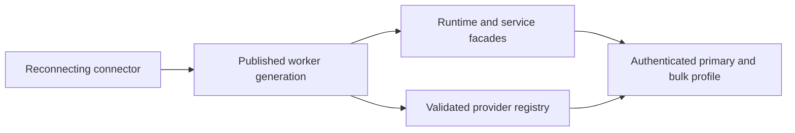

# Executor Compatibility

Operational contract for the method-version cutover. This supersedes both
package/revision equality and the intermediate all-application-in-core-1 model.

## Compatibility Rules

- Bootstrap 1 contains connection mechanics only. Every RPC and CLI operation
  has a named version, introduced at v1. Event and shared resource contracts
  cover their actual cross-operation guarantees. Package versions, build age
  and Git ancestry do not establish compatibility.
- Offers derive from executable registrations. Discovery retains every common
  exact version; requests name the version they use. There is no connection
  default, highest-version assignment or fallback after dispatch. Unknown
  well-formed names grant no authority; `[1, 3]` never implies version 2.
- Before admission, callers and receivers check the selected definition's flat
  requirements. Workflow owners also check request-specific endpoint, history,
  cleanup and control requirements before effects. Missing support disables
  only affected operations, not independently usable Files, Git or terminals.
- The role-bound authenticated handshake covers the raw hello frames and decision.
  No application setup occurs before agreement. Bulk inherits primary's profile.
- Retained replies, producer frames and launch outcomes belong to one controller
  runtime, worker runtime, executor and profile. A new continuity starts fresh.
- Pending/late calls and journals capture their exact codecs and policy. Resource
  creators capture their notification codecs before dispatch/emission; consumers
  compare the actual resource's semantic contract, not creator-method versions.
- Provider facets, host services and grants remain independently enforced.



Same-worker reconnect preserves facades and initialization. A replacement worker
gets fresh objects and may change membership, descriptors, facets and settings
schemas. Old references, delayed cleanup, waiters and catalog completions never
retarget it. Unsent held work may fail with `STALE_RESOURCE`; sent mutations keep
their actual or unknown outcome. There is no automatic mutation resubmission.

## Settings And Cleanup

Saved settings are not converted or reset. Execution parses them against the
captured provider's current schema before provider effects. An incompatible
scheduled, interactive, CLI or agent-command operation fails without rewriting
its saved envelope. Definition-only edits remain possible offline. Exact command
replay precedes readiness and settings validation.

Settings snapshots distinguish literal absence (`null`) from an actual empty
schema-1 envelope. Absence uses current provider defaults when consumed; old or
newer incompatible envelopes remain preserved/read-only. Partial provider edits
require the rendered ownership epoch, executor instance and settings schema.
Stale edits fail before effects and preserve the draft. A successfully applied
native edit is not relabeled as non-dispatch if its generation subsequently retires.

Deletion records raw native identity and saved settings, including explicit null,
without execution parsing. Native release stays pending while the current provider
or its release facet is unavailable. Null resolves to captured defaults only for
that release attempt, never in durable storage. Existing non-null journal entries
remain valid without conversion.

## Deployment

1. Back up durable controller and provider storage; drain active work.
2. Stop and update controller, workers, CLI and browser together for the initial
   cutover. Preserve enrollment/configuration, settings and transcripts. There is
   no pre-cutover compatibility mode or conversion pass.
3. Confirm primary/bulk readiness, credential grants, CLI forwarding and fresh
   execution in the configured dial direction. Inspect bounded last-error/log
   codes for bootstrap, profile, unsupported-operation, stale-generation or settings failures.
4. After baseline publication and mixed-artifact qualification below, later
   controller upgrades may leave compliant workers running. Drain first;
   graceful shutdown still requests native aborts. Queues, command ledgers,
   permissions and active-turn ownership restart empty. Surviving worker PTYs
   remain usable; fresh CLI invocations discover the new controller.
5. After a crash, native work may survive. Busy protection and explicit Reload
   remain the recovery path. Transparent active-turn adoption is not supported.

Rollback across the initial cutover requires a matching pre-cutover binary set.
Older binaries cannot read newly written null delete references. Finish pending
cleanup or restore a consistent checkpoint before rollback; never delete pending
references to force startup. Wire rollback does not reverse other storage changes.
Incompatible workers do not block healthy executors or controller-only actions.

## Evolving Contracts

Every RPC, CLI operation and producer/terminal event has an explicit versioned
owner. Rendered-message vocabulary belongs to its consuming row/history contracts,
not bootstrap. Unknown critical producer events fail their binding; unreadable rows
produce a gap; unknown error domains/codes remain protocol faults.

Frozen bootstrap envelopes and errors live in `fixtures/bootstrap-1-*.json` under
`server/remote/transport/__tests__/`. `fixtures/contracts/<name>@<version>.json`
freezes each operation's expanded payloads, requirements and policy; runtime
fixtures retain behavioral examples. The literal `released-contracts.json` list
is independent of registry enumeration. Shared `common/` and internal aliases
are safe only while those boundary shapes stay unchanged.
Fixtures are tripwires, not proof of semantics. Never regenerate released
fixtures to bless drift. A breaking application change needs a new version of
the affected operation and a faithful old implementation when still advertised.
Review outcomes, defaults, authority, lanes, CLI status and retry behavior too.
Changing only `files.read` must not version `files.list`, Git or terminals.

Examples:

- [#924](https://github.com/cfal/garcon/commit/8e8a956185a64fc90dc61d013d9ba11e33d281a8): an internal rename may retain a stable serializer.
- [#947](https://github.com/cfal/garcon/commit/c9c4572add7c4b1d18efbc0470ab0e2cee90039e): removing Git summary values requires retaining their real computation or changing the contract, not fabricated values.
- [#937](https://github.com/cfal/garcon/commit/ce0078c80ef86f1bdc4e1e9f05d98c055db9cf54): each schedule HTTP operation has its own explicit v1 contract and absence behavior; definition-only edits do not require an execution target to be ready.
- [#928](https://github.com/cfal/garcon/commit/95d64f840c57efdda19b410a701169e61c2fc6f7): a union or safety-limit change needs a faithful old projection or a new affected operation version.

Only incompatible connection mechanics require a bootstrap change. No mandatory
deprecation release or directional revision floor is imposed. A security withdrawal
is explicit operational policy, not compatibility inferred from version ordering.

### Maintenance Checklist

1. Classify the observable change before editing the contract. Versions cover
   requests, results, errors, defaults, limits, authorization, lane/continuity,
   ordering, outcome and retry meanings, and resource cleanup guarantees.
   Internal refactors may preserve a version; even an added field or union member
   can break a strict old decoder. Trace shared DTO changes through every consuming
   contract. Introduce a new version only where the existing promise changes.
2. Update the complete implemented boundary. Definitions live in
   `common/{protocol-contracts,executor-contracts,cli-contracts}.ts`; RPC codecs and
   registration helpers live in `server/remote/transport/`, with implementations
   under `server/remote/{client,server}/`. Check role composition in
   `server/controller/executors/controller-contracts.ts` and
   `server/remote/server/worker-contracts.ts`. For CLI changes, include route-backed
   registration in `server/controller/lib/cli-contracts.ts`, direct HTTP, client
   discovery/selection, the gateway, and controller dispatch. A declaration alone
   must never advertise an implementation. Retain a faithful old implementation
   while advertising its version; otherwise advertise its absence.
3. Preserve admission and ownership. Resolve exact-command replay before fresh
   support checks; a reopened pre-schedule failure is a fresh admission attempt.
   Include request-dependent endpoint/history requirements before command
   acceptance, dequeue, or other effects. Creators require their cleanup/control
   operations, such as terminal create/terminate or history open/next/close.
   Resource consumers check the captured resource contract, not its creator's
   method version. Keep late results, events, cleanup, and reconciliation bound
   to their original codecs and worker generation.
4. Add evidence without rewriting the old promise. Preserve released fixtures and
   add fixtures for new versions. Test a reduced registration that refuses the
   affected operation before dispatch and at the receiver before effects, while
   an unrelated operation still succeeds. For changed version dispatch or resource
   semantics, test old/new codecs, retained ownership, and incompatible resources.
   Run affected direct/forwarded CLI and both-dial-direction workflows. Use the
   artifact matrix below before claiming cross-release compatibility; synthetic
   v2 handlers and A/A runs prove different, narrower properties.

### First Multi-Version Operation

Production currently implements v1 only. The exact-version wire dispatcher is
multi-version capable, but its higher-level operation projections are not a
complete production multi-version adapter:

- `common/executor-contracts.ts` defines `ExecutorOperation` from `RPC_V1`, derives
  `supportedExecutorOperations` from that inventory, and declares v1 workflows.
- `server/controller/executors/manager.ts` checks published operation names;
  `server/controller/agents/execution-support.ts` builds name-based requirements.
- `common/executors.ts` projects v1 execution support for the paired browser.
  CLI route registration and client selection also have explicit v1 owners.

When a real v2 is needed, audit these consumers alongside the new codecs. Choose
implemented exact contracts inside the owning adapter before effects, then derive
availability from the workflow that adapter can actually execute. A logical
operation-name projection may remain name-based; it must not claim support merely
because some version with that name exists. Do not teach UI components to choose
wire versions or implement speculative production v2 adapters to prepare for this.

### Complexity Boundaries

Keep unconditional wire prerequisites in contract definitions and conditional
requirements in the existing workflow owner. Reuse named flat lists where they
express the same guarantee; do not add a dependency solver or another registration
framework. Browser checks improve feedback but do not replace server admission or
receiver enforcement. Avoid reproducing request-specific admission logic in UI.

Best-effort behavior belongs at optional feature boundaries: report unavailability
and preserve user selections/drafts while unrelated services continue. It must not
mean empty-success responses, lost critical events, substituted settings, missing
cleanup, or version fallback after an operation may have executed.

## Acceptance And Releases

`bun run --cwd integration-tests test:compatibility` runs serial real-process
controller/worker/CLI checks in both dial directions. Each controller is driven
by its own artifact's parsers through the frozen test-only JSON protocol in
`compatibility-contract.ts`, including auth seeding and login. The orchestrator
passes credentials, not tokens or private auth files. HEAD's browser parsers never
drive an old controller. The contract also names the frozen process launch and
readiness signals used by the orchestrator.
The frozen driver also depends on `cli/main.ts`, `--config-dir`/`--runtime`,
`list agents --executor --json`, `start --agent shell --model sh --executor --cwd --json`,
and `schedule create/show/delete` with `--definition`/`--expected-revision`/`--json`.
Their JSON results retain `agents[].id`, `receipt.chatId`, `scheduledPrompt.id`,
and `revision`. The production `shell` agent's `sh` model and
`GARCON_TERMINAL_SHELL` remain available. Restart checks capture CLI context with
each artifact's own discovery code and read that opaque context with the same
artifact after restart, for both direct and gateway access.
Separate installations own dependencies and generated outputs. Synthetic changed-
inventory workers inject integrations through production worker composition,
without protocol-offer overrides or a production CLI mode.

The cutover is artifact A. `integration-tests/compatibility/baselines.json`
explicitly marks bootstrap for package 0.3.4: A/A evidence only. It also tests
worker membership/facet/schema replacement against a continuously running controller.
Do not describe bootstrap artifact evidence as mixed-build evidence. Reduced
registrations and test-only versions establish partial-support behavior separately;
they are not production offer overrides or speculative production v2 codecs.
The first release has only A/A artifact evidence. A source-distinct successor B
must pass mixed-artifact qualification before release, including Docker `:main`
and `sha-*` distributions. The bootstrap package-version expiry is an additional
guard, not qualification of intervening builds or a product compatibility mode.

Immediately after merging the validated cutover, a release maintainer checks out
that exact merged commit with a clean tracked tree and Bun 1.4.3, then runs:

```sh
bun integration-tests/compatibility/archive.ts "$HOME/tmp/executor-contracts-v1-source.tar.gz"
```

Publish that source archive and printed SHA-256/source/Bun/lockfile metadata as
durable release assets under `executor-contracts-v1-baseline` in `cfal/garcon`. This is
a maintainer operation; read-only CI has no release-write credential. Archive
generation uses committed source, never untracked design documents or installed
dependencies. Keep the official Linux x64 Bun archive and its digest pinned too.

Publish and pin A as the immediate follow-up to the cutover merge; do not wait for
the next package-version bump. Change the manifest to
`stage: "cross-build"`, remove `bootstrapPackageVersion`, and add A's `sourceSha`,
`archiveUrl`, `archiveSha256`, both `lockfiles` digests, and `runtime` version/URL/
digest. The matrix then runs A/A, B/B, A/B and B/A in both directions, both CLI
artifacts directly and through each gateway, rendered output rows, controller-only
upgrades with retained PTYs, and worker A-to-B-to-A replacement while each A or B
controller stays running. Catalog instance identity, the production `shell` agent,
and fresh supported workflows are checked after every worker replacement. Missing,
corrupt or same-revision baselines fail rather than silently falling back to HEAD.
Require this matrix before claiming compatibility for a source-distinct build B.

The dedicated `executor-compatibility` CI job is required by the server aggregate;
failure, cancellation or an unintended skip fails that aggregate. Drivers report
executed and intentionally unsupported workflows separately with the observed
catalog. Expected absences must be explicit; arbitrary skips cannot pass a scenario.
Source archives
prove source-process interoperability, not standalone packaging: run official
Linux `build-exe` smoke before claiming compiled-binary coverage.
