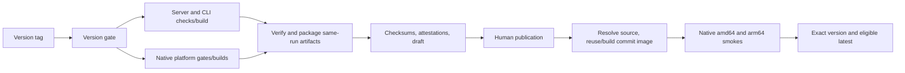

# Releases

The release flow follows Shoes: a committed version bump, an external version tag,
CI-built draft, human publication, then Docker promotion. CI never bumps versions,
creates tags, or publishes the draft. Numeric `MAJOR.MINOR.PATCH` versions only;
native prerelease package versions have not been qualified.



## Prepare And Rehearse

1. Update root `package.json`, `native/package.json`, and the native Cargo package
   version together. Regenerate `bun.lock` with `bun install --lockfile-only` and
   the local `garcon-native` Cargo lock entry with
   `cargo update --manifest-path native/src-tauri/Cargo.toml -p garcon-native`.
   Leave unrelated workspace/dependency versions untouched. Tauri continues
   reading `../../package.json`.
2. Run `bun run release:check`, frozen installs, `bun run check`, and
   `bun run test`. Review and merge the preparation PR. Require green main CI,
   including integration/browser workflows, before tagging. The release job
   repeats server/CLI/web checks and all native gates, but does not query or
   duplicate every independent integration workflow.

   Release assembly tests require `git`, `zip`, `unzip`, `tar`, and `sha256sum`,
   provided by the Ubuntu CI runners.
3. Optionally dispatch **Build Executable** against the preparation branch.
   This builds and assembles the full `release-candidate` CI artifact without
   publishing or attesting a release. No signing secrets are used. This is the
   safe hosted-platform rehearsal before tagging.
4. Once the merged source is green, create an annotated tag on that exact commit:

   ```bash
   git tag -a v0.4.0 <full-green-main-commit-sha> -m 'Release v0.4.0'
   git push origin v0.4.0
   ```

   The workflow files must be merged before the tag: GitHub uses the tagged
   revision's workflow definitions. Never move or reuse a published version tag.

## Inventory And Verification

The draft contains exactly 12 assets:

- Three ZIPs: Linux x64 server, Windows x64 server, Linux x64 CLI. Each contains
  its versioned executable and LICENSE. Windows server runtime is unverified.
- Six `garcon-native-preview-v<version>-<platform>.zip` files: Linux x64
  (`.deb` and AppImage), Windows x64 (NSIS), macOS arm64 and x64 (DMG), Android
  (universal build-only debug APK), and iOS simulator (original `.app.zip`). Each
  retains its original distribution manifest and LICENSE. iOS is not universal
  or device-installable. There is no AAB, device IPA, or Windows standalone CLI.
- `garcon-v<version>-source.tar.gz`, archived from the captured commit including
  tracked lockfiles, scripts, and license, not from a dirty working directory.
- `release-manifest.json`, recording source repository, commit, version, tag,
  payload sizes/hashes, and preview target identities.
- `SHA256SUMS`, covering the other 11 assets after final packaging.

All 12 final files receive GitHub build provenance attestations. Attestations
are stored by GitHub, not added as a thirteenth asset. Download all assets into
an empty directory and verify:

```bash
gh release download v0.4.0 --repo cfal/garcon --dir ./garcon-v0.4.0
cd garcon-v0.4.0
sha256sum --check --strict SHA256SUMS
for asset in *; do gh attestation verify "$asset" --repo cfal/garcon; done
```

Native status remains [preview-only](../native/PLATFORM_READINESS.md).
`distribution release` still refuses every target. Extraction is required before
installation; restore AppImage executable permission with `chmod +x`. Unsigned
desktop packages can be blocked by OS security policy. Android keys are ephemeral,
connections are disabled, and upgrade continuity is not promised. iOS is simulator
launch/relaunch evidence only. Checksums and provenance do not confer signing,
notarization, reproducibility, or real-device/workflow qualification.

## Publish And Recover

Review generated notes, every preview warning, the source identity, and all CI
results. Publish the draft manually through GitHub or an authenticated human
`gh release edit v0.4.0 --draft=false`. A workflow using its own `GITHUB_TOKEN`
must not be relied on to trigger downstream release workflows.

Wait for **Publish Docker Image**. It verifies the current release and live tag
against `release-manifest.json`, preserves the selected commit image, runs both
architecture smokes, and assigns the exact version alias. A different existing
version digest fails closed; a matching one is a no-op. Only GitHub's current
latest non-prerelease release advances `latest`. Published download assets are
never modified to add Docker metadata; use the workflow summary for the digest.
See [Docker tags and deployment](docker.md).

The publisher deliberately refuses **any** existing release, draft or published.
Failed builds can be rerun normally before a draft exists. If upload fails after
creating a draft, inspect and explicitly delete only that unpublished draft before
rerunning the publisher; it never silently replaces reviewed notes or assets.
Never delete a published release to retry. A moved/deleted tag, API failure, or
source mismatch blocks publication/promotion.

Do not publish while the workflow is still uploading. Release-state checks and
asset uploads are not atomic. Configure a repository tag ruleset blocking `v*`
updates/deletions and immutable published releases where available. These are
repository settings, not protections this workflow can enforce. Docker aliases
are likewise immutable only by workflow policy; use digest-pinned deployments.
