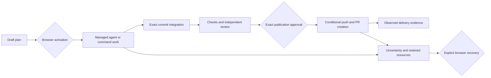

# Workflow Execution Contracts

Workflows is an opt-in delivery engine, disabled by default. Production composition
connects durable plans and attempts, managed repository preparation, exact Git
integration, checks, approval gates, PR creation, explicit recovery, and the
workspace surface. Ordinary chats do not depend on workflow storage. Worktrees
and approval gates are trusted-workspace coordination, not an OS sandbox.

## Operation And Authority

Enable Workflows in settings, then open its workspace surface. A Captain or the
JSON plan editor can create and stage plans without executing them. Activation
requires a current authenticated browser session and the exact displayed manifest.
An active plan and a proposed revision remain separate until activation. The
surface provides graph/list, attention, activity, task history, evidence, worker
chat navigation, and the exact publication manifest with a lazy Git diff.
History remains independent of current-plan membership: removed tasks and older
attempts retain their exact inspection and recovery controls.

Local CLI capability and delegated executor CLI authority allow reads, drafts,
staged plans, Pause and Stop. Activation, approval, resume, retry, resolution,
cancellation, archival, publication recheck and cleanup are browser-only. These
actions remain unavailable on auth-disabled deployments; a local principal is not
treated as an operator browser. Worker permission decisions also require browser
authority. Workflow workers are ordinary chats with automation/attention-only
presentation and disabled in-band delegation. The Automation chat filter remains
available independently of workflow storage.

Every mutation carries a principal/payload-bound operation ID. Recover a lost
response with that same ID and payload, not a newly generated operation. Current
authorization is checked before retrieving the saved result. Receipts establish
that a decision was recorded, not that an external effect completed. Resource
operation status is displayed separately.
The browser retains an unconfirmed request in session storage. Explicit local
dismissal archives its identity and unblocks unrelated decisions without replaying
or canceling the server operation; the unconfirmed-outcome warning survives reload.

Reads are bounded separately: `/detail` returns the overview, `/plan` an exact
immutable revision, `/gate` the approval and evidence summaries, and `/attempt`
the exact historical task, attempt, evidence and resource operations. Artifact and
attempt history use byte-limited pages; a nonempty short page does not mean history
has ended. Full evidence remains available through `/artifacts`.

Pause and disable stop new effects while admitted work drains. Stop revokes
automatic attribution and requests exact-turn interruption; it does not prove a
disconnected process stopped. Re-enabling the feature does not silently resume
old intent: browser Resume authorizes the current admission epoch. Uncertain
effects, intervention holds and quarantined resources survive restart and never
authorize automatic replay. Recovery remains available while admission is disabled.

## Repository Inputs

Every repository target declares its executor, existing clone, logical repository
identity, approved root commit and explicit managed `worktreeRoot`. The root must
already exist outside a Git checkout and use the executor's canonical path spelling. Paths
are interpreted and checked on the selected executor, including Local.

Agent and command targets also declare `inputTaskId`, either null to start at the
approved root or a direct dependency that produces a commit. Reservation selects
exactly one current, passing, clean, runtime-observed or explicitly adopted commit artifact from that
dependency. The plan keeps its root commit; the attempt binds the selected commit.
The input digest includes the dependency artifact identities and digests. Missing
or ambiguous evidence blocks admission rather than choosing an arbitrary SHA.
Publication selects its input through `sourceTaskId` with the same exact-artifact
rules; it never checks a source review against the plan's older root commit.

Preparation verifies ancestry to the approved root, persists an operation intent
and exclusive resource claim, then creates a new managed branch/worktree through
the selected Git runtime. The clean creation identity, runtime instance and tree
are retained. Unknown creation quarantines its resource and is never replayed.

Input selection loads the exact artifact's producing attempt and retained managed
identity, never an independently selected latest attempt. An accepted artifact's
commit is the transfer source; its managed target's HEAD records creation input,
not output. Producer artifacts, attempts and claims remain unchanged by consumers.

Transfer mode follows approved coordinates: identical executor and clone path
require the object to be present already. Different coordinates, including two
clone paths on one executor, require approved remote writes and identical remote
URL strings. Inspection errors never trigger a fetch fallback. Linked worktree
paths with different approved spelling also use this conservative rule.

Cross-clone preparation rechecks the retained source marker, clean output, tree
and runtime instance. Source drift or restart holds the consumer for operator
resolution without spending admission retries or rewriting provenance. Same-clone
reuse verifies the exact object and ancestry on the destination, so a producer
runtime restart alone does not block it. Both endpoint intents persist before a push.
Transfers use unique `refs/heads/garcon/transfers/<uuid>` branches, exact-SHA pushes
conditioned on absence, and source-only fetches without moving destination refs.
Remote names are endpoint-specific; runtime primitives verify directional URLs.
Push claims identify the remote URL/ref and actual source executor; fetch claims
identify the destination executor/clone/ref. No consumer claims the source worktree.
Lost replies quarantine consuming resources without replay; successful earlier
pushes remain retained when a later fetch fails. Transfer-ref cleanup is deferred.
Creation, push, fetch and integration calls pin their observed runtime at mutation
admission, rejecting replacement instances before effects. Recovery distinguishes
an unstarted task from potentially executed repository preparation in its detail;
uncertain preparation remains quarantined and blocks retry.

## Ordered Integration

Integration selects inputs in declared order. All sources share the approved
logical repository and root commit. Plans are capped at 15 inputs, allowing at
most two transfers per input plus creation and integration within the 32-operation
budget. Operation count and anticipated metadata are checked before remote writes;
planned operations reserve bounded result space, and runtime limits remain hard
guards. Source pushes remain subject to runtime mutation admission; workflow
attempt-capacity accounting is destination-based.

Integration creates a fresh managed worktree at the approved root. Its immutable
intent contains the exact request, runtime/resource identity, ordered artifact
identities and a manifest digest. The request's operation ID is the creation marker,
distinct from the integration intent ID. Preparation allocates no chat, turn or
effective chat input. Attempt and intent advance to dispatching atomically before
one `integrateCommits` call. No new scheduler or receipt store is involved.

Successful integration requires read-only verification of the exact returned HEAD,
clean managed identity and ancestry of the root and every input, with stable
managed snapshots around the reads. One runtime-observed commit artifact settles
atomically through the shared evidence transaction. Integration evidence has its
own manifest/lineage variant, no fabricated chat digest or complete-log coverage.
Fast-forward and no-op results are valid. Conflicts are definite failures with
bounded diagnostics and a retained worktree. Integration never automatically
retries; explicit new-generation retry creates a fresh worktree. Repair/reuse is
deferred.

Pause and feature-disable block the next effect but let a dispatched merge vector
drain and settle. Stop revokes attribution and cancels observation, not a merge
already dispatched; shutdown can interrupt the call with an unknown result. There
is no automatic merge abort, rollback or replacement. Restart before dispatch
records non-execution; any possibly dispatched merge without committed evidence
remains unknown and requires resolution.

## Evidence Acceptance

An exact terminal first records bounded execution facts. Its runtime identity
comes from the matched producer binding, not current executor discovery. That
identity is process-local command metadata; no execution attribution is added to
durable transcript rows. Missing runtime identity cannot certify workflow output.

Read-only output capture runs after core execution ownership releases and while
the automation control lease remains held. The adapter checks managed ownership,
HEAD, cleanliness, raw commit identity and input ancestry. Final acceptance
rechecks current generation, dependency artifacts, holds, resource ownership,
persisted control and live revocation/shutdown fences in the same transaction as
evidence, resolution and claim settlement. Pause and feature-disable do not
prevent already-admitted work from settling. Stop, takeover and stale generations
cannot become automatic success.

Command evidence evaluates the persisted structured outcome, not receipt success
or assistant text. Passing requires the expected exit code, no signal, the exact
reported managed directory and a clean unchanged input. Shell reports its final
directory; the captured effective input identifies its launch directory. A full-log
check additionally requires complete executor capture and controller delivery.
Explicit exit-status-only checks may tolerate missing logs but retain that
disclosure. A known wrong exit or signal remains failure when logs are incomplete;
missing required observations remain unknown and are not automatically retried.

Agent commit outputs come only from the observed clean HEAD and must advance the
input commit with verified ancestry. A completed turn with no new commit fails.
SHA strings in prose do not establish output identity. Summaries and review
verdicts remain agent-asserted. Reviews leave the selected input unchanged and
return one bounded JSON object with exactly `commit`, `decision` (`accept` or
`reject`) and `summary`; the reported commit is compared with the independently
observed input. These instructions are composed before effective-input hashing.
Reviews cannot also produce a commit. Review/approval dependencies constrain
existing inputs, not commits that a future producing task has not created yet.
Independent reviews select the same repository, approved root and input task as
their consumers. Gates are checked before dispatch and again at acceptance.
Rejected reviews do not automatically retry; another review requires an explicit
operator decision. Commit-output instructions require a clean commit on the
current branch. An empty commit advances HEAD and can satisfy commit presence;
content quality remains the responsibility of declared checks and review.

Evidence records endpoint observations, not continuous filesystem isolation.
Ignored files, environment/toolchain changes, hooks, custom merge drivers and
same-account background writers remain trusted. A clean before/after pair does
not prove the filesystem was unchanged throughout execution. Complete logs remain
in ordinary chat storage; bounded workflow evidence survives independently of
transcript navigation availability.

## Explicit Recovery

Resolution names an exact attempt and generation and records operator evidence.
An old generation cannot clear a newer task's hold. Confirmed non-execution and
abandonment are distinct decisions; risk release is a capacity waiver, not proof
of termination or permission to remove a resource.

Commit adoption independently inspects the requested full SHA, clean managed
identity and ancestry on the recorded executor. It requires a current, latest,
settled agent attempt with an observed terminal and no unsettled resource effects.
Only commit output and an optional operator summary can be adopted. Missing
command results, review verdicts or log coverage cannot be manufactured through
free-text evidence. Read-only recovery may observe a replacement runtime while
checking persistent repository and marker identities. Original mutation bindings
are never rewritten or sent again.

Accepted artifacts are marked `operator-attested`, with their adoption operation
and observation identity. The original attempt result, execution certainty,
coverage and revocation history remain unchanged. Downstream selection validates
this explicit provenance; it does not accept arbitrary operator text as a commit.

Publication recheck is an explicit browser operation with its own durable receipt
and at most five reads. It inspects the frozen original create intent, including
after replanning or a runtime restart. A matching open PR is recorded on the
recheck intent, preserving the original create record; accepting the task requires browser adoption
against the current approved inputs. Empty, incomplete, conflicting, closed or
changed results do not authorize another push/create. Replaying the same recheck
ID does not reset its budget or start another activation. A new publication after
failure requires replanning with a fresh branch and approval, not task Retry.

## Managed Cleanup

Cleanup is explicit and browser-only, per recorded resource, after archival or
cancellation. It requires settled writers and a retained, unquarantined resource;
capacity risk release does not satisfy this condition. The operator confirms the
exact current HEAD. Removal rechecks marker, repository/worktree identities,
branch, HEAD and cleanliness under executor repository coordination.

The runtime conservatively refuses removal while native admission, known
uncertain native work, running provider sessions, PTYs or in-flight Files mutations
exist on that executor.
Its removal reservation prevents new native admissions, PTY creation and Files
mutations until the call settles.
PTY exclusion lasts until observed native exit, not removal from the visible list.
Stop and unknown native outcomes conservatively block cleanup for the runtime's
lifetime because logical turn completion does not prove native quiescence.
Failed provider turns also block cleanup unless a structured command outcome
confirms exit; providers can publish a failure before native teardown completes.
Cleanup also refuses a replacement runtime: read-only inspection cannot establish
that prior ordinary native writers stopped. These rules can block cleanup because
of unrelated work; manual recovery may be needed. External same-account writes
remain outside this exclusion; cleanup is not a filesystem sandbox.
An idle provider can retain background tool processes, and detached jobs can
outlive a PTY. The provider contract does not enumerate these processes. Operators
must stop such background writers before cleanup; a finished turn alone does not
establish that they stopped.

Removal is non-force and retains the branch, marker, artifacts and history. Git
cleanliness ignores ignored files: removal can delete ignored `.env` files and
build output, which the browser confirmation discloses. A successful removal
retires only its exact claim. A lost reply leaves that claim quarantined and is
never replayed by path or inferred successful solely from absence. Cleanup
attention does not downgrade an already delivered task. Automatic retention,
branch/transfer-ref deletion and orphan process recovery are not implemented.

## Scope

The initial product supports artifact and PR-open goals using existing executor
clones. It does not merge PRs, provision repositories/containers, autonomously
repair plans, maintain stacked PRs, or integrate Slack/Linear/MCP intake. Those are
separate roadmap increments. A Captain can propose a repair, but its new scope
requires browser activation. No durable core queue or command replay is added.

The workflow store format is version 2. Earlier development stores are rejected
without migration or rewriting; adding explicit roots is an approval change, not
a value the controller can infer for an existing plan.
