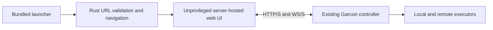
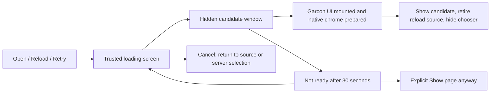

# Garcon Native Preview

Tauri 2 client for the existing Garcon web application. Bundle identifier:
`com.garconcloud.garcon`.

This first milestone establishes native packaging and CI. It bundles only the
server-entry page, not `web/build`, Bun, providers, or a local execution runtime.
The selected server serves the existing UI and owns all execution. Its **Local**
executor is local to that server, not the phone or desktop client.

**Android is currently build-only:** its APK displays the launcher but the Rust
host disables server connections. Android's navigation callback does not cover
POST forms or their method-preserving redirects. A tested native request guard
is required before enabling remote pages. **iOS retains its existing confined
single-WebView connection flow**, without the new switcher capability. The
desktop chooser uses separate native windows; it is not assumed to work on
mobile. iOS recovery still requires exiting and reopening the app, and its
interaction behavior remains unverified without a simulator/device. See
[platform gates and the pinned Android blocker](PLATFORM_READINESS.md) for the
regression harness, distribution preflight, and readiness matrix.



## Run

Install the [Tauri prerequisites](https://v2.tauri.app/start/prerequisites/) for
the target host, then from the repository root:

```sh
bun install --frozen-lockfile
bun run --cwd native tauri dev
```

`bun run --cwd native tauri dev --release` optimizes the Rust host while retaining
Tauri's development server for the launcher. Packaged builds use embedded assets;
both modes retain the launcher's origin and route restrictions.

The CLI builds the launcher and generates platform icons from the existing Carbon
brand asset. No frontend dev server is required. Enter the complete deployment
URL, such as `https://example.com/tools/garcon/`. Every cold app launch returns to
the chooser with the last URL filled in; it never connects automatically.
Use the server's **base URL**, not a chat, login, or share URL. The first accepted
connection attempt reserves that origin's mount, even if the server fails to load.
Correcting an incorrect mount later requires a different hostname or resetting
all app data, including credentials and drafts.

On desktop, **Open server** always creates a new window, even for a server that
is already open. Other windows remain alive with their drafts and connections.
An optional name is saved with the URL and used as `<name> — Garcon` in the new
window's title. Without a name, the title is `<hostname> — Garcon`, excluding
the port and mount path. Removing a name restores the hostname fallback.
Windows for the same origin share login and browser storage, like browser tabs;
they are not separate accounts. Different origins retain their own storage.

Both release and development builds accept HTTP and HTTPS on any hostname or
IPv4/IPv6 address, including LAN and VPN servers
(for example `http://garcon.vpn.test:3001/` or `http://100.64.0.2:3001/`).
The chooser shows a red warning beneath HTTP URLs without blocking connection.
HTTP itself is unencrypted; use HTTPS unless the network or VPN is trusted.
HTTPS still requires valid certificates. A phone's localhost is the phone,
not the development machine. The shared Apple `Info.plist` permits HTTP in
WebView content via `NSAllowsArbitraryLoadsInWebContent`, not a general native
networking exception. Apple runtime verification and App Store justification
remain platform/distribution gates. No certificate bypass, native HTTP bridge,
or controller CORS change is introduced.
Android's upstream debug template permits cleartext subresources platform-wide;
the launcher's URL admission rule is not a network-wide restriction, and Android
server connections remain disabled.

## Builds

Run these commands inside `native/`. Rust builds should set `CARGO_BUILD_JOBS=1`.

```sh
# Desktop, on the corresponding operating system.
bun run tauri build --ci --no-sign -- --locked

# Android, with platforms;android-37.0, build-tools;37.0.0, NDK 29.0.13846066, JDK 25.
export NDK_HOME="$ANDROID_HOME/ndk/29.0.13846066"
rustup target add aarch64-linux-android x86_64-linux-android
bun run build
bun run tauri android init --ci --skip-targets-install
bun run tauri android build --ci --debug --apk --target aarch64 --target x86_64

# iOS simulator, on an Apple Silicon macOS host with full Xcode.
rustup target add aarch64-apple-ios-sim
bun run build
bun run tauri ios init --ci --skip-targets-install
bun run tauri ios build --ci --debug --target aarch64-sim --no-sign
bun scripts/archive-ios.js
```

The Android APK is in
`src-tauri/gen/android/app/build/outputs/apk/universal/debug/`. It includes arm64
and x86_64 code. Debug keys generated on ephemeral runners are not stable release
keys; a later APK may require uninstalling the earlier one, losing app-local data.

The iOS simulator artifact is `artifacts/Garcon-simulator.app.zip`. It is **not an
iPhone-installable IPA**. Device signing and TestFlight/App Store uploads are
deferred. Hosted macOS runners provide the required Xcode machine; no personal
Mac is required. iOS supports 17.4+, matching the web app's declared WebKit floor;
macOS is conservatively set to 14.4+.

Generated mobile projects and icons are ignored. CI generates them from a fresh
checkout using pinned CLI 2.12.4. Do not hand-edit `src-tauri/gen/`: changes will
not survive a fresh build. If native platform customizations become necessary,
move them into supported configuration/templates or deliberately start tracking
the generated project. Re-running `init` is not a full refresh of existing files.

## CI

`.github/workflows/native-app.yml` runs on relevant pull requests/main changes,
manual dispatch, and reusable calls from the tag-triggered executable workflow.
It does not publish releases or use signing secrets. Its artifacts are:

- Linux x64: `.deb` and AppImage, built on Ubuntu 22.04.
- Windows x64: unsigned NSIS installer.
- macOS arm64 and x64: unsigned/unnotarized DMGs.
- Android: build-only debug APK for arm64 and x86_64; connections disabled.
- iOS: unsigned simulator `.app` zip matching the runner architecture.

The [release workflow](../docs/releases.md) attaches all six targets as separate
`garcon-native-preview-*` ZIPs, each containing its original package(s), blocker
manifest, and license. Hosting these previews does not change their qualification
or enable `distribution release`. Extract before installing; AppImages need
`chmod +x`. macOS Gatekeeper can block unsigned/unnotarized DMGs; these are not
represented as end-user-ready installers.

The workflow pins Rust, Bun, Tauri, SDK/NDK selections, and dependency lockfiles.
Runner images, Xcode, and the emulator's system WebView can still change.
Build Tools 37.0.0 is installed for APK verification; Gradle's pinned plugin owns
the build tool selection. Build success does not establish store acceptance or support for every
older WebView. Linux runtime WebKitGTK must support the existing web application.
Unsigned desktop packages may trigger OS security warnings or be blocked.

## Validation

```sh
bun run test
CARGO_BUILD_JOBS=1 bun run --cwd native test:host
bun run --cwd native tauri build --debug --no-bundle -- --locked
cargo install tauri-driver --version 2.1.0 --locked
xvfb-run -a bun native/scripts/smoke-x11.js
```

Build the launcher with `bun run --cwd native build` before running Rust checks
from a clean checkout. Linux smoke tests need `webkit2gtk-driver`, `xvfb`,
`xauth`, `openbox`, `xdotool`, `openssl`, and `curl`. The X11 wrapper starts and
stops its own window manager on the dedicated Xvfb display; bare Xvfb cannot
exercise raising an already-mapped chooser. On an existing desktop, run
`bun run --cwd native test:smoke` directly. Keyboard checks use OS-level input;
WebDriver DOM key events are not proof of native menu activation. Tests use
isolated app data and synthetic servers, never an existing
user server. The real native WebView is tested for launcher rendering, root and
mounted URLs, bearer HTTP and WebSocket transport, remote command denial,
navigation confinement, saved selection, and sibling-mount rejection.
External-link checks register an isolated synthetic HTTP/HTTPS application,
verifying OS dispatch without opening the user's browser or contacting external
sites. The smoke runner honors `CARGO_TARGET_DIR`, `GARCON_NATIVE_SMOKE_TMP`, and
`TMPDIR`. Root/mount fixtures also check trusted pointer/keyboard activation,
file-input assignment, multipart upload bytes, shared clipboard copy/paste, focus,
OS-level Ctrl+C/Ctrl+Z delivery to page key handlers, and unchanged socket count,
both initially and after replacing a remote window.
Set `GARCON_NATIVE_SMOKE_HOST` to an IPv4 address assigned to the test machine or
a hostname resolving to it to exercise HTTP beyond `localhost`;
fixtures still bind `0.0.0.0`.
Set `GARCON_NATIVE_SMOKE_PROFILE=release` to exercise an already-built release
executable instead of the default debug executable.
Open/cancel and same-window page reload are exercised across eight further reloads
for each root/mount fixture, requiring a fresh chooser-open event rather than
accepting stale hidden-page controls. Managed Reload additionally checks source-only
replacement, route/query/fragment retention, titlebar state and saved-name ownership.
Slow and failed loads exercise the trusted loading controls, retry and cancellation.
Linux installs its titlebar recovery button without a menubar. Windows retains
a hidden platform menu, detached before window destruction; no custom recovery
accelerators are registered. macOS retains its app-wide menu. The isolated Linux test environment
shares only system icon and MIME-type resources, not user application associations.
These checks do not qualify the OS file chooser or a real Garcon terminal session.
The Linux WebDriver probe emitted cancellation without presenting an OS dialog;
file assignment is not evidence of native picker selection/cancellation behavior.
The server WebViews disable Tauri's native file-drop handler so the browser's
`File`/`DataTransfer` events can reach the composer. Tauri otherwise replaces
WebView2's HTML5 drop handling on Windows. No native file paths or filesystem
commands are exposed to the page. Actual OS file dragging still needs platform
qualification; file and blob document navigation remain blocked in the smoke.
The smoke test uses WebKit's default renderer: forcing
`WEBKIT_DISABLE_DMABUF_RENDERER=1` stalls screenshot capture on WebKitGTK 2.50.4
under Xvfb.
The synthetic remote page executes test assertions through its own WebSocket
because WebKitGTK automation can hang when evaluating scripts in a second
app-created window. WebDriver script evaluation remains on the host chooser;
remote assertions use the fixture socket, while trusted input uses WebDriver.
This is test-fixture code only, not a production native bridge. The TLS fixture first proves it serves
HTTP using an explicitly insecure test-only curl request, then asserts that the
native client aborts after the self-signed certificate without completing its
handshake. The app never disables certificate verification.

These synthetic transport checks do not replace testing Garcon login and chat
flows on each real platform. See the [platform matrix](PLATFORM_READINESS.md#platform-matrix)
for Android emulator and iOS simulator gates, their coverage limits, and the
remaining desktop/device workflow qualification. Linux results do not establish
Windows, macOS, or mobile interaction correctness.

## Preview Boundaries

- Only the bundled launcher can invoke the seven native commands. The remote UI
  has no Tauri command permissions, filesystem/process access, or general network bridge.
- On desktop/iOS, top-level navigation remains restricted to the selected origin
  and mount. Linux supports the external links described below. Other platforms,
  same-window external navigation, and provider-login popups remain blocked.
  Mobile popup behavior still requires device validation.
- The sidebar menu's **Reload** action opens the trusted loading screen and prepares
  a replacement of the requesting window, without a confirmation dialog. **Open
  server** below it opens the host-owned chooser. Neither action registers a
  hotkey; the host does not intercept Ctrl+R, Ctrl+Shift+S or Ctrl+Q. Conventional
  platform editing/system menu behavior is unchanged. The Linux in-window
  menubar is removed and the Windows menubar stays hidden. macOS retains its
  standard app/edit menu with an unaccelerated **Open server** entry under
  **Garcon**. Ordinary page/engine reloads retain the existing web unload safeguards;
  explicit native replacement can discard unsaved in-memory changes without prompting.
  Cancel preserves all pages and returns focus to the requesting window when it
  is still open, otherwise to another server window.
- Linux uses a compact, theme-aware GTK titlebar with native window controls and
  an **Open server** icon for pointer-accessible recovery. Windows/macOS retain
  their OS titlebars. Titlebar dimensions respect the system theme and scaling.
- On desktop, the sidebar menu separates native actions from **Settings** and
  includes a **Hide titlebar** checkbox below **Open server**. It hides the current
  server window's entire titlebar, including the drag area and window controls;
  unchecking restores them. Other windows are unaffected. The setting survives
  page reloads, but new windows and app restarts start with a titlebar.
  The native chooser always keeps its titlebar. If a server page becomes unusable
  after a successful load with its titlebar hidden, recovery may require closing the window through the
  OS and reopening it; there are no custom recovery shortcuts. The capability is absent on
  mobile and in ordinary browsers. Only two fixed, source-window-bound titlebar
  requests are admitted; remote pages gain no general Tauri command permissions.
- After its first authenticated WebSocket connection, a native-capable web page
  briefly shows **Connected to &lt;server&gt;**, including the deployment mount.
  Failed connection attempts do not show success, and routine reconnects do not
  repeat the toast. This uses the existing web notification surface, not another
  privileged window. Ordinary browsers are unchanged.
- iOS still navigates the original launcher WebView to the selected deployment.
  It receives no chooser adapter or additional native permissions. It has no new
  in-session chooser/reload recovery; failed loads retain the baseline exit and
  reopen recovery path. Android connections remain disabled independently.
- Opening never closes or replaces another server window. Each window has its own
  deployment-bound navigation and external-link checks. Closing one window leaves
  the others running; closing the last server window returns to the chooser.
  Closing a loading chooser cancels its attempt; otherwise closing the chooser
  returns to an existing page or exits when none remain.
  Managed Reload retains the title, deployment boundary, current allowed URL and
  titlebar state, but changes OS window identity. Size, position and maximized state
  are restored where the platform permits. Reload/Retry never update saved names.
  The source remains alive until the replacement is ready; cancellation returns
  to it if it still exists. Failed creation retains the chooser. Opening or
  closing windows does not log out or send Stop. Previously admitted server
  requests may still complete; closing is not rollback or proof of cancellation.
- The host remembers one mount per origin, across selections and restarts, with
  a maximum of 32 origins. A sibling mount is rejected because Garcon's auth,
  drafts, and caches share browser-origin storage. Different origins remain
  independent. A process lock prevents concurrent host instances from admitting
  conflicting selections.
- Settings errors leave the launcher visible with connection disabled. Close the
  other app instance if its settings lock is held; corrupt settings require a full
  app-data reset, not silently forgetting the saved mount restrictions.
- There is deliberately no "clear site data" control: upstream Android clearing
  does not reliably remove all credentials/storage. Resetting requires clearing
  **all** OS-managed app data, including browser data and native settings. Removing
  only `servers.json` is not a safe reset. Garcon's existing logout remains the
  server-session revocation operation.
- Removing a recent entry does not remove its mount reservation, credentials, or
  browser data. The previous last-server settings format is read without losing
  reservations. Removed recents remain removed across restarts.
- Remote service-worker behavior is unchanged. Where supported, cached shells
  can be stale after server upgrades; this preview does not promise offline
  operation or strict revision admission. Native cache/recovery policy must be
  resolved before general distribution.
- Browser notifications are not mobile push. Notifications, blob downloads,
  clipboard access, file pickers, and external authentication need platform
  validation and narrow native adapters where necessary.

## Loading And Recovery

Desktop Open server, managed Reload and Retry share one chooser-owned attempt.
Existing windows remain usable; another request presents the existing attempt
without replacing its target or silently queuing a reload.
If the loading window loses focus, a ready candidate stays hidden until that
window is focused again. This avoids activating a replacement over a sibling
or another application; returning to the loading window resumes presentation.



Readiness is reported after the server-hosted login/setup UI, application shell,
or authentication recovery surface mounts. It does not wait for every background
request or WebSocket connection, and is not proof of server authentication.
Construction success and WebView load-finished events alone never reveal a page.
Retry becomes available once native window preparation finishes; Cancel is
available throughout. A 30-second deadline reports only that Garcon has not
become ready, not an inferred network diagnosis. **Show page anyway** explicitly
reveals an unverified page after that deadline, including older server UI that
does not report readiness. TLS validation remains unchanged.
If an engine error page reports a URL outside the selected deployment, showing
it is rejected and Retry/Cancel remain available.

Ordinary `location.reload()`, engine context-menu reload, other full navigations,
and failures after successful reveal do not use this loading screen. They can
still show an engine loading/error page. No per-window loading overlay, custom
hotkeys, right-click interception or network preflight is installed.

## Chooser Contract

The remote page receives an optional, top-frame-only capability:
`window.__GARCON_NATIVE__ = { version: 1, requestServerChooser(): void, lifecycle, titlebar }`.
The browser application discovers it through
`web/src/lib/native/server-chooser.ts`; ordinary browsers have no capability.
This is a request, not an acknowledgement or a navigation API. It takes no URL,
returns no settings, and grants no Tauri IPC permission.

The host-injected implementation requests the exact navigation sentinel
`garcon-host://switch-server/`. A Rust `on_navigation` closure captures the
remote window's identity, rejects retired windows, opens the local chooser
idempotently, and returns `false` so the remote document does not navigate.
All other navigations are checked against that window's deployment. The
callback identifies the owning WebView, not an independently authenticated
initiating frame; even a subframe provoking this sentinel can only request the
same non-destructive chooser. The optional `lifecycle` capability exposes only
`requestReload()` and `reportReady()`, using exact `garcon-host://reload-server/`
and `garcon-host://page-ready/` sentinels. Reload captures the owning window's
native URL and checks its original deployment boundary; the page cannot supply
a target URL or another window ID. Readiness can reveal only the current candidate.
These requests share the WebView-level, not frame-authenticated, caller model;
a subframe may request a reload of its own containing window or advisory readiness.
No saved data or navigation authority is returned.
The injected adapter is installed only in the top frame. All remote IPC remains
denied by the local-only `main` capability. This avoids wildcard remote ACLs and
does not depend on caller-supplied origin strings or Tauri detection as authority.

The caller model was checked against the pinned Tauri 2.12.5 source:
[navigation callbacks are attached to the WebView](https://github.com/tauri-apps/tauri/blob/993038c49185307dfc895ab7657d77ca0d5ed7c7/crates/tauri/src/webview/webview_window.rs#L266),
while [IPC independently checks the native-delivered request URL and window/WebView labels](https://github.com/tauri-apps/tauri/blob/993038c49185307dfc895ab7657d77ca0d5ed7c7/crates/tauri/src/webview/mod.rs#L2010).
Real WebView smoke coverage verifies command denial and sentinel interception;
source inspection alone does not establish cross-platform interaction support.

Local-only host commands:

- `server_choices()` returns `{ generation, recents, lastUrl, currentUrl,
  canCancel, connection }`. `connection` is null or
  `{ id, server, url, message, ready, canRetry, canShow }`; it never exposes the current
  route's query or fragment. Each recent is
  `{ url, name }`; `currentUrl` identifies the chooser's requesting window, not a
  global active server. The generation fences chooser snapshots independently of
  each server window's lifetime.
- `connect_server({ url, name, generation })` validates URL/mount and
  the optional name, durably reserves the mount and saves the name, then creates a
  new window. Names are trimmed, limited to 120 characters and reject controls.
  A stale generation is rejected. Closing the chooser's source invalidates its
  snapshot without changing any surviving window's identity.
- `cancel_chooser({ generation })` hides only the chooser and focuses the existing
  page. It invalidates the snapshot so queued submissions cannot open a server
  after cancellation. It never reloads, logs out, clears storage, or sends Stop.
- `remove_recent({ url, generation })` removes only the recent-list entry.
- `retry_connection({ id })`, `cancel_connection({ id })` and
  `show_connection({ id })` act only on the current attempt. Retry allocates a
  fresh candidate identity and retains the native-captured target; late callbacks
  from retired candidates cannot complete another attempt.

Draft audit: chat text is debounced to origin-local storage (250 ms); attachments
are memory-only. File recovery checkpoints use asynchronous IndexedDB writes
(750 ms idle, 5 s maximum interval), may fail, and do not cover every pending edit.
Reload may discard recent in-memory changes. Explicit native Reload replaces its
source after readiness without a confirmation or unload flush. Existing browser
unload guards remain unchanged for ordinary reload/navigation. Opening
a server does not destroy any existing document. No async
unload flush is treated as a durability guarantee. The existing storage scopes
and executor-qualified recovery identities are unchanged.

The bundled-UI workstream must preserve this optional adapter contract, replace
the remote-navigation sentinel with an equally narrow host request if its local
origin model requires it, and independently partition credentials/drafts by
deployment. Do not grant its UI the launcher's `connect_server` permission.
The chooser, lifecycle and titlebar adapters expose only their fixed host requests
and the read-only titlebar state subscription.
Linux external-link handling is installed independently on each remote WebView
and does not extend the injected capability.

## Linux External Links

The host handles WebKitGTK new-window link activations, including keyboard Enter,
and opens validated cross-origin HTTP(S) URLs in the OS default browser. Garcon's
Markdown, pull-request, and settings documentation links already use this path.
The current WebView stays on its selected deployment; no native popup is created.
No JavaScript bridge, remote capability, plugin permission, or executor operation
is added. Browser clients are unchanged. The OS browser resolves URLs on the client;
this does not tunnel an executor's `localhost` or reinterpret executor file paths.

Admission requires a native user gesture, a link navigation, GET, no redirect,
and a current page inside the active deployment. Scripted `window.open`, synthetic
clicks without a user gesture, same-origin destinations (including sibling mounts),
credentials, non-HTTP(S) schemes, noncanonical URLs, escaped/repeated-slash paths,
and URLs over 8 KiB are rejected. Launches are capped at one per second without
queuing or retries. The URL is passed to GTK's URI launcher, never to a shell.
An OS dispatch failure shows a host-owned error dialog; successful dispatch does
not promise the browser completed loading.

Authentication paths/hosts, OAuth/device-code query fields, and token-like fragments
are conservatively excluded. These exclusions are not a general authentication URL
classifier: arbitrary websites can redirect to login. They do not implement provider
authentication, return callbacks, or credential transfer. Those workflows remain a
separate design and must not be routed through this feature.

Tauri 2.12.5's portable navigation and new-window callbacks do not expose a trusted
user-gesture flag. Other OS adapters and same-window links remain fail-closed rather
than infer user intent from remote JavaScript. The Linux hook observes only
`NewWindowAction`; the existing document-navigation guard and popup denial remain
installed. Every replacement remote WebView receives the hook. Its captured
window identity and its deployment are checked before dispatch; requests from a
retired page are rejected. Opening another window does not revoke a live page.

## Later Work

Full web UI bundling is deferred. The selected server continues to supply its
matching UI; only the launcher/recovery shell ships with the native app. A future,
separately approved bundled mode would need to materialize the runtime shell,
separate local routes from server endpoints, partition credentials/drafts/caches
by deployment, configure cross-origin transport, and admit only compatible
controller/client revisions. Loading the current `web/build` directly is not a
working substitute because its HTML contains controller-rendered placeholders.

Port CPU-heavy work to Rust only after profiling demonstrates a benefit and the
data ownership/IPC boundary is clear. This scaffold does not add a speculative
Rust service layer or move existing controller/provider responsibilities.

Desktop local-server bundling, native UX parity, signing/notarization, and store
submission are separate milestones. A website wrapper can face App Store
minimum-functionality review even after it is signed or its assets are bundled.

Android connections remain disabled until the
[pre-network loading guard and regression requirements](PLATFORM_READINESS.md#android-loading-blocker)
are met. JavaScript or stopping a page after load is not a request boundary.

## References

- [Released Tauri mobile CI](https://github.com/tauri-apps/tauri/blob/993038c49185307dfc895ab7657d77ca0d5ed7c7/.github/workflows/test-api-e2e-mobile.yml)
- [Released Android SDK/NDK defaults](https://github.com/tauri-apps/tauri/blob/993038c49185307dfc895ab7657d77ca0d5ed7c7/crates/tauri-cli/src/mobile/android/mod.rs#L53)
- [Released iOS unsigned build path](https://github.com/tauri-apps/tauri/blob/993038c49185307dfc895ab7657d77ca0d5ed7c7/crates/tauri-cli/src/mobile/ios/build.rs#L432)
- [Remote-origin capability enforcement](https://github.com/tauri-apps/tauri/blob/993038c49185307dfc895ab7657d77ca0d5ed7c7/crates/tauri/src/webview/mod.rs#L2044)
- [Android browsing-data clearing limitations](https://github.com/tauri-apps/wry/blob/792d0359ba6501a4fc360ece17de2ae42329a47c/src/android/kotlin/RustWebView.kt#L78)
- [Android navigation callback excludes POST](https://github.com/aosp-mirror/platform_frameworks_base/blob/1cdfff555f4a21f71ccc978290e2e212e2f8b168/core/java/android/webkit/WebViewClient.java#L61)
- [Android request interception excludes redirect destinations](https://github.com/aosp-mirror/platform_frameworks_base/blob/1cdfff555f4a21f71ccc978290e2e212e2f8b168/core/java/android/webkit/WebViewClient.java#L204)
- [Apple minimum-functionality guideline](https://developer.apple.com/app-store/review/guidelines/#minimum-functionality)
