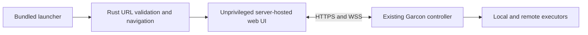

# Garcon Native Preview

Tauri 2 client for the existing Garcon web application. Bundle identifier:
`com.garconcloud.garcon`.

This first milestone establishes native packaging and CI. It bundles only the
server-entry page, not `web/build`, Bun, providers, or a local execution runtime.
The selected server serves the existing UI and owns all execution. Its **Local**
executor is local to that server, not the phone or desktop client.

**Android is currently build-only:** its APK displays the launcher but the Rust
host disables server connections. Android's navigation callback does not cover
POST forms or their method-preserving redirects. A tested native request guard
is required before enabling remote pages. Desktop and iOS retain remote loading;
iOS interaction still requires simulator/device validation.



## Run

Install the [Tauri prerequisites](https://v2.tauri.app/start/prerequisites/) for
the target host, then from the repository root:

```sh
bun install --frozen-lockfile
bun run --cwd native tauri dev
```

The CLI builds the launcher and generates platform icons from the existing Carbon
brand asset. No frontend dev server is required. Enter the complete deployment
URL, such as `https://example.com/tools/garcon/`. Every cold app launch returns to
this form with the last URL filled in; it never connects automatically.
Use the server's **base URL**, not a chat, login, or share URL. The first accepted
connection attempt reserves that origin's mount, even if the server fails to load.
Correcting an incorrect mount later requires a different hostname or resetting
all app data, including credentials and drafts.

Release builds require HTTPS with valid certificates. Debug builds additionally
allow HTTP on `localhost`, `127.0.0.1`, and `::1` for local tests. A phone's
localhost is the phone, not the development machine. No release ATS exception,
certificate bypass, native HTTP bridge, or controller CORS change is introduced.
Android's upstream debug template permits cleartext subresources platform-wide;
the launcher's loopback-only HTTP rule is not a network-wide restriction.

## Builds

Run these commands inside `native/`. Rust builds should set `CARGO_BUILD_JOBS=1`.

```sh
# Desktop, on the corresponding operating system.
bun run tauri build --ci --no-sign -- --locked

# Android, after installing platforms;android-37.0, NDK 29.0.13846066, and JDK 25.
export NDK_HOME="$ANDROID_HOME/ndk/29.0.13846066"
rustup target add aarch64-linux-android x86_64-linux-android
bun run build
bun run tauri android init --ci --skip-targets-install
bun run tauri android build --ci --debug --apk --target aarch64 --target x86_64

# iOS simulator, on an Apple Silicon macOS host with full Xcode.
rustup target add aarch64-apple-ios-sim
bun run build
bun run tauri ios init --ci --skip-targets-install
bun run tauri ios build --ci --debug --target aarch64-sim --no-sign
bun scripts/archive-ios.js
```

The Android APK is in
`src-tauri/gen/android/app/build/outputs/apk/universal/debug/`. It includes arm64
and x86_64 code. Debug keys generated on ephemeral runners are not stable release
keys; a later APK may require uninstalling the earlier one, losing app-local data.

The iOS simulator artifact is `artifacts/Garcon-simulator.app.zip`. It is **not an
iPhone-installable IPA**. Device signing and TestFlight/App Store uploads are
deferred. Hosted macOS runners provide the required Xcode machine; no personal
Mac is required. iOS supports 17.4+, matching the web app's declared WebKit floor;
macOS is conservatively set to 14.4+.

Generated mobile projects and icons are ignored. CI generates them from a fresh
checkout using pinned CLI 2.12.4. Do not hand-edit `src-tauri/gen/`: changes will
not survive a fresh build. If native platform customizations become necessary,
move them into supported configuration/templates or deliberately start tracking
the generated project. Re-running `init` is not a full refresh of existing files.

## CI

`.github/workflows/native-app.yml` runs on relevant pull requests/main changes,
version tags, and manual dispatch. It does not publish releases or use signing
secrets. Its artifacts are:

- Linux x64: `.deb` and AppImage, built on Ubuntu 22.04.
- Windows x64: unsigned NSIS installer.
- macOS arm64 and x64: unsigned/unnotarized DMGs.
- Android: build-only debug APK for arm64 and x86_64; connections disabled.
- iOS: unsigned simulator `.app` zip matching the runner architecture.

The workflow pins Rust, Bun, Tauri, SDK/NDK selections, and dependency lockfiles.
Runner images, Xcode, and Android Build Tools provisioned by Gradle can still
change. Build success does not establish store acceptance or support for every
older WebView. Linux runtime WebKitGTK must support the existing web application.
Unsigned desktop packages may trigger OS security warnings or be blocked.

## Validation

```sh
bun run test
CARGO_BUILD_JOBS=1 bun run --cwd native test:host
bun run --cwd native tauri build --debug --no-bundle -- --locked
cargo install tauri-driver --version 2.1.0 --locked
xvfb-run -a bun run --cwd native test:smoke
```

Build the launcher with `bun run --cwd native build` before running Rust checks
from a clean checkout. Linux smoke tests need `webkit2gtk-driver`, `xvfb`, and
`xauth`. They use isolated app data and synthetic servers, never an existing
user server. The real native WebView is tested for launcher rendering, root and
mounted URLs, bearer HTTP and WebSocket transport, remote command denial,
navigation confinement, saved selection, and sibling-mount rejection.
The smoke test uses WebKit's default renderer: forcing
`WEBKIT_DISABLE_DMABUF_RENDERER=1` stalls screenshot capture on WebKitGTK 2.50.4
under Xvfb.

These synthetic transport checks do not replace testing Garcon login and chat
flows on each real platform. Android/iOS/Windows/macOS currently have build gates,
not native interaction gates. Before distribution, verify real authenticated
Garcon sessions, chat streaming, attachments, terminal input, background/resume,
keyboard/safe areas, TLS failures, and server upgrades on those platforms.

## Preview Boundaries

- Only the bundled launcher can invoke the two native commands. The remote UI
  has no native capabilities, filesystem/process access, or general network bridge.
- On desktop/iOS, top-level navigation is restricted to the selected origin and mount. External
  navigation and desktop popup requests are blocked. External links and provider
  login popups are not supported in this preview; use an ordinary browser for
  those flows. Mobile popup behavior still requires device validation.
- Recovery is a **full app exit/force-quit and reopen**. There is no always-visible
  native mobile toolbar or automatic load-failure recovery yet. Android Back is
  not a guaranteed return to the launcher. An unreachable server can leave the
  current WebView on its loading/error page until the app is restarted.
- The host remembers one mount per origin, across selections and restarts, with
  a maximum of 32 origins. A sibling mount is rejected because Garcon's auth,
  drafts, and caches share browser-origin storage. Different origins remain
  independent. A process lock prevents concurrent host instances from admitting
  conflicting selections.
- Settings errors leave the launcher visible with connection disabled. Close the
  other app instance if its settings lock is held; corrupt settings require a full
  app-data reset, not silently forgetting the saved mount restrictions.
- There is deliberately no "clear site data" control: upstream Android clearing
  does not reliably remove all credentials/storage. Resetting requires clearing
  **all** OS-managed app data, including browser data and native settings. Removing
  only `servers.json` is not a safe reset. Garcon's existing logout remains the
  server-session revocation operation.
- Remote service-worker behavior is unchanged. Where supported, cached shells
  can be stale after server upgrades; this preview does not promise offline
  operation or strict revision admission. Native cache/recovery policy must be
  resolved before general distribution.
- Browser notifications are not mobile push. Notifications, blob downloads,
  clipboard access, file pickers, and external authentication need platform
  validation and narrow native adapters where necessary.

## Later Work

Bundled web assets remain an explicit next phase: materialize the runtime shell,
separate local routes from server endpoints, partition credentials/drafts/caches
by deployment, configure cross-origin transport, and admit only compatible
controller/client revisions. Loading the current `web/build` directly is not a
working substitute because its HTML contains controller-rendered placeholders.

Port CPU-heavy work to Rust only after profiling demonstrates a benefit and the
data ownership/IPC boundary is clear. This scaffold does not add a speculative
Rust service layer or move existing controller/provider responsibilities.

Desktop local-server bundling, native UX parity, signing/notarization, and store
submission are separate milestones. A website wrapper can face App Store
minimum-functionality review even after it is signed or its assets are bundled.

Android remote loading requires a native guard installed before connection is
enabled, with tests for document POST, method-preserving redirects, sibling-mount
escape, and activity recreation. Injected JavaScript or stopping a page after it
starts loading is not a substitute for a host-enforced request boundary.

## References

- [Released Tauri mobile CI](https://github.com/tauri-apps/tauri/blob/993038c49185307dfc895ab7657d77ca0d5ed7c7/.github/workflows/test-api-e2e-mobile.yml)
- [Released Android SDK/NDK defaults](https://github.com/tauri-apps/tauri/blob/993038c49185307dfc895ab7657d77ca0d5ed7c7/crates/tauri-cli/src/mobile/android/mod.rs#L53)
- [Released iOS unsigned build path](https://github.com/tauri-apps/tauri/blob/993038c49185307dfc895ab7657d77ca0d5ed7c7/crates/tauri-cli/src/mobile/ios/build.rs#L432)
- [Remote-origin capability enforcement](https://github.com/tauri-apps/tauri/blob/993038c49185307dfc895ab7657d77ca0d5ed7c7/crates/tauri/src/webview/mod.rs#L2044)
- [Android browsing-data clearing limitations](https://github.com/tauri-apps/wry/blob/792d0359ba6501a4fc360ece17de2ae42329a47c/src/android/kotlin/RustWebView.kt#L78)
- [Android navigation callback excludes POST](https://github.com/aosp-mirror/platform_frameworks_base/blob/1cdfff555f4a21f71ccc978290e2e212e2f8b168/core/java/android/webkit/WebViewClient.java#L61)
- [Android request interception excludes redirect destinations](https://github.com/aosp-mirror/platform_frameworks_base/blob/1cdfff555f4a21f71ccc978290e2e212e2f8b168/core/java/android/webkit/WebViewClient.java#L204)
- [Apple minimum-functionality guideline](https://developer.apple.com/app-store/review/guidelines/#minimum-functionality)
