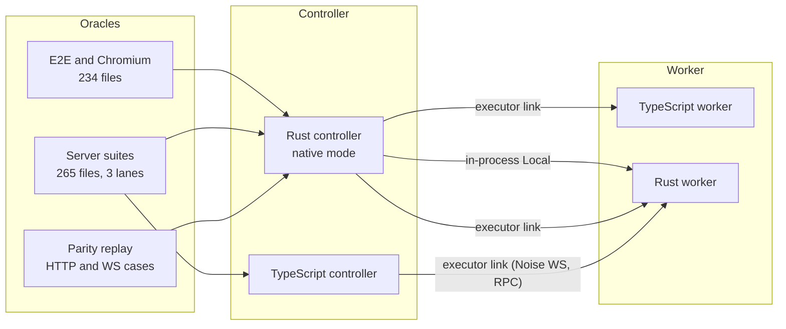

# Port map

Goal: a Garcon controller and executor worker in Rust that pass every recorded
case and every black-box suite with no fallback to the TypeScript original,
after which the fallback is removed (the lift). The SPA in `web/` stays Svelte.

Decisions are in [`DECISIONS.md`](DECISIONS.md). A session claims one unit here
before starting it and marks it done with its gate results.

Plan accepted 2026-11-27 (ADR-012 to ADR-028). A new session reads this file,
then `DECISIONS.md`, `RULES.md`, and `GLOSSARY.md`.

## Where the port stands

| Unit | State | Result |
| --- | --- | --- |
| front-door | done | ADR-001, ADR-007. Replays 683/683 with every unit sent to the original. |
| static-assets | done | ADR-004, ADR-005, ADR-011. 120 cases native; 683/683 pass. Kill switch `GARCON_RS_UNIT_STATIC_ASSETS`. |
| everything else | open | About 172,000 lines of TypeScript outside tests: `server/` 86,000, `server-agents/` 54,000, `common/` 23,000, `cli/` 9,000. |

## Strategy

Route-by-route migration behind the proxy stops at ADR-003: every remaining
controller domain reads state that other in-process consumers cache, so no
further route can move without hand-over glue between the two processes. The
codebase already has two process boundaries with black-box coverage, and the
port moves along those instead:

- **The executor link.** `ExecutorRpcMethods`
  (`server/remote/transport/rpc-protocol.ts`) is a complete wire contract for
  providers, Files, Git, GH, terminals, projects, and reverse CLI. A Rust
  worker (`garcon-server executor`) is verified under the unmodified TypeScript
  controller by the two remote lanes of the server suite
  (`GARCON_TEST_EXECUTION_BACKEND=remote-*`), which run about 155 of the 265
  suites by default.
- **The process boundary.** The integration fixtures start the controller by
  command line and drive it over HTTP and WebSocket. A native controller mode
  of `garcon-server`, with no fallback, is verified by the same suites
  (`GARCON_TEST_CONTROLLER=rust`), by the parity replay, and against the
  TypeScript worker on the remote lanes before the Rust runtime is complete.

The two halves share only the link crate and the contract crate, so they
proceed in parallel. The front door with its TypeScript fallback stays the
default mode until the lift; native modes are selected explicitly.

Progress is measured per quadrant: suites with identical outcomes
(`rust/parity/compare-junit.ts`) for TypeScript controller with Rust worker,
Rust controller with TypeScript worker, Rust with Rust on the remote lanes, and
Rust in-process. The lift requires all four at 100% of the suites that pass
under the original.

## Crates

One crate per ownership boundary, mirroring the TypeScript layout so that the
first pass is a faithful translation and parallel sessions do not share files.
The crates form three groups (ADR-022): shared (`garcon-js`,
`garcon-contract`, `garcon-interface`, `garcon-base`, `garcon-link`, in that
dependency order, ADR-024), executor (`garcon-runtime`,
`garcon-agents-common`, `garcon-agent-*`, `garcon-executor`), and controller
(the rest except the binaries). `garcon-server/tests/workspace_structure.rs`
fails on a dependency between the executor and controller groups, and on a
new crate without a role.

| Crate | Ports | Lines |
| --- | --- | ---: |
| `garcon-js` | JavaScript semantics the port relies on: number formatting, UTF-16 measures, Node path functions, the clock (no original) | new |
| `garcon-contract` | Server-side DTOs and parsers from `common/` | about 11,000 |
| `garcon-interface` | `server-agents/interface/` | 1,400 |
| `garcon-base` | `server/common/` | 1,300 |
| `garcon-link` | `@cfal/noise-ws`; `server/remote/transport/` | 4,400 |
| `garcon-runtime` | `server/runtime/` (git 8,400; gh 1,300; terminals 1,000; files 600; projects 440; hosting 670) | 12,500 |
| `garcon-agents-common` | `server-agents/common/` without search | 10,700 |
| `garcon-agent-<id>` | One per integration: claude 6,900; codex 10,700; opencode 7,300; pi 3,100; antigravity 1,500; cursor 2,400; factory 2,500; amp 2,000; shell 900; three direct 460 | 37,800 |
| `garcon-executor` | `server/remote/server/`, `worker.ts`, `worker-cli.ts`; `Executor::start`, `api`, and `serve`; the standalone `garcon-executor` binary (ADR-022) | 1,500 |
| `garcon-search` | `server-agents/common/src/search/` | 4,200 |
| `garcon-ledger` | `server/controller/ledger/` | 7,100 |
| `garcon-stores` | Auth, settings, snippets, preambles, chat boards, canvases, tickets, API providers, executor configuration, scheduled-prompt store, shares store, pull-request-review store | about 13,000 |
| `garcon-chats` | `server/controller/chats/` without shares store | 10,600 |
| `garcon-execution` | `chat-execution/`, `commands/`, `agents/`, `executors/`, `server/remote/client/` | 17,100 |
| `garcon-controller` | `server/controller/server.ts`, `config.ts`: `Controller::start(config, local)`, the composition root; the controller-only `garcon-controller` binary (ADR-023) | 1,300 |
| `garcon-http` | `routes/`, `ws/`, `server-event-wiring.ts`, `lib/http-*` | 11,500 |
| `garcon-server` | The combined binary: a controller with a Local executor, and the `executor` subcommand; the front door until the lift | existing |
| `garcon-cli` | `cli/` | 9,000 |

## Units

State is `open`, `claimed by <session> <date>`, or `done` with gate results.
Lines are TypeScript outside tests. The oracle is what must pass before the
unit is done, in addition to the [gate](#gate).

### Wave 0: foundation

Six sessions: harness (unit-cases, harness-modes, suite-traces,
known-differences), foundation (base, contract-core), interface, research
(port-rules), scenarios (edge-scenarios), and the link unit of wave 1. The other wave 1 units
wait for base and contract-core.

| Unit | Scope | Oracle | State |
| --- | --- | --- | --- |
| harness-modes | `GARCON_TEST_CONTROLLER=rust` and `GARCON_TEST_WORKER=rust` in `integration-tests/support`; a quadrant report built on `compare-junit.ts` | Original still passes its own lanes; the launch selection is unit-tested | done: f2705b0ba. The launch selection is unit-tested; a Rust-worker run of the compatibility suite for one driver starts the fetched `garcon-executor`, fails clearly while it is unported (5/16 against 16/16), and `compare-junit.ts` lists the 11 differences |
| edge-scenarios | Edge recordings (ADR-020) for every route group of the `edge` and `stores` units, against the original only | Each scenario replays every case under the original; every wildcard reviewed | done: 52 scenarios added, 58 in all with 12,231 cases, replaying on Bun 1.4.3 under the original and through the front door; gaps in `parity/coverage-gaps.md` |
| unit-cases | ADR-020 unit level: a recorder that captures every call the TypeScript unit tests make to a pure module's exports, adds trap inputs, and writes `{fn, args, result}` JSONL from two runs; a Rust test helper that replays it N of N | Recorded and replayed for one `common/` parser; a planted bug fails; an edited case file fails | done: 1b7e68b1f. 81 harness tests; the demonstration module replays 83/83; planted bugs and an edited case file fail |
| suite-traces | ADR-020 suite level: the integration test client writes every HTTP exchange and every reply to its own WebSocket requests; normalization and wildcards reuse `rust/parity/src`; a comparer reports the first difference per test | The original matches its own trace on a second run for ten varied suites, with every wildcard reviewed | done: f2705b0ba. Eleven varied suites reproduce on a third run of the original, 45/45 traced tests; all 68 wildcards are reply clock values; exclusions are three queue-lifecycle paths, one chat-boards path and two broadcast groups, and two chat-lifecycle tests, each with its cause in `trace-unstable.json`; `preambles` is left out (alias order race) |
| known-differences | ADR-015: `rust/parity/known-differences.json` honored by the edge replay and the trace comparer | A listed case passes only with exactly the listed result and fails once it no longer differs | done: f2705b0ba. A listed case passes only with the listed result and is stale once it stops differing, also under a wildcard ancestor; entries can be scoped to build labels |
| base | `garcon-js` helpers; `garcon-base`: logging, domain errors, keyed lock, JSON file store, private files, workspace lease (same on-disk lock as `proper-lockfile`), path boundary, runtime descriptor | Ported unit tests; a TypeScript process and a Rust process exclude each other on one workspace | claimed by foundation 2026-11-27 |
| contract-core | `garcon-contract`: identifiers, error codes, `chat-types`, WebSocket protocol and events, executors, agents, settings | Recorded cases for every parser and codec; JSON round trip with the TypeScript encoders | done: all 148 `common/` modules merged (the last two, `ws_events` and `ws_protocol`, at 9e53ea309 in the gate), each with recorded cases replayed N of N on Bun 1.4.3 and a planted bug; the key-order audit over every recorded case is at zero with three scoped pass-through exceptions in `executors` |
| interface | `garcon-interface`: the integration and runtime contracts as traits; the `common/` domain modules its signatures need (git, gh, terminal, files, tickets, attachments, API providers, usage, and the rest) in `garcon-contract` | Every type that crosses the executor link serializes to the JSON the original sends; recorded cases for the parsers | done pending the roster test: every contract of `server-agents/interface` merged with byte-level wire fixtures from Bun, the transcript seed complete, and the conformance kit `garcon_interface::testing` (ten behavior and negative fixtures; a missing literal-execution exclusion fails it) merged at 2d291e970 |
| port-rules | `GLOSSARY.md` (TypeScript term to Rust name), `RULES.md` (mapping rules and corrections), `research/` notes for each dependency listed under [dependencies](#dependencies) | Reviewed by the manager | done: 20 notes under `research/` and `GLOSSARY.md` |

### Wave 1: independent leaves

Parallel. Each needs only wave 0.

| Unit | Scope | Oracle | State |
| --- | --- | --- | --- |
| link | Noise PSK WebSocket in both dial directions, sessions, framing, RPC, lanes, reply journal, admission budgets, file, git, terminal, and CLI protocols | noise-ws test vectors; Rust client with TypeScript server and the reverse; ported transport tests | claimed by link 2026-11-27; all 24 transport modules and the review fixes merged at 238714bfd (138 crate tests, 791/791 recorded cases in ten directories, interoperation with the TypeScript link in both directions); under review |
| runtime-projects-files | `ProjectService`, `FilesService`, directory creation | Ported unit tests; golden cases; the TypeScript and the Rust service compared over the same generated directory tree | merged: 89969af78 (link). 38/38 crate tests; recorded cases directory-reader 10/10, errors 12/12, file-revision 3/3, file-mentions 7/7; the TypeScript and Rust services agree over the same tree (collation, symlinks and loops, unreadable entries, invalid UTF-8 names, large directories, revisions after writes by each side, ticket-default trees); removing ctime from the revision hash fails it; Windows compile-checked only. Open from review: the abort error loses its name once erased |
| runtime-git | `GitRuntime`: status, diff engine, comparisons, history, worktrees, stashes, review documents; `gh` | Ported unit tests against real repositories from `git-fixture` | done: Git (06a535591) and gh (980c966aa: 886 recorded, a byte oracle over status, reads, and the comment lifecycle against a fake gh), both by harness. The worker serves Git (45 methods) and GH (6 methods) RPC (link). Under the TypeScript controller the 18 Git and GH suite files give 62 of 65 in each dial direction with `executor-gh` 3 of 3; the three differences are roster gaps (`git-name-generation` needs Amp; the two remote `pull-request-reviews` variants need shell), open against agent-pi\x27s units |
| runtime-terminals | PTY runtime, replay buffer, terminal framing | Ported unit tests with a real shell | merged by link 2026-11-28 (c2ba5c4d5, in the gate): 60/60 crate tests with three real-shell cases; terminal identity 16/16 and replay buffer 9/9 recorded; stale attachment generations, missing UUID validation, and a UTF-16 replay budget each fail it; ConPTY compile-checked only |
| agents-direct | `garcon-agents-common` execution, producer adapter, direct runtimes and session store; the three direct integrations | Ported unit tests against `fake-openai-server` and `fake-anthropic-server`; the integration conformance kit | claimed by link 2026-11-28. Merged: `garcon-agents-common` adapters, catalog, settings, lifecycle, migration, the direct session store and native session, and the runtime integration host, registry, and migration store. Open: the turn runtime, the three protocol runtimes on a shared HTTP client, the three integration crates with the conformance kit, the roster |
| edge | Arguments and environment, lease, runtime descriptor, the native mode (`GARCON_RS_CONTROLLER=native`) that answers unported routes with a marked 501 and logs them, router with `wrapRoutes` semantics, auth store, service, tokens and rate limiter, WebSocket upgrade, session, and delivery budget, SPA shell | Parity: `api-session`, `auth-logout`, `settings-shell`, `websocket-session`, `static-assets*` native | done: 29255b2fb (scenarios). Configuration (176 cases), native start, listener, routes, static assets, runtime routes, leases, the seven auth methods, and the browser WebSocket (upgrade, permessage-deflate, authentication and revocation fences, ping, reconnect, request validation, write budget). Native replay with no fallback: 5,144 of 12,238 cases match, 6,485 answer the unported marker, 605 are blocked behind those, 4 mismatch (settings-shell title cases, waiting on the settings store); `websocket-session` 31 matched and 1 unported; 223 route methods unported. Seven review findings on the WebSocket layer open |
| stores | Settings and its sub-stores, snippets, preambles, chat boards, canvases, saved searches, folders, tickets, API providers and assignments, Telegram settings, executor configuration | New parity scenarios per route group on an empty and a seeded workspace; ported unit tests; files written by one implementation read by the other | claimed by scenarios 2026-11-28. Merged: the settings store and stored title, Telegram settings, tickets, executor configuration with the native connection export, API provider stores with management reads and the endpoint resolver, preamble and snippet catalogs with their native reads and the startup short-name check, precise per-field surrogate handling for username and ticket writes (native replay 6,428 matched, 0 mismatching). In progress: settings reconciliation with the registry, canvases, boards. Mutation routes of API providers, preambles, and snippets wait for the executor reference guard and the project inspector; then saved searches and folders |
| ledger | Store, codec, service, views, staging, paging, anchors, native activity, clear and reload | `docs/transcript-ledger-v5-cts.md`; ported unit tests; ledgers written by one implementation read by the other | done except the controller adapters and routes (foundation). Row codec and contracts, connection, schema, migrations, fences, the store with staged views, promotion, and bounded retirement; presentation, preview, frozen conversation, and export folds; `TranscriptViewReader`; the producer lease and service; adoption (`TranscriptAdoptionService`, registry and integration adapters by research); orphan cleanup, `last_run_outcome`, and `native_activity_state`; Clear and Clear-before; Reload with the native history seed importer and preamble sanitation. 87 crate tests and about 350 recorded cases with three approved differences; stored bytes, public reads, and notification traces equal in both writer directions. Open: the Clear and Reload controller adapters (research), the carryover adapter for adoption (interface), and the routes (harness, chat-surface) |
| search | FTS5 schema, indexer, query, worker pair as threads | Ported unit tests; the search corpus fixtures; same index readable by both | done except search-surface: 06a535591 (interface). 41 crate tests; 22 queries return the same bytes from indexes built by the Bun writer and by the Rust writer thread; one writer and two reader threads with a supervised service |
| execution-state | The pure state machines of `chat-execution/` (control transitions, operations, ownership) and `commands/command-ledger.ts` | Golden cases from the TypeScript transition tests | done: 76f5bb47c (research, in the gate). Control state and projection, transitions, the in-memory repository, turn identity, attempts, the finalization tracker, ownership, control operations, and the command ledger in `garcon-execution`: 42 Rust tests and 214 recorded cases; concrete error types reach callers; no cancellation point between commit and `input_accepted`; the API contract test pins the ownership booleans, and its coordinator half waits for wave 2 |

### Wave 2: assembly

| Unit | Needs | Scope | Oracle | State |
| --- | --- | --- | --- | --- |
| agent-conformance | interface | `garcon_interface::testing` (the conformance kit), the roster test in `garcon-executor`, and a way to run the SACS modules for one driver (ADR-027) | The kit passes against the direct integrations and fails a planted facet-shape bug; the SACS registry test still locks the roster | kit merged (interface, 2d291e970); the per-driver compatibility suite command for the Rust worker exists (harness); the roster test and the run against the direct integrations wait for agents-direct (link) |
| worker | link, runtime-*, agents-direct | `garcon-executor`: `Executor::start`, `api`, `serve`; RPC dispatch, `ProducerRelay`, CLI gateway, executor arguments, listener secret | `executor-*` and `git-*` suites, TypeScript controller with Rust worker, both dial directions | claimed by link 2026-11-28. Merged: `Executor::start`, `api` (the shared `ExecutionRuntimeApi`), `serve`, listener secret, handshake, project, files, and terminal services, the CLI gateway, bulk history, the producer relay, and the roster with the first direct integration (31d673492, in the gate). Under the TypeScript controller in both dial directions, `executor-files`, `executor-terminals`, and `executor-cli*`: 26 of 27 with the Rust worker and 26 of 27 with the original, identical outcomes on all 27 (the one failure in both is a missing Claude binary on the test machine). Open: the Responses and Anthropic registrations, the compatibility suite and the direct scripted suites through the Rust worker, the git RPC server; the Git RPC server (45 methods on the process-owned `GitRuntime`, 13 recorded cases) is merged, GH RPC next |
| agent-claude | worker | Claude CLI transport, protocol, steering, history, forking | `claude-*` and `scripted-*` suites and the SACS modules for its driver through the Rust worker; conformance kit | claimed by agent-claude 2026-11-28; plan approved. Merged: model context, slash commands and their discovery process, tool-use and permission conversion, native paths, the shared CLI login controller and transcript digest, the control broker and turn state, compaction helpers, input and steering frames, process transport and retirement, one-shot processes, CLI arguments and version checks, context window control, session supervision, permission decisions, the initialize handshake, endpoint environment, result correlation; all reviewer findings closed. Open: start and resume orchestration, the full stream and native history conversion, tool results and shared forking (wait for the shared Pi leaves), facets, worker parity |
| agent-codex | worker | App-server client, runtime, converter, history, code-mode parser | `codex-*` suites and the SACS modules for its driver through the Rust worker; conformance kit | claimed by agent-codex 2026-11-28; plan approved. Merged: command display, shared CLI update and shared usage in `garcon-agents-common`, code mode on Oxc (708 recorded, two surrogate differences), app-server protocol validation (155), the stdio transport with launch overrides and version check, speed settings and skill discovery (281), request builders (184), question validation (225), approvals and runtime support (78), subagent converters (50); in the gate: utility thread discovery, endpoint projection, operation routing, source identities. Open: runtime assembly and lifecycle, converters that need the shared `normalize-util`, history, facets, worker parity |
| agent-pi | worker | Pi RPC runtime | `pi-*` suites | claimed by agent-pi 2026-11-28. Shared leaves of part 0 complete and merged. In the gate: `garcon_agent_pi::PiAgentIntegration` (long-lived RPC runtime, one-shot CLI, configuration, catalog and auth, canonical messages, native history, session activity; 245 recorded cases, the conformance kit, fake-child RPC tests). Open: worker registration and parity (Pi scripted suites and SACS in both dial directions), then shell, factory, amp |
| agent-opencode | worker | `opencode serve` supervisor, event stream, permissions | `opencode-*` suites | claimed by agent-opencode 2026-11-28. Merged: `garcon_agent_opencode::OpenCodeAgentIntegration` with every facet of the original (165 crate tests, about 1,800 recorded cases, the conformance kit). Open: worker registration and scripted parity with the pinned real binary in both dial directions (link, in progress as the worked example) |
| agent-antigravity | worker | Shared ACP runtime, Antigravity converter | `antigravity-*` suites | claimed by agent-acp 2026-11-28. Merged: the shared ACP runtime and, in the gate, `garcon_agent_antigravity::AntigravityAgentIntegration` (execution on shared ACP, auth and browser-code login, catalog, steering, native references, migration, isolated plan-mode queries; 236 recorded cases, runtime rows and outcomes byte-equal to Bun). Open: worker registration and parity with the pinned CLI behind the fake Gemini model; the runtime tests cover a provider-focused subset of the original\x27s 125-case file |
| agent-shell | worker | Shell agent and its native store | `shell-*` suites | claimed by agent-pi 2026-11-28, after Pi |
| agents-best-effort | worker | cursor, amp, factory | Ported unit tests and golden converter cases only; no scripted tier exists | cursor claimed by agent-acp, factory and amp by agent-pi, 2026-11-28 |
| chats | stores, ledger | Registry, metadata index, list projector, ownership journal, identifiers, tags, parents, order | Ported unit tests; registry files read by both | claimed by interface 2026-11-28. Merged (in the gate): the registry with its v6 codec and ID allocator (230 recorded; files written by each implementation read by the other), the metadata index with paced preview repair, the list and summary projector (228 recorded; controller bytes compared with Bun), order ranking (66 recorded), tag and parent mutation services. Open: the ownership journal and its cross-writer gate; routes and the concrete ledger, board, and archive adapters belong to chat-surface |
| agents-registry | chats, agents-direct | `AgentRegistry`, runtime router, directory, catalog, session settings, producer bindings, `ExecutorManager` with the in-process Local runtime | Ported unit tests | claimed by research 2026-11-28, in `garcon-execution`. Merged: directory, event bus, listener dispatch, session-loss retry, turn operation, model catalog, execution aborts, session types, the router\x27s permission, steering, and running-view slice, `executor_manager_ports`, reference writes, producer bindings, the registry\x27s running read and transcript source description, the integration chat reference, the two adoption adapters, session settings and endpoint projection on the stores\x27 resolver; in the gate: `ExecutorManager` with configuration guards (live Noise reverse CLI checked) and availability wiring (749 recorded cases in the crate). Open: the execution composition module in `garcon-controller`, the transcript-commit bridge, session lost and resumed on the registry, the Clear and Reload adapters, the rest of the router (launch, compaction, fork), executor snapshot bytes for the list route, then the registry-backed commands |
| execution | execution-state, agents-registry | Coordinator, queue drainer, steering, accepted input, start, session, steer, queue, and fork commands | Ported unit tests | claimed by research 2026-11-28. Merged (in the gate): accepted input and terminal helpers, receipt projection, command settlement; steer, queued steer, and control input delivery and the queue drainer (64 recorded); the coordinator with its command, query, and lifecycle facets against fakes (17 recorded; the API contract test ported). Open: the registry-backed start, session, queue, steer, and fork commands, after agents-registry |
| chat-surface | execution, edge | Chat routes, command routes, snapshots, rows, browser chat handler, `server-event-wiring` | **Core milestone:** generic server suites pass in-process on the native controller with direct providers | claimed by harness 2026-11-28; plan approved. Merged, all unmounted: last-selected state, snapshot assembly, `ChatProcessingActivity`, the durable chat-row validator, the transient permission feed, list, selection, snapshot, raw and anchor paging, row, and details routes, bounded subscribe replay, commit fanout on the per-chat task queue, activation decorators and the advisory probe, typed ping and reconnect socket state. Recorded scenarios: chat-read-seeded 21 and chat-transcript-seeded 31 cases. Native registration waits for the carryover adapter of transcript adoption (interface) and the settings reconciliation (scenarios); adoption itself, its registry and integration adapters, the startup ledger APIs, and the native activity read are on origin |
| remote-client | link, agents-registry | `RemoteExecutorClient`, remote integration and service proxies, CLI dispatcher | Remote lanes, Rust controller with TypeScript worker | claimed by interface 2026-11-28, in `garcon-execution/src/remote_client/`. Merged: the reverse CLI dispatcher (71 recorded) and the client itself (executor client, held sessions, wire shaping, integration facets, producers with replay and settlement, bounded history paging, Files, Git, and terminal proxies; 196 wire cases). The Rust client passes against the Bun worker and the Rust worker in both dial directions (inventory, project, Git quick summary, file read, save, and create, PTY create and terminate, independent bulk recovery, primary reconnect). Open: composition with `ExecutorManager` (research), GitHub mutations and a model turn through a worker, and the remote lanes under the native controller |

### Wave 3: features around the core

Parallel after the core milestone.

| Unit | Scope | Oracle | State |
| --- | --- | --- | --- |
| service-routes | Files, Git, GH, terminal routes, terminal stream, git generation, project resolution | `git-*`, `executor-files`, `executor-terminals` suites on all lanes | open |
| carryover | Carryover store, compaction, token fitting, garbage collection | `carryover-*` suites; token estimates equal to `tokenx` on golden inputs | open |
| fork-handoff | Fork, agent handoff, handoff artifact, self-handoff | `fork-*`, `cross-executor-handoff`, `self-*` suites | open |
| shares-export | Share snapshots and pages, Markdown and XML export, rendering off the core thread | Suites for shares and export; `long-chat-responsiveness` | claimed by foundation 2026-11-28: the `TaskWorker` supervisor first (also used by token fitting), then transcript rendering, export (Markdown, XML), shares (snapshot, page, store), and handoff-artifact rendering. Plan requested |
| search-surface | Search controller, settings coordinator, routes | `search-*` suites; search gate | open |
| schedules | Scheduled-prompt scheduler, dispatcher, run log, routes | `scheduled-*`, `garcon-schedule-*` suites | open |
| agent-commands | Inter-agent messages, start, resume, stop, schedule, and ticket commands, replies | `garcon-agent-*`, `delegated-*` suites | open |
| pull-request-reviews | Scanner, runner, poster, routes | `pull-request-reviews` suite | open |
| notifications | Telegram notifier, attention tracker | Ported unit tests | open |
| catalog-surface | Agents, models, API-provider, usage, CLI-update, prompt-refinement routes, title generation | `provider-*`, `usage-*`, `agent-*` suites | open |
| controller-only | The `garcon-controller` binary (ADR-023): a controller whose Local executor is absent. New behavior with no original to mirror; its semantics need the user's confirmation before the unit starts (see open questions) | New server suites for startup, chat admission, catalogs, and the SPA with only remote executors | open; semantics decided in ADR-030 (Local listed and unavailable with a fixed reason) |

### Wave 4: lift

| Unit | Scope | State |
| --- | --- | --- |
| quadrants | Four quadrants at 100%; E2E and Chromium identical under the Rust controller; parity replay native with no fallback; restart and crash suites | open |
| known-differences | Every remaining difference listed with its reason and accepted or fixed | open |
| remove-fallback | Delete the proxy, the shadow mode, and the kill switches; native becomes the only mode | open |
| packaging | `build-exe`, Docker, `scripts/start.js`, CI lanes, benchmarks rerun | open |

### Wave 5: CLI

| Unit | Scope | Oracle | State |
| --- | --- | --- | --- |
| cli | `garcon-cli` in Rust | `garcon-cli*` and `executor-cli*` suites with real CLI processes; the 38 CLI unit test files ported | open |

## Workstreams

Each lane is one session at a time, owns its crates, and works in its own
worktree and branch (ADR-025). Lanes report a commit to the manager, who
verifies it, merges it into `rust-server`, and pushes; only the manager edits
the workspace manifest, `garcon-server`, and this file.

| Lane | Order of work |
| --- | --- |
| A. Link and worker | link, worker, remote-client |
| B. Runtime services | runtime-projects-files, runtime-terminals (link); runtime-git and its `gh` half (harness); service-routes |
| C. Worker and direct providers | agents-direct, the roster, the git RPC server (link) |
| D. CLI-backed providers, one session each (ADR-032) | shared leaves, agent-pi, agent-shell, then factory and amp (agent-pi); agent-claude with shared forking and CLI login (agent-claude); agent-codex with shared CLI update and usage (agent-codex); agent-opencode (agent-opencode); the shared ACP runtime, agent-antigravity, cursor (agent-acp) |
| E. Ledger and search | ledger, search, search-surface, shares-export, carryover |
| F. Edge and stores | edge, stores, chats, catalog-surface, schedules, notifications |
| G. Core execution | execution-state, agents-registry, execution, chat-surface, fork-handoff, agent-commands, pull-request-reviews |

Lane A starts with wave 0. Lanes B, C, E, F, and G start when base and
contract-core land; lane D started on 2026-11-28 with the roster. Eleven
porting sessions and a reviewer run at once (ADR-032).

## Gate

A unit is done when all of these hold, and its row records the numbers:

1. `cargo fmt --check`, `cargo clippy --all-targets -- -D warnings`, and
   `cargo test` pass for its crate.
2. No `todo!`, `unimplemented!`, or stubbed branch. No `unwrap`, `expect`, or
   `panic!` on a path where the original returns or throws an error; a state
   the original also treats as impossible carries `// INFALLIBLE: <why>`.
3. Its recorded unit cases match N of N (ADR-020), and its ported unit tests
   pass. Tests that only mock the original's internals are not ported; tests
   that pin observable behavior are. No recorded result is written into the
   code, and no case file is edited by hand.
4. Its oracle in the tables above passes, and `bun run parity:replay` still
   passes for the original.
5. A planted bug in the unit fails the oracle on the expected field; a
   surviving mutant means a case is missing.
6. On-disk and wire formats it owns are read and written identically by both
   implementations, shown by a cross-implementation test.

A mismatch is fixed in the port, never in the recording or the suite. A
difference that should stand goes to the manager, who takes it to the user
(ADR-015). After three changes in a row that gain no matching case, stop and
report the remaining mismatches to the manager instead of editing further.

## Session rules

- Read this file, `DECISIONS.md`, `GLOSSARY.md`, `RULES.md`, and the research
  note for each dependency the unit uses before writing code. Read the contract
  documents that `CLAUDE.md` names for the domain.
- Translate faithfully first: the original's structure, types, error codes, and
  error text. Make it idiomatic only after the gate passes, and run the gate
  again.
- Controller logic runs on one core thread, as it runs on one event loop today.
  Short bounded SQLite transactions stay on it where the original runs them
  synchronously; SQLite work proportional to a transcript, rendering, token
  fitting, search, and compression run in the original's bounded steps or off
  it.
- Compile no Rust on the development machine; build and test on the build
  machine (ADR-026, `RULES.md` "Build"). Never kill a server you did not
  start; start test servers on port 0.
- Work in your own worktree and branch (ADR-025) and commit there when a part
  is complete and green. Never push, rebase, or touch another worktree; the
  manager merges your reported commit into `rust-server` and pushes.
- Do not edit another lane's crate. Report a needed change to the manager.
- Turn every correction into a rule in `RULES.md` so the next unit keeps it.

## Dependencies

| Original | Rust | Trap to research |
| --- | --- | --- |
| `Bun.serve` HTTP and WebSocket | hyper; `yawc` 0.5 (MPL-2.0, zlib) for the browser socket, since the original negotiates permessage-deflate and neither tungstenite 0.30 nor soketto can match it; tungstenite stays for the executor link | Idle timeouts, payload limit, backpressure budget (ADR-010), close codes; an upgrade over HTTP/1.0 is refused (the original accepts it) |
| `bun:sqlite` | rusqlite with bundled SQLite and FTS5 | Needs a C compiler at build time; WAL and pragma defaults; statement caching |
| `@cfal/noise-ws` | The fixed Noise state machine on RustCrypto primitives | Vectors and the Go interop program in the package |
| `bun-pty` | portable-pty | Resize, exit codes, Windows ConPTY |
| `Bun.password` bcrypt cost 12 | bcrypt | Hash format accepted by both |
| `jsonwebtoken` | jsonwebtoken | Claims, expiry strings such as `30d` |
| `proper-lockfile` | Own implementation | Lock directory and mtime heartbeat compatible with the original |
| `tokenx` | Own port | Estimates must be equal, not close |
| `emoji-regex` | Unicode tables | Sequences and ZWJ |
| `shell-quote` | Own port | Quoting and parse results as the original |
| `acorn` (Codex code mode) | A JavaScript parser crate | AST shape the command parser reads |
| `@opencode-ai/sdk` | HTTP and SSE client | Event framing and reconnect |
| `jsonc-parser` | A JSONC crate | Comment and trailing-comma tolerance |
| `mime-types` | Existing table in `static_assets.rs` | Already matched |
| `localeCompare`, `Intl.Collator` | ICU4X `icu_collator` behind `garcon_js::collation`, pinned to the Unicode version of Bun 1.4.3 | The default locale is `en-US` whatever `LANG` says; Bun orders Han by radical and stroke, ICU4X's compiled data by code point (accepted, ADR-029) |
| `String.prototype.normalize` | ICU4X `icu_normalizer`, same pin | Unicode version |
| `Date.parse`, local dates, `Intl` time zones | `garcon_js::date_parse` on `tz-rs` and `tzdb` | Bundled IANA data is newer than Bun 1.4.3's ICU (America/Vancouver from 2026-11-01); the three-letter aliases are case-sensitive |
| `new RegExp` on user input | `regress`, unoptimized, for validation | Not JavaScriptCore's parser: 16 listed syntax differences (accepted, ADR-029); matching differences in `research/regexp.md` |
| Bun `Worker` | Threads | Message ordering, shutdown |

## Recording coverage

| Scenario | Cases | Covers |
| --- | ---: | --- |
| static-assets | 367 | Shell routes, every asset type and cache rule, compression negotiation, byte ranges, 404s, method routing |
| static-assets-base-path | 77 | The same under `/tools/garcon`, the bare-mount redirect, requests outside the mount |
| api-session | 196 | Auth status, login failures and the rate limiter, workspace reads and writes, query parameters, unknown routes, the CLI controller fence, forwarded-address spoofing |
| settings-shell | 7 | Settings writes reflected in the shell and manifest, HTML escaping of the title |
| auth-logout | 4 | Session revocation over HTTP and WebSocket |
| websocket-session | 32 | Subprotocol negotiation, ping, reconnect state, request errors, refused upgrades |

The `edge-scenarios` unit has added 38 scenarios for the route groups of the
`edge` and `stores` units (runtime, workspace, snippets, preambles, saved
searches, folders, chat boards, chat canvases, chat tags, tickets, API
providers, executors, scheduled prompts, Telegram, usage, and auth), for 44
scenarios and 9,992 cases in all; [`parity/replay-report.md`](parity/replay-report.md)
lists each with its case count. Each `service-routes` route group adds a scenario. Chat lifecycle,
queueing, permissions, executor links, PTYs, and restart behavior are verified
by the server suites, which already drive them deterministically with the
scripted providers; the parity replay covers the HTTP and WebSocket edge those
suites do not enumerate.

## End-to-end verification

Last run 2026-11-26 on the front door, following ADR-009: every suite runs
under both controllers and outcomes are compared test by test
(`rust/parity/compare-junit.ts`). A test that differs is rerun serially on both
before it counts.

| Suite | Tests | Identical outcomes | Shadowed native responses |
| --- | ---: | ---: | ---: |
| Server integration (265 files, scripted providers) | 1,148 | 1,148 | n/a |
| Chromium (158 files) | 450 | 450 | 76,093, all matching |

Tests that fail under both controllers on the verification machine (missing
`zip`, `cursor-agent`, or timing in remote-executor suites) count as agreement
but not as evidence. Leaked `opencode serve` processes from interrupted runs
loaded the machine into timeouts under both controllers; stop orphans between
runs.

## Decision index

| ADR | Decision |
| --- | --- |
| 001 | Rust front door with the TypeScript original as fallback |
| 002 | Record and replay from the outside |
| 003 | A unit moves with the state it owns |
| 004, 005 | Canonical requests and range requests; resolved for the lift by 015 |
| 006 | Recordings use a fixed web build |
| 007 | The front door owns the client address |
| 008 | hyper without a web framework; its pure-Rust constraint is superseded by 016 |
| 009 | Shadow the end-to-end suites |
| 010 | The relay enforces the browser socket budget |
| 011 | Cache web build files and their encodings |
| 012 | Port along the executor link and the process boundary |
| 013 | Every integration is ported to Rust |
| 014 | Only current-version workspaces |
| 015 | Accidental behavior becomes a listed difference |
| 016 | A C toolchain at build time |
| 017 | One core thread |
| 018 | One contract crate; the CLI is ported last (interface placement superseded by 024) |
| 019 | Targets |
| 020 | Three levels of recorded behavior |
| 021 | The manager integrates and commits (shared worktree superseded by 025) |
| 022 | The controller and the executor are separate crate graphs |
| 023 | Three binaries |
| 024 | The shared crates mirror the original's packages |
| 025 | Each session works in its own worktree |
| 026 | Bun 1.4.3 is the reference runtime, and Rust builds leave the development machine |
| 027 | Each integration is a crate of its own, held to the compatibility suite |
| 028 | The manager approves known differences that are clear bugs |
| 029 | Three differences are accepted: the native 431 framing, regular-expression syntax validation, Han collation |
| 030 | A controller without a Local executor lists Local as unavailable |
| 031 | Provider requests identify as Garcon and never follow a redirect to another origin |
| 032 | Provider integrations are ported in parallel sessions, on a second build machine |

## Open questions

The six questions of 2026-11-28 are decided in ADR-029, ADR-030, and
ADR-031. One is open:

1. Provider output that the shared parser changes or rejects at its first
   read. The original hands some provider values on unchecked, and its own
   shared parser trims or refuses them at the first read; the port's typed
   messages can only hold the checked form, so it applies the check at the
   provider. Two cases so far. The Claude converter passes the model's
   `changes` and `allowedPrompts` arrays through unchanged, and the parser
   drops members other than the declared strings (2 of 141 recorded converter
   cases). The Codex usage report can carry a token total beyond the safe
   integer range, which `parseAgentUsageReport` rejects; the port fails the
   usage read at the provider. An ACP peer that answers `session/new`
   without a string `sessionId` is refused before the session is registered,
   where the original carries the non-string value on. The difference shows only for input no real
   model or account produces, and only in the bytes of the link message, the
   stored row, and the live frame of a Local turn; every reader, the browser
   included, sees the same result. Proceeding as accepted (RULES.md, JSON);
   refusing it means message and report types that carry unchecked values.
2. A defect of the original the port does not copy. When a fork's target
   file already exists, the original's writer
   (`server-agents/common/src/forking/fork-jsonl.ts`, `TargetWriter`) fails
   to create it and then deletes the existing file in its cleanup. No test
   covers the path, and the target name is new for every fork, so it should
   not occur. The port fails the same way and leaves the existing file.
   Proceeding with that; say if the original should be corrected as well or
   if the port should delete the file as the original does.

## Out of scope

- The SPA in `web/` and the native client in `native/`.
- Removing the TypeScript original from the tree; it stays as reference until
  the user decides otherwise.
- Wiring `cargo-mutants`; mutation checks stay manual per unit.
