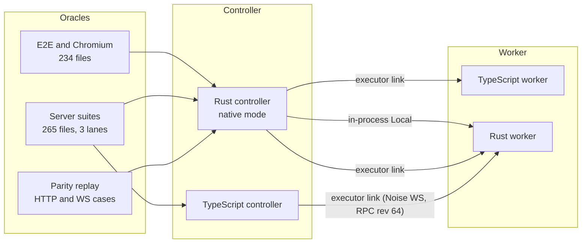

# Port map

Goal: a Garcon controller and executor worker in Rust that pass every recorded
case and every black-box suite with no fallback to the TypeScript original,
after which the fallback is removed (the lift). The SPA in `web/` stays Svelte.

Decisions are in [`DECISIONS.md`](DECISIONS.md). A session claims one unit here
before starting it and marks it done with its gate results.

Plan accepted 2026-11-27 (ADR-012 to ADR-024). A new session reads this file,
then `DECISIONS.md`, `RULES.md`, and `GLOSSARY.md`.

## Where the port stands

| Unit | State | Result |
| --- | --- | --- |
| front-door | done | ADR-001, ADR-007. Replays 683/683 with every unit sent to the original. |
| static-assets | done | ADR-004, ADR-005, ADR-011. 120 cases native; 683/683 pass. Kill switch `GARCON_RS_UNIT_STATIC_ASSETS`. |
| everything else | open | About 172,000 lines of TypeScript outside tests: `server/` 86,000, `server-agents/` 54,000, `common/` 23,000, `cli/` 9,000. |

## Strategy

Route-by-route migration behind the proxy stops at ADR-003: every remaining
controller domain reads state that other in-process consumers cache, so no
further route can move without hand-over glue between the two processes. The
codebase already has two process boundaries with black-box coverage, and the
port moves along those instead:

- **The executor link.** `ExecutorRpcMethods`
  (`server/remote/transport/rpc-protocol.ts`) is a complete wire contract for
  providers, Files, Git, GH, terminals, projects, and reverse CLI. A Rust
  worker (`garcon-server executor`) is verified under the unmodified TypeScript
  controller by the two remote lanes of the server suite
  (`GARCON_TEST_EXECUTION_BACKEND=remote-*`), which run about 155 of the 265
  suites by default.
- **The process boundary.** The integration fixtures start the controller by
  command line and drive it over HTTP and WebSocket. A native controller mode
  of `garcon-server`, with no fallback, is verified by the same suites
  (`GARCON_TEST_CONTROLLER=rust`), by the parity replay, and against the
  TypeScript worker on the remote lanes before the Rust runtime is complete.

The two halves share only the link crate and the contract crate, so they
proceed in parallel. The front door with its TypeScript fallback stays the
default mode until the lift; native modes are selected explicitly.

Progress is measured per quadrant: suites with identical outcomes
(`rust/parity/compare-junit.ts`) for TypeScript controller with Rust worker,
Rust controller with TypeScript worker, Rust with Rust on the remote lanes, and
Rust in-process. The lift requires all four at 100% of the suites that pass
under the original.

## Crates

One crate per ownership boundary, mirroring the TypeScript layout so that the
first pass is a faithful translation and parallel sessions do not share files.
The crates form three groups (ADR-022): shared (`garcon-js`,
`garcon-contract`, `garcon-interface`, `garcon-base`, `garcon-link`, in that
dependency order, ADR-024), executor (`garcon-runtime`,
`garcon-agents-common`, `garcon-agent-*`, `garcon-executor`), and controller
(the rest except the binaries). `garcon-server/tests/workspace_structure.rs`
fails on a dependency between the executor and controller groups, and on a
new crate without a role.

| Crate | Ports | Lines |
| --- | --- | ---: |
| `garcon-js` | JavaScript semantics the port relies on: number formatting, UTF-16 measures, Node path functions, the clock (no original) | new |
| `garcon-contract` | Server-side DTOs and parsers from `common/` | about 11,000 |
| `garcon-interface` | `server-agents/interface/` | 1,400 |
| `garcon-base` | `server/common/` | 1,300 |
| `garcon-link` | `@cfal/noise-ws`; `server/remote/transport/` | 4,400 |
| `garcon-runtime` | `server/runtime/` (git 8,400; gh 1,300; terminals 1,000; files 600; projects 440; hosting 670) | 12,500 |
| `garcon-agents-common` | `server-agents/common/` without search | 10,700 |
| `garcon-agent-<id>` | One per integration: claude 6,900; codex 10,700; opencode 7,300; pi 3,100; antigravity 1,500; cursor 2,400; factory 2,500; amp 2,000; shell 900; three direct 460 | 37,800 |
| `garcon-executor` | `server/remote/server/`, `worker.ts`, `worker-cli.ts`; `Executor::start`, `api`, and `serve`; the standalone `garcon-executor` binary (ADR-022) | 1,500 |
| `garcon-search` | `server-agents/common/src/search/` | 4,200 |
| `garcon-ledger` | `server/controller/ledger/` | 7,100 |
| `garcon-stores` | Auth, settings, snippets, preambles, chat boards, canvases, tickets, API providers, executor configuration, scheduled-prompt store, shares store, pull-request-review store | about 13,000 |
| `garcon-chats` | `server/controller/chats/` without shares store | 10,600 |
| `garcon-execution` | `chat-execution/`, `commands/`, `agents/`, `executors/`, `server/remote/client/` | 17,100 |
| `garcon-controller` | `server/controller/server.ts`, `config.ts`: `Controller::start(config, local)`, the composition root; the controller-only `garcon-controller` binary (ADR-023) | 1,300 |
| `garcon-http` | `routes/`, `ws/`, `server-event-wiring.ts`, `lib/http-*` | 11,500 |
| `garcon-server` | The combined binary: a controller with a Local executor, and the `executor` subcommand; the front door until the lift | existing |
| `garcon-cli` | `cli/` | 9,000 |

## Units

State is `open`, `claimed by <session> <date>`, or `done` with gate results.
Lines are TypeScript outside tests. The oracle is what must pass before the
unit is done, in addition to the [gate](#gate).

### Wave 0: foundation

Six sessions: harness (unit-cases, harness-modes, suite-traces,
known-differences), foundation (base, contract-core), interface, research
(port-rules), scenarios (edge-scenarios), and the link unit of wave 1. The other wave 1 units
wait for base and contract-core.

| Unit | Scope | Oracle | State |
| --- | --- | --- | --- |
| harness-modes | `GARCON_TEST_CONTROLLER=rust` and `GARCON_TEST_WORKER=rust` in `integration-tests/support`; a quadrant report built on `compare-junit.ts` | Original still passes its own lanes; the launch selection is unit-tested | claimed by harness 2026-11-27 |
| edge-scenarios | Edge recordings (ADR-020) for every route group of the `edge` and `stores` units, against the original only | Each scenario replays every case under the original; every wildcard reviewed | claimed by scenarios 2026-11-27 |
| unit-cases | ADR-020 unit level: a recorder that captures every call the TypeScript unit tests make to a pure module's exports, adds trap inputs, and writes `{fn, args, result}` JSONL from two runs; a Rust test helper that replays it N of N | Recorded and replayed for one `common/` parser; a planted bug fails; an edited case file fails | claimed by harness 2026-11-27 |
| suite-traces | ADR-020 suite level: the integration test client writes every HTTP exchange and every reply to its own WebSocket requests; normalization and wildcards reuse `rust/parity/src`; a comparer reports the first difference per test | The original matches its own trace on a second run for ten varied suites, with every wildcard reviewed | claimed by harness 2026-11-27 |
| known-differences | ADR-015: `rust/parity/known-differences.json` honored by the edge replay and the trace comparer | A listed case passes only with exactly the listed result and fails once it no longer differs | claimed by harness 2026-11-27 |
| base | `garcon-js` helpers; `garcon-base`: logging, domain errors, keyed lock, JSON file store, private files, workspace lease (same on-disk lock as `proper-lockfile`), path boundary, runtime descriptor | Ported unit tests; a TypeScript process and a Rust process exclude each other on one workspace | claimed by foundation 2026-11-27 |
| contract-core | `garcon-contract`: identifiers, error codes, `chat-types`, WebSocket protocol and events, executors, agents, settings | Recorded cases for every parser and codec; JSON round trip with the TypeScript encoders | claimed by foundation 2026-11-27 |
| interface | `garcon-interface`: the integration and runtime contracts as traits; the `common/` domain modules its signatures need (git, gh, terminal, files, tickets, attachments, API providers, usage, and the rest) in `garcon-contract` | Every type that crosses the executor link serializes to the JSON the original sends; recorded cases for the parsers | claimed by interface 2026-11-27 |
| port-rules | `GLOSSARY.md` (TypeScript term to Rust name), `RULES.md` (mapping rules and corrections), `research/` notes for each dependency listed under [dependencies](#dependencies) | Reviewed by the manager | claimed by research 2026-11-27 |

### Wave 1: independent leaves

Parallel. Each needs only wave 0.

| Unit | Scope | Oracle | State |
| --- | --- | --- | --- |
| link | Noise PSK WebSocket in both dial directions, sessions, framing, RPC, lanes, reply journal, admission budgets, file, git, terminal, and CLI protocols | noise-ws test vectors; Rust client with TypeScript server and the reverse; ported transport tests | claimed by link 2026-11-27 |
| runtime-projects-files | `ProjectService`, `FilesService`, directory creation | Ported unit tests; golden cases | open |
| runtime-git | `GitRuntime`: status, diff engine, comparisons, history, worktrees, stashes, review documents; `gh` | Ported unit tests against real repositories from `git-fixture` | open |
| runtime-terminals | PTY runtime, replay buffer, terminal framing | Ported unit tests with a real shell | open |
| agents-direct | `garcon-agents-common` execution, producer adapter, direct runtimes and session store; the three direct integrations | Ported unit tests against `fake-openai-server` and `fake-anthropic-server`; the integration conformance kit | open |
| edge | Arguments and environment, lease, runtime descriptor, the native mode (`GARCON_RS_CONTROLLER=native`) that answers unported routes with a marked 501 and logs them, router with `wrapRoutes` semantics, auth store, service, tokens and rate limiter, WebSocket upgrade, session, and delivery budget, SPA shell | Parity: `api-session`, `auth-logout`, `settings-shell`, `websocket-session`, `static-assets*` native | open |
| stores | Settings and its sub-stores, snippets, preambles, chat boards, canvases, saved searches, folders, tickets, API providers and assignments, Telegram settings, executor configuration | New parity scenarios per route group on an empty and a seeded workspace; ported unit tests; files written by one implementation read by the other | open |
| ledger | Store, codec, service, views, staging, paging, anchors, native activity, clear and reload | `docs/transcript-ledger-v5-cts.md`; ported unit tests; ledgers written by one implementation read by the other | open |
| search | FTS5 schema, indexer, query, worker pair as threads | Ported unit tests; the search corpus fixtures; same index readable by both | open |
| execution-state | The pure state machines of `chat-execution/` (control transitions, operations, ownership) and `commands/command-ledger.ts` | Golden cases from the TypeScript transition tests | open |

### Wave 2: assembly

| Unit | Needs | Scope | Oracle | State |
| --- | --- | --- | --- | --- |
| worker | link, runtime-*, agents-direct | `garcon-executor`: `Executor::start`, `api`, `serve`; RPC dispatch, `ProducerRelay`, CLI gateway, executor arguments, listener secret | `executor-*` and `git-*` suites, TypeScript controller with Rust worker, both dial directions | open |
| agent-claude | worker | Claude CLI transport, protocol, steering, history, forking | `claude-*` and `scripted-*` suites through the Rust worker; conformance kit | open |
| agent-codex | worker | App-server client, runtime, converter, history, code-mode parser | `codex-*` suites through the Rust worker; conformance kit | open |
| agent-pi | worker | Pi RPC runtime | `pi-*` suites | open |
| agent-opencode | worker | `opencode serve` supervisor, event stream, permissions | `opencode-*` suites | open |
| agent-antigravity | worker | Shared ACP runtime, Antigravity converter | `antigravity-*` suites | open |
| agent-shell | worker | Shell agent and its native store | `shell-*` suites | open |
| agents-best-effort | worker | cursor, amp, factory | Ported unit tests and golden converter cases only; no scripted tier exists | open |
| chats | stores, ledger | Registry, metadata index, list projector, ownership journal, identifiers, tags, parents, order | Ported unit tests; registry files read by both | open |
| agents-registry | chats, agents-direct | `AgentRegistry`, runtime router, directory, catalog, session settings, producer bindings, `ExecutorManager` with the in-process Local runtime | Ported unit tests | open |
| execution | execution-state, agents-registry | Coordinator, queue drainer, steering, accepted input, start, session, steer, queue, and fork commands | Ported unit tests | open |
| chat-surface | execution, edge | Chat routes, command routes, snapshots, rows, browser chat handler, `server-event-wiring` | **Core milestone:** generic server suites pass in-process on the native controller with direct providers | open |
| remote-client | link, agents-registry | `RemoteExecutorClient`, remote integration and service proxies, CLI dispatcher | Remote lanes, Rust controller with TypeScript worker | open |

### Wave 3: features around the core

Parallel after the core milestone.

| Unit | Scope | Oracle | State |
| --- | --- | --- | --- |
| service-routes | Files, Git, GH, terminal routes, terminal stream, git generation, project resolution | `git-*`, `executor-files`, `executor-terminals` suites on all lanes | open |
| carryover | Carryover store, compaction, token fitting, garbage collection | `carryover-*` suites; token estimates equal to `tokenx` on golden inputs | open |
| fork-handoff | Fork, agent handoff, handoff artifact, self-handoff | `fork-*`, `cross-executor-handoff`, `self-*` suites | open |
| shares-export | Share snapshots and pages, Markdown and XML export, rendering off the core thread | Suites for shares and export; `long-chat-responsiveness` | open |
| search-surface | Search controller, settings coordinator, routes | `search-*` suites; search gate | open |
| schedules | Scheduled-prompt scheduler, dispatcher, run log, routes | `scheduled-*`, `garcon-schedule-*` suites | open |
| agent-commands | Inter-agent messages, start, resume, stop, schedule, and ticket commands, replies | `garcon-agent-*`, `delegated-*` suites | open |
| pull-request-reviews | Scanner, runner, poster, routes | `pull-request-reviews` suite | open |
| notifications | Telegram notifier, attention tracker | Ported unit tests | open |
| catalog-surface | Agents, models, API-provider, usage, CLI-update, prompt-refinement routes, title generation | `provider-*`, `usage-*`, `agent-*` suites | open |
| controller-only | The `garcon-controller` binary (ADR-023): a controller whose Local executor is absent. New behavior with no original to mirror; its semantics need the user's confirmation before the unit starts (see open questions) | New server suites for startup, chat admission, catalogs, and the SPA with only remote executors | open |

### Wave 4: lift

| Unit | Scope | State |
| --- | --- | --- |
| quadrants | Four quadrants at 100%; E2E and Chromium identical under the Rust controller; parity replay native with no fallback; restart and crash suites | open |
| known-differences | Every remaining difference listed with its reason and accepted or fixed | open |
| remove-fallback | Delete the proxy, the shadow mode, and the kill switches; native becomes the only mode | open |
| packaging | `build-exe`, Docker, `scripts/start.js`, CI lanes, benchmarks rerun | open |

### Wave 5: CLI

| Unit | Scope | Oracle | State |
| --- | --- | --- | --- |
| cli | `garcon-cli` in Rust | `garcon-cli*` and `executor-cli*` suites with real CLI processes; the 38 CLI unit test files ported | open |

## Workstreams

Each lane is one session at a time and owns its crates. Lanes hand units to the
manager for review and integration; only the manager edits the workspace
manifest, `garcon-server`, and this file.

| Lane | Order of work |
| --- | --- |
| A. Link and worker | link, worker, remote-client |
| B. Runtime services | runtime-projects-files, runtime-terminals, runtime-git, service-routes |
| C. Providers | agents-direct, agent-claude, agent-pi, agent-antigravity, agents-best-effort |
| D. Providers | (after agents-direct) agent-codex, agent-opencode, agent-shell |
| E. Ledger and search | ledger, search, search-surface, shares-export, carryover |
| F. Edge and stores | edge, stores, chats, catalog-surface, schedules, notifications |
| G. Core execution | execution-state, agents-registry, execution, chat-surface, fork-handoff, agent-commands, pull-request-reviews |

Lane A starts with wave 0. Lanes B, C, E, F, and G start when base and
contract-core land; lane D starts when agents-direct lands. At most six
sessions run at once (ADR-021).

## Gate

A unit is done when all of these hold, and its row records the numbers:

1. `cargo fmt --check`, `cargo clippy --all-targets -- -D warnings`, and
   `cargo test` pass for its crate.
2. No `todo!`, `unimplemented!`, or stubbed branch. No `unwrap`, `expect`, or
   `panic!` on a path where the original returns or throws an error; a state
   the original also treats as impossible carries `// INFALLIBLE: <why>`.
3. Its recorded unit cases match N of N (ADR-020), and its ported unit tests
   pass. Tests that only mock the original's internals are not ported; tests
   that pin observable behavior are. No recorded result is written into the
   code, and no case file is edited by hand.
4. Its oracle in the tables above passes, and `bun run parity:replay` still
   passes for the original.
5. A planted bug in the unit fails the oracle on the expected field; a
   surviving mutant means a case is missing.
6. On-disk and wire formats it owns are read and written identically by both
   implementations, shown by a cross-implementation test.

A mismatch is fixed in the port, never in the recording or the suite. A
difference that should stand goes to the manager, who takes it to the user
(ADR-015). After three changes in a row that gain no matching case, stop and
report the remaining mismatches to the manager instead of editing further.

## Session rules

- Read this file, `DECISIONS.md`, `GLOSSARY.md`, `RULES.md`, and the research
  note for each dependency the unit uses before writing code. Read the contract
  documents that `CLAUDE.md` names for the domain.
- Translate faithfully first: the original's structure, types, error codes, and
  error text. Make it idiomatic only after the gate passes, and run the gate
  again.
- Controller logic runs on one core thread, as it runs on one event loop today.
  SQLite, rendering, token fitting, search, compression, and other work
  proportional to a transcript run off it.
- Build with `CARGO_BUILD_JOBS=1` and a target directory of your own. Never
  kill a server you did not start; start test servers on port 0.
- Do not edit another lane's crate. Report a needed change to the manager.
- Do not run git commands that modify the tree.
- Turn every correction into a rule in `RULES.md` so the next unit keeps it.

## Dependencies

| Original | Rust | Trap to research |
| --- | --- | --- |
| `Bun.serve` HTTP and WebSocket | hyper, a WebSocket crate | Idle timeouts, payload limit, backpressure budget (ADR-010), close codes |
| `bun:sqlite` | rusqlite with bundled SQLite and FTS5 | Needs a C compiler at build time; WAL and pragma defaults; statement caching |
| `@cfal/noise-ws` | The fixed Noise state machine on RustCrypto primitives | Vectors and the Go interop program in the package |
| `bun-pty` | portable-pty | Resize, exit codes, Windows ConPTY |
| `Bun.password` bcrypt cost 12 | bcrypt | Hash format accepted by both |
| `jsonwebtoken` | jsonwebtoken | Claims, expiry strings such as `30d` |
| `proper-lockfile` | Own implementation | Lock directory and mtime heartbeat compatible with the original |
| `tokenx` | Own port | Estimates must be equal, not close |
| `emoji-regex` | Unicode tables | Sequences and ZWJ |
| `shell-quote` | Own port | Quoting and parse results as the original |
| `acorn` (Codex code mode) | A JavaScript parser crate | AST shape the command parser reads |
| `@opencode-ai/sdk` | HTTP and SSE client | Event framing and reconnect |
| `jsonc-parser` | A JSONC crate | Comment and trailing-comma tolerance |
| `mime-types` | Existing table in `static_assets.rs` | Already matched |
| Bun `Worker` | Threads | Message ordering, shutdown |

## Recording coverage

| Scenario | Cases | Covers |
| --- | ---: | --- |
| static-assets | 367 | Shell routes, every asset type and cache rule, compression negotiation, byte ranges, 404s, method routing |
| static-assets-base-path | 77 | The same under `/tools/garcon`, the bare-mount redirect, requests outside the mount |
| api-session | 196 | Auth status, login failures and the rate limiter, workspace reads and writes, query parameters, unknown routes, the CLI controller fence, forwarded-address spoofing |
| settings-shell | 7 | Settings writes reflected in the shell and manifest, HTML escaping of the title |
| auth-logout | 4 | Session revocation over HTTP and WebSocket |
| websocket-session | 32 | Subprotocol negotiation, ping, reconnect state, request errors, refused upgrades |

Each `stores` and `service-routes` route group adds a scenario. Chat lifecycle,
queueing, permissions, executor links, PTYs, and restart behavior are verified
by the server suites, which already drive them deterministically with the
scripted providers; the parity replay covers the HTTP and WebSocket edge those
suites do not enumerate.

## End-to-end verification

Last run 2026-11-26 on the front door, following ADR-009: every suite runs
under both controllers and outcomes are compared test by test
(`rust/parity/compare-junit.ts`). A test that differs is rerun serially on both
before it counts.

| Suite | Tests | Identical outcomes | Shadowed native responses |
| --- | ---: | ---: | ---: |
| Server integration (265 files, scripted providers) | 1,148 | 1,148 | n/a |
| Chromium (158 files) | 450 | 450 | 76,093, all matching |

Tests that fail under both controllers on the verification machine (missing
`zip`, `cursor-agent`, or timing in remote-executor suites) count as agreement
but not as evidence. Leaked `opencode serve` processes from interrupted runs
loaded the machine into timeouts under both controllers; stop orphans between
runs.

## Decision index

| ADR | Decision |
| --- | --- |
| 001 | Rust front door with the TypeScript original as fallback |
| 002 | Record and replay from the outside |
| 003 | A unit moves with the state it owns |
| 004, 005 | Canonical requests and range requests; resolved for the lift by 015 |
| 006 | Recordings use a fixed web build |
| 007 | The front door owns the client address |
| 008 | hyper without a web framework; its pure-Rust constraint is superseded by 016 |
| 009 | Shadow the end-to-end suites |
| 010 | The relay enforces the browser socket budget |
| 011 | Cache web build files and their encodings |
| 012 | Port along the executor link and the process boundary |
| 013 | Every integration is ported to Rust |
| 014 | Only current-version workspaces |
| 015 | Accidental behavior becomes a listed difference |
| 016 | A C toolchain at build time |
| 017 | One core thread |
| 018 | One contract crate; the CLI is ported last (interface placement superseded by 024) |
| 019 | Targets |
| 020 | Three levels of recorded behavior |
| 021 | The manager integrates and commits |
| 022 | The controller and the executor are separate crate graphs |
| 023 | Three binaries |
| 024 | The shared crates mirror the original's packages |

## Open questions

- What a controller without a Local executor presents (unit `controller-only`).
  Proposed: Local stays listed and is reported unavailable with a fixed
  reason, so the existing unavailable-executor paths apply and new chats
  require a remote executor.

## Out of scope

- The SPA in `web/` and the native client in `native/`.
- Removing the TypeScript original from the tree; it stays as reference until
  the user decides otherwise.
- Wiring `cargo-mutants`; mutation checks stay manual per unit.
